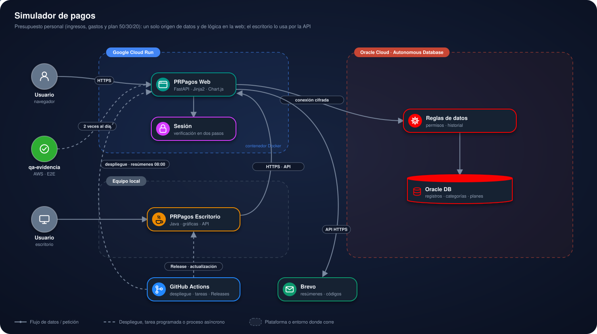

# Simulador de pagos (PRPagos)

<p>
  <a href="https://prpagos-web-1087929107584.us-east4.run.app"></a>
  <a href="https://frontend-nine-topaz-99.vercel.app"></a>
  <a href="https://d4i3vsgw7xwmh.cloudfront.net"></a>
</p>


> 📘 **Manuales de usuario:** [versión web](docs/MANUAL-WEB.md) y [versión de escritorio](docs/MANUAL-ESCRITORIO.md),
> paso a paso y con imágenes.

## Contenido

1. [Presentación](#1-presentación)
2. [Funcionalidades](#2-funcionalidades)
3. [Arquitectura](#3-arquitectura)
4. [Estructura del proyecto](#4-estructura-del-proyecto)
5. [Instalación para pruebas](#5-instalación-para-pruebas)
6. [Autor y licencia](#6-autor-y-licencia)

---

## 1. Presentación

Gestor de presupuesto personal: registra ingresos y gastos por categoría, los compara con el plan
50/30/20 en un dashboard con gráficas y envía un resumen por correo cada semana y cada mes. Nació
como un registro de pagos en el curso de Desarrollo de Software de la Universidad EAN.

Tiene dos interfaces de la misma aplicación con **un solo origen**: la lógica, las reglas y los
datos viven en el servidor web, y las dos interfaces los muestran.

- **[`web/`](./web)**: versión web en Python (FastAPI, Jinja2 y Chart.js). Se instala como
  aplicación en Android, iPhone, Windows, macOS y Linux desde el navegador.
- **[`escritorio/`](./escritorio)**: aplicación de Windows en Java (Swing), publicada como
  **PRPagos.exe** con Java incluido y actualización automática. No guarda datos ni claves: todo lo
  pide al servidor.

**Cómo probarlo:** entra a la [demo web](https://prpagos-web-1087929107584.us-east4.run.app) y crea
tu cuenta, o descarga la [aplicación de escritorio](https://github.com/lariasca1994/PRPagos/releases/latest).

## 2. Funcionalidades

**Presupuesto (igual en web y escritorio)**
- Ingresos y gastos con tipo, monto, fecha, categoría y concepto; categorías sugeridas y propias.
- Plan 50/30/20 con porcentajes editables por cuenta.
- Dashboard del mes: ingresos, gastos, balance y ahorro, con gráficas de los últimos 6 meses, gastos
  por categoría y avance del plan.
- Presupuesto por categoría y mes comparado con lo real, con resumen de los 12 meses.
- Consulta con filtros, totales y exportación a CSV.

**Resúmenes por correo:** semanal y mensual, programados; se pueden pedir al momento o desactivar.

**Cuenta (una sola para web y escritorio)**
- Ingreso en dos pasos obligatorio (app autenticadora o código por correo) y llaves de acceso
  (Windows Hello, huella, rostro o PIN).
- Recuperación de contraseña y del autenticador, códigos de respaldo y eliminación de la cuenta con
  todos sus datos.

**Interfaz:** la misma estructura, menú y colores en web y escritorio, con tema claro y oscuro;
adaptable a celular, tablet y computador.

## 3. Arquitectura

<p align="center">
  
</p>

| Capa | Web | Escritorio |
|---|---|---|
| Interfaz | Jinja2, HTML, CSS y Chart.js | Java Swing con FlatLaf y JFreeChart |
| Lógica y reglas | Servicios del servidor (FastAPI) | Los mismos, a través de la API |
| Datos | Base de datos relacional, solo desde el servidor | — |
| Distribución | Contenedor que se publica solo desde GitHub | PRPagos.exe en GitHub Releases |
| Pruebas | Pytest en cada cambio; pruebas E2E diarias con Playwright | Compilación en cada cambio |

## 4. Estructura del proyecto

```
web/           Aplicación web (FastAPI + Jinja2) y su API
escritorio/    Aplicación de escritorio (Java Swing) y su empaquetado
compartido/    Consultas del dashboard y plantillas de correo (las usa el servidor)
sql/           Tablas y migraciones de la base
docs/          Manuales de usuario y diagramas
```

## 5. Instalación para pruebas

- **Web:** necesita Python 3.12 y una base de datos propia. Los pasos están en
  [`web/README.md`](./web/README.md).
- **Escritorio:** para usarla basta el ejecutable de
  [Releases](https://github.com/lariasca1994/PRPagos/releases/latest). Para compilarla, ver
  [`escritorio/README.md`](./escritorio/README.md).

## 6. Autor y licencia

**Luis F. A.** · [GitHub](https://github.com/lariasca1994) · [LinkedIn](https://linkedin.com/in/lfac1)

Contacto: Telegram [@lfac6](https://t.me/lfac6) · WhatsApp [@carraian160](https://wa.me/carraian160) ·
[ariascluisf@hotmail.com](mailto:ariascluisf@hotmail.com)

Licencia: [MIT](LICENSE). [Política de privacidad](docs/PRIVACIDAD.md).
