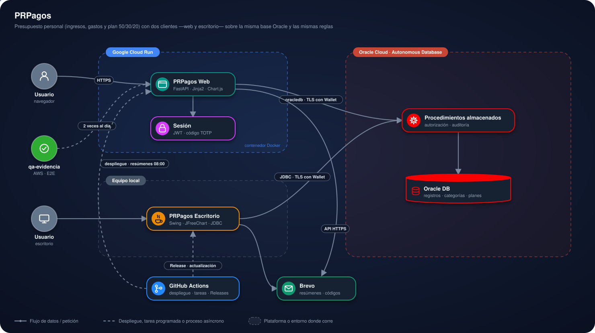

# PRPagos

<p>
  <a href="https://prpagos-web-1087929107584.southamerica-east1.run.app"></a>
  <a href="https://frontend-nine-topaz-99.vercel.app"></a>
  <a href="https://d4i3vsgw7xwmh.cloudfront.net"></a>
</p>


## Contenido

1. [Presentación](#1-presentación)
2. [Estructura del proyecto](#2-estructura-del-proyecto)
3. [Arquitectura](#3-arquitectura)
4. [Plataformas y su función](#4-plataformas-y-su-función)
5. [Cómo usar la plataforma](#5-cómo-usar-la-plataforma)
6. [Instalación para pruebas](#6-instalación-para-pruebas)
7. [Autor y licencia](#7-autor-y-licencia)

---

## 1. Presentación

Gestor de presupuesto personal con persistencia en Oracle Autonomous Database:
registra ingresos y gastos por categoría, los compara con el plan 50/30/20 en
un dashboard con gráficas y envía un resumen por correo cada semana y cada mes.
Nació como un registro de pagos en el curso de Desarrollo de Software de la
Universidad EAN.

El repositorio tiene dos versiones de la misma aplicación, que comparten la
misma base de datos, las mismas cuentas y las mismas reglas:

- **[`web/`](./web)** — versión web en Python (FastAPI + Jinja2 + Chart.js),
  desplegada en Google Cloud Run. Es además una **PWA**: se instala como app en
  Android, iPhone/iPad, Windows, macOS y Linux desde el navegador.
- **[`escritorio/`](./escritorio)** — aplicación de escritorio en Java/Swing
  (FlatLaf + JFreeChart), publicada como **PRPagos.exe** con Java incluido y
  con actualización automática.

Ver [`CHANGELOG-migracion.md`](./CHANGELOG-migracion.md) para el detalle de la
migración de escritorio a web.

### En pocas palabras

- **Qué hace:** registra ingresos y gastos, muestra en un dashboard cuánto se
  va en cada categoría y si el mes va dentro del plan 50/30/20, y manda el
  resumen por correo. Cada persona ve solo lo suyo.
- **Qué lo hace interesante:** dos aplicaciones (web y escritorio) que funcionan
  y se ven igual, con **la misma base, las mismas consultas y los mismos
  correos**: las reglas viven en procedimientos almacenados de Oracle y las
  consultas del dashboard y las plantillas de correo están en archivos
  compartidos (`compartido/`) que leen las dos.
- **Cómo probarlo:** entra a la [demo web](https://prpagos-web-1087929107584.southamerica-east1.run.app)
  y crea un usuario, o descarga la [aplicación de escritorio](https://github.com/lariasca1994/PRPagos/releases/latest).
  Para correrlo desde el código, ve a [Instalación para pruebas](#6-instalación-para-pruebas).

### Demo en vivo

**Aplicación web:** [abrir la demo en vivo](https://prpagos-web-1087929107584.southamerica-east1.run.app)

**Aplicación de escritorio:** [descargar la última versión](https://github.com/lariasca1994/PRPagos/releases/latest)
(instalador o portable para Windows; necesita su archivo de configuración, ver
[`escritorio/README.md`](./escritorio/README.md)).

### Funcionalidades

**Presupuesto (igual en web y escritorio)**
- Registro de **ingresos y gastos** con tipo, monto, fecha, categoría y concepto
- **Categorías** sugeridas y propias; cada categoría de gasto pertenece a un
  grupo del plan (necesidades, deseos, ahorro y deudas)
- **Plan 50/30/20** con porcentajes editables por cuenta
- **Dashboard** del mes: ingresos, gastos, balance y ahorro; ingresos vs. gastos
  de los últimos 6 meses, gastos por categoría y avance del plan con su estado
- Consulta con filtros (tipo, concepto, montos y fechas), totales y exportación a CSV

**Resúmenes por correo**
- Semanal cada viernes y mensual cada día 29 (en febrero, el último día), a las
  08:00 de Colombia, programados desde GitHub Actions; se pueden desactivar en Perfil
- Botones para recibirlos al momento desde la web o el escritorio, con el mismo contenido

**Cuentas y seguridad (una sola para web y escritorio)**
- Ingreso en dos pasos obligatorio: contraseña y código de una app autenticadora (TOTP)
- **Llaves de acceso (passkeys):** ingreso con Windows Hello, huella, rostro o PIN, en la web
  (Windows, Android y iPhone) y en el escritorio; la misma llave sirve en Edge y en la app del mismo Windows
- **Códigos de respaldo** y **código por correo** para recuperar el acceso si se pierde el teléfono
- **Perfil** con datos, plan, categorías, autenticador, códigos de respaldo y contraseña
- Bloqueo de 5 minutos tras 5 intentos fallidos seguidos
- Sesión que se cierra tras 6 horas sin uso (máximo 8 horas), con un mensaje del motivo

**Escritorio**
- **PRPagos.exe** con Java incluido: instalador por usuario o versión portable
- **Actualización automática** desde GitHub Releases, verificada con SHA-256
- Secretos de la configuración cifrados con **DPAPI** de Windows

**Interfaz**
- Web y escritorio con la misma estructura, menú, ícono, portada animada y
  colores (rojo Oracle y azul de Google Cloud Run), en tema claro y oscuro

### Stack

| Capa | Web | Escritorio |
|---|---|---|
| Interfaz | Jinja2, HTML, CSS y Chart.js | Java Swing con FlatLaf y JFreeChart |
| Servidor | FastAPI, Uvicorn | — (aplicación local) |
| Acceso a datos | python-oracledb (modo thin) | JDBC (ojdbc17 + oraclepki) |
| Consultas del dashboard | `compartido/consultas/*.sql` | Las mismas |
| Base de datos | Oracle Autonomous Database | Oracle Autonomous Database |
| Reglas de negocio | Procedimientos almacenados PL/SQL | Procedimientos almacenados PL/SQL |
| Correos | Brevo (API HTTPS) con `compartido/correo/` | Brevo con las mismas plantillas |
| Sesiones | JWT en cookie httponly; 6 h sin uso, máximo 8 h | En memoria; 6 h sin uso, máximo 8 h |
| Contraseñas | PBKDF2-SHA256 | PBKDF2-SHA256 (mismo formato) |
| Verificación en dos pasos | TOTP; secreto cifrado con AES-256-GCM | TOTP; mismo secreto y misma clave |
| Llaves de acceso | WebAuthn en el navegador (librería `webauthn`) | Windows Hello (`webauthn.dll` vía JNA) |
| Distribución | Docker en Google Cloud Run (GitHub Actions) | PRPagos.exe en GitHub Releases (jpackage) |
| App instalable | PWA (Android, iOS, Windows, macOS, Linux) | Instalador o portable para Windows |

---

## 2. Estructura del proyecto

```
web/           Aplicación web en Python (FastAPI + Jinja2)
escritorio/    Aplicación de escritorio en Java (Swing) y su empaquetado (empaquetar.ps1)
compartido/    Consultas SQL del dashboard y plantillas de correo que usan las dos versiones
sql/           Tablas, procedimientos y migraciones (seguridad, finanzas, actualizaciones)
wallet/        Wallet de Oracle Autonomous Database (no se sube a git)
docs/          Manuales, diagramas y capturas
.github/       Despliegue web, resúmenes programados y publicación del escritorio
Dockerfile     Imagen de la versión web para Cloud Run (se construye desde la raíz)
```

`compartido/`, `sql/`, `wallet/` y `docs/` están en la raíz porque los usan
tanto `escritorio/` como `web/`: ambas versiones hablan con la misma base de
datos, calculan el dashboard con las mismas consultas y envían los mismos
correos.

---

## 3. Arquitectura

<p align="center">
  
</p>

- La versión web (FastAPI + Jinja2) corre en un contenedor Docker; la sesión
  viaja en un JWT dentro de una cookie.
- La **versión de escritorio** (Java Swing) corre en el equipo del usuario y se
  conecta por JDBC.
- Ambas llegan a la base con TLS y Wallet, llaman a los mismos procedimientos
  almacenados (autorización y auditoría) y leen las mismas consultas y
  plantillas de `compartido/`.
- **GitHub Actions** despliega la web, la llama cada día a las 08:00 para enviar
  los resúmenes por **Brevo**, y publica el ejecutable de escritorio como
  Release, del que se actualizan las aplicaciones instaladas.

Cada versión tiene su propio diagrama detallado en
[`web/README.md`](./web/README.md#3-arquitectura) y
[`escritorio/README.md`](./escritorio/README.md#3-arquitectura).

### Seguridad

- **Una sola seguridad:** contraseña, autenticador, último código usado,
  códigos de respaldo y bloqueo por intentos fallidos viven en la base, y las
  dos versiones aplican las mismas reglas.
- Contraseñas con PBKDF2-SHA256 (600.000 iteraciones y sal única); las cuentas
  con el SHA-256 anterior se actualizan solas en su siguiente ingreso.
- Verificación en dos pasos obligatoria (TOTP, RFC 6238); un código no se puede
  reutilizar. El secreto se guarda cifrado con AES-256-GCM y la clave vive
  fuera de la base.
- Llaves de acceso (WebAuthn): en la base solo se guarda la clave pública y un contador; exigen
  la verificación del dispositivo, solo valen para el sitio de PRPagos y cada firma se comprueba
  con un reto nuevo. Agregar una pide un código vigente.
- Recuperación sin el teléfono: 10 códigos de respaldo de un solo uso (solo se
  guarda su huella SHA-256) o un código por correo que vence en 15 minutos; cada
  uso queda en la auditoría.
- La visibilidad de los registros está limitada por usuario, y el procedimiento
  de actualización verifica la autorización antes de modificar un registro.
- La tarea de resúmenes y el registro de versiones exigen un token; las
  actualizaciones del escritorio solo se aceptan desde GitHub por HTTPS y con la
  huella SHA-256 registrada en la base.
- En el escritorio, los secretos de `config.properties` se cifran con DPAPI.
- Conexión a la base por TLS con Wallet. El Wallet, `.env` y
  `config.properties` no se suben al repositorio; solo sus plantillas de ejemplo.

---

## 4. Plataformas y su función

| Plataforma | Función en el proyecto |
|---|---|
|  | Corre la versión web (FastAPI + Jinja2) en un contenedor Docker. |
|  | Oracle Autonomous Database guarda cuentas, registros, categorías, planes y versiones del escritorio, y ejecuta los procedimientos almacenados con las reglas de negocio y la auditoría. Conexión por TLS con Wallet. |
|  | La versión de escritorio corre en el equipo de cada usuario como PRPagos.exe, con Java incluido. |
|  | Envía los resúmenes semanales y mensuales y los códigos de recuperación (plan gratuito). |
|  | Despliega la web, programa los resúmenes diarios y publica el ejecutable de escritorio en GitHub Releases. |
|  | Prueba la versión web automáticamente dos veces al día y publica la evidencia. |

---

## 5. Cómo usar la plataforma

Las dos versiones comparten las mismas cuentas y los mismos datos: lo que registras en
una aparece en la otra. Cada una tiene su manual con capturas:

- **Versión web:** [Manual web](docs/MANUAL-WEB.md) (incluye cómo instalarla como app)
- **Versión de escritorio:** [Manual de escritorio](docs/MANUAL-ESCRITORIO.md) (incluye la
  instalación y las actualizaciones automáticas)

Resumen del flujo, igual en ambas:

1. **Crear cuenta:** correo, nombre completo y contraseña (mínimo 8 caracteres).
2. **Iniciar sesión** con correo y contraseña, y luego el código de 6 dígitos de tu
   app autenticadora. La primera vez se configura escaneando un QR y se reciben
   10 códigos de respaldo.
3. **Dashboard:** el mes con ingresos, gastos, balance, ahorro y el avance del plan 50/30/20.
4. **Nuevo registro:** tipo (ingreso o gasto), monto, fecha, categoría y concepto.
5. **Consultar registros:** filtra, revisa totales, **modifica** o **exporta** a CSV.
6. **Perfil:** nombre, resúmenes por correo, porcentajes del plan, categorías,
   autenticador, códigos de respaldo y contraseña.
7. **Perdí mi teléfono:** entra con un código de respaldo o pide un código al correo.
8. **Llave de acceso:** agrega tu dispositivo en Perfil y luego entra con **Ingresar con llave
   de acceso** (Windows Hello, huella, rostro o PIN), sin contraseña ni código.

---

## 6. Instalación para pruebas

### Requisitos

- Una base Oracle accesible (por ejemplo, Oracle Autonomous Database)
- El Wallet de esa base, descargado desde la consola de Oracle Cloud
- Para la versión web: Python 3.11 o superior
- Para compilar la versión de escritorio: JDK 17 o superior (para usarla basta
  el ejecutable de Releases)
- Para los correos: una cuenta de Brevo (plan gratuito) con un remitente verificado

### Base de datos (una sola vez)

Ejecuta, en orden, `sql/DBPagos.sql` y las migraciones `seguridad`, `finanzas` y
`actualizaciones` y `llaves`. Desde `web/`, con su `.env` configurado:

```bash
python migrar.py seguridad --aplicar
python migrar.py finanzas --aplicar
python migrar.py actualizaciones --aplicar
python migrar.py llaves --aplicar
```

Sin `--aplicar` solo muestra el SQL. Las migraciones son aditivas y se pueden
repetir. Luego descomprime el Wallet en `wallet/`, en la raíz del repositorio
(está en `.gitignore`).

### Versión web

```bash
git clone https://github.com/lariasca1994/PRPagos.git
cd PRPagos/web

python -m venv .venv
.venv\Scripts\Activate.ps1        # Windows
source .venv/bin/activate         # Linux o macOS

pip install -r requirements.txt
cp .env.example .env
```

Completa el `.env` con los datos del Wallet y de la base, un `JWT_SECRET`
propio, la `TOTP_CLAVE` (la misma del escritorio) y, para los correos,
`BREVO_API_KEY` y `BREVO_REMITENTE`. Detalle en [`web/README.md`](./web/README.md#configuración).

### Versión de escritorio

Copia `escritorio/config.properties.example` como `config.properties` y completa
el alias, las credenciales de la base, `totp.clave` (la misma `TOTP_CLAVE` de la
web) y los datos de Brevo. Desde el código va en `escritorio/`; con el ejecutable,
en `%APPDATA%\PRPagos\`. Detalle en [`escritorio/README.md`](./escritorio/README.md#configuración).

### Ejecución

| Versión | Comando | Dónde |
|---|---|---|
| Web | `uvicorn app.main:app --reload` (desde `web/`) | `http://127.0.0.1:8000` |
| Escritorio (código) | Ejecutar `com.prpagos.ui.VentanaLogin` | Ventana local |
| Escritorio (ejecutable) | `.\empaquetar.ps1` (desde `escritorio/`) | `build\dist\PRPagos\PRPagos.exe` |

### Despliegue

Todo sale de GitHub: un push a `main` despliega la web en Cloud Run
(`desplegar.yml`) y publica el escritorio como Release (`escritorio.yml`);
`resumenes.yml` llama cada día a la tarea de los correos.

---

## 7. Autor y licencia

> 📘 **Manuales de usuario:** [web](docs/MANUAL-WEB.md) y [escritorio](docs/MANUAL-ESCRITORIO.md): cómo usar cada versión campo por campo, qué datos se ingresan y qué garantiza en seguridad.

**Luis Felipe Arias Carriazo**
[GitHub](https://github.com/lariasca1994) · [LinkedIn](https://linkedin.com/in/lfac1)

Licencia: MIT.
