# 📘 Manual de usuario · Simulador de pagos (escritorio)

## 1. Portada

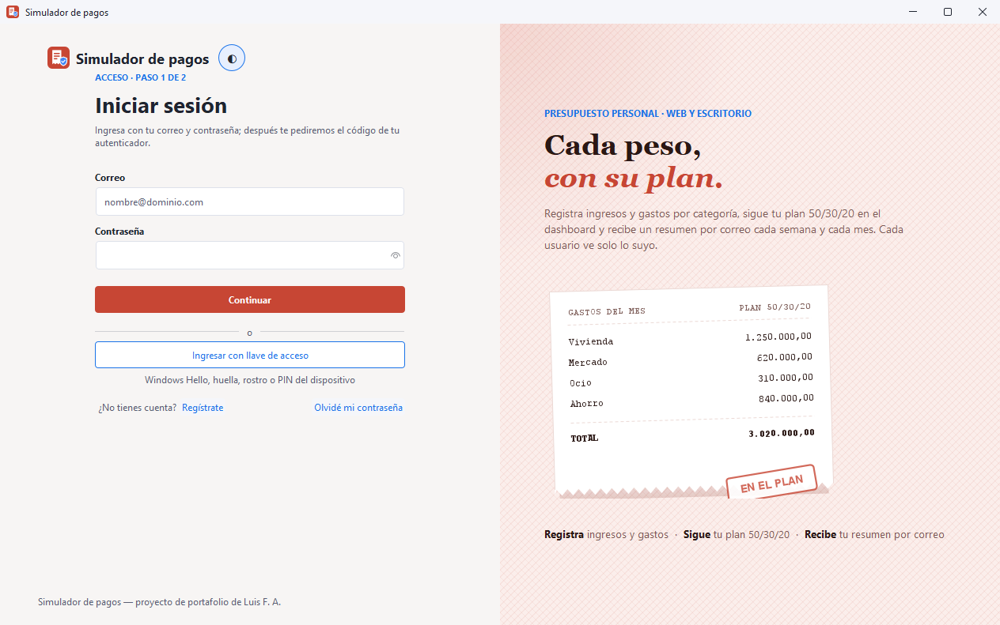

| | |
|---|---|
| **Producto** | Simulador de pagos (PRPagos), aplicación de escritorio para Windows |
| **Documento** | Manual de usuario |
| **Versión** | 2.0 · noviembre de 2026 |
| **Dirigido a** | Personas que quieren llevar su presupuesto personal en su computador |
| **Descarga** | [Última versión](https://github.com/lariasca1994/PRPagos/releases/latest) |
| **Autor** | Luis F. A. |

La versión web tiene su propio manual: [MANUAL-WEB.md](MANUAL-WEB.md). Las dos usan la misma
cuenta y los mismos datos.

## Contenido

1. [Portada](#1-portada)
2. [Introducción](#2-introducción)
3. [Objetivo](#3-objetivo)
4. [Alcance](#4-alcance)
5. [Acceso al sistema](#5-acceso-al-sistema)
6. [Pantalla principal](#6-pantalla-principal)
7. [Navegación](#7-navegación)
8. [Funcionalidades](#8-funcionalidades)
9. [Gestión de perfil](#9-gestión-de-perfil)
10. [Mensajes frecuentes](#10-mensajes-frecuentes)
11. [Preguntas frecuentes](#11-preguntas-frecuentes)
12. [Glosario](#12-glosario)

---

## 2. Introducción

El **Simulador de pagos** para Windows registra tus ingresos y gastos por categoría y los compara
con el **plan 50/30/20**: la mitad de lo que recibes para necesidades, un 30 % para deseos y un
20 % para ahorro y deudas. Es la misma aplicación de la web, con las mismas pantallas, en una
ventana propia que se actualiza sola.

Este manual explica cómo instalarla y usar cada pantalla, paso a paso y con imágenes.

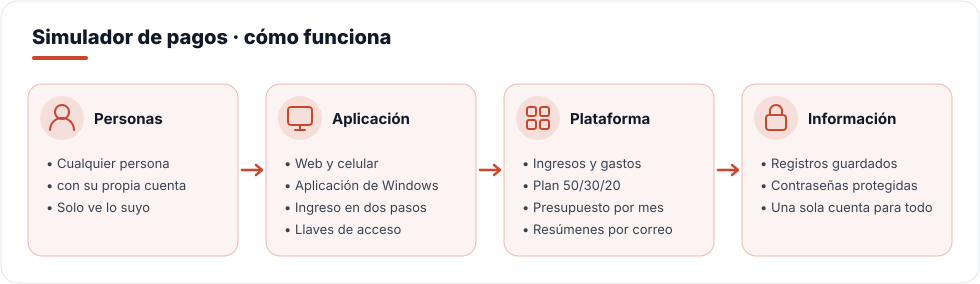

## 3. Objetivo

Que cualquier persona pueda, sin conocimientos técnicos:

- Instalar la aplicación, crear su cuenta e ingresar de forma segura.
- Registrar sus ingresos y gastos en segundos.
- Consultar y corregir sus registros.
- Saber si el mes va dentro de su plan y planear el presupuesto de cada categoría.

## 4. Alcance

**Incluye:** instalación sin configuración, actualización automática, ingreso en dos pasos y con
Windows Hello, ingresos y gastos con categorías, dashboard del mes, presupuesto por categoría,
consulta con filtros y exportación a CSV, resúmenes por correo y tema claro y oscuro.

**No incluye:** conexión con bancos ni pagos reales: los montos los escribes tú.

**Qué necesitas:** Windows 10 o superior, conexión a internet, un correo propio y una app
autenticadora en el celular (o acceso a tu correo para recibir códigos).

### Instalar

1. Entra a la [última versión](https://github.com/lariasca1994/PRPagos/releases/latest) y descarga:
   - **`Simulador-de-pagos-<versión>.exe`** (instalador): se instala solo, sin permisos de
     administrador, y crea el acceso directo **Simulador de pagos**. Si Windows muestra "Windows
     protegió su PC", pulsa **Más información → Ejecutar de todas formas**.
   - **`Simulador-de-pagos-escritorio-<versión>.zip`** (portable): descomprímelo y abre `PRPagos.exe`.
2. Abre **Simulador de pagos** e ingresa con tu cuenta (la misma de la web) o crea una.

**Actualizaciones:** al abrirla, y luego cada hora, la aplicación revisa si hay una versión nueva,
la descarga, comprueba que sea la publicada y te avisa. La actualización es obligatoria: al pulsar
**Actualizar ahora** se cierra, se instala y vuelve a abrirse sola.

**Desinstalar:** en **Configuración → Aplicaciones → Simulador de pagos → Desinstalar**. Tu cuenta y
tus datos siguen en la web.

## 5. Acceso al sistema

### 5.1 Crear una cuenta

En la portada pulsa **Regístrate**.

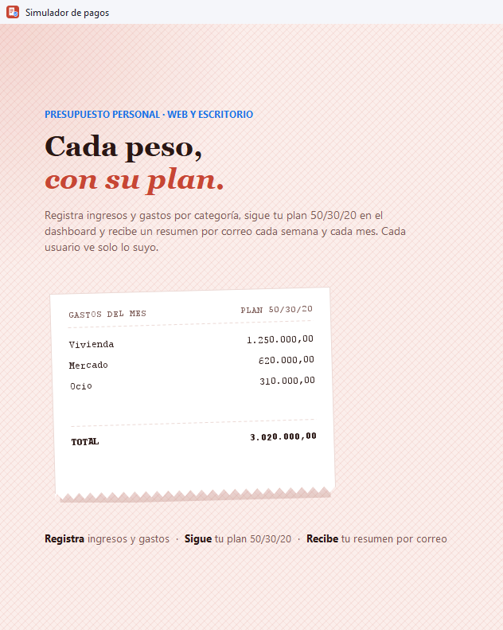

| # | Campo | Qué escribir |
|:-:|---|---|
| 1 | Correo | Tu correo real: es tu usuario y ahí llegan los avisos |
| 2 | Nombre completo | Tu nombre, como quieres verlo en la aplicación |
| 3 | Contraseña | Mínimo 8 caracteres |
| 4 | Repite la contraseña | La misma contraseña |
| 5 | Crear cuenta | Crea la cuenta y te lleva a configurar la verificación en dos pasos |

La primera vez eliges cómo recibir el código: con una **app autenticadora** (escaneas un código QR;
recomendado) o con un **código por correo**. Al activarla recibes tus **códigos de respaldo**:
guárdalos, sirven si pierdes el teléfono.

### 5.2 Iniciar sesión

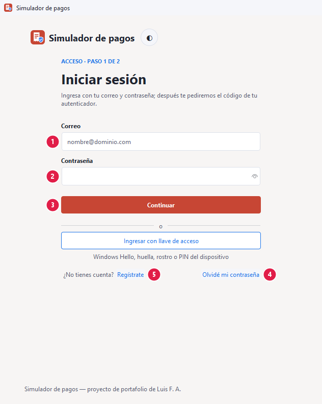

| # | Elemento | Qué hace |
|:-:|---|---|
| 1 | Correo | El correo de tu cuenta |
| 2 | Contraseña | Tu contraseña (el ojo la muestra u oculta) |
| 3 | Continuar | Comprueba tus datos y pasa al código de verificación |
| 4 | Olvidé mi contraseña | Abre la recuperación de contraseña (5.4) |
| 5 | Regístrate | Crea una cuenta nueva (5.1) |

Si ya agregaste una llave de acceso (9.4), **Ingresar con llave de acceso** te deja entrar con
Windows Hello (huella, rostro o PIN), sin contraseña ni código.

### 5.3 Verificación en dos pasos

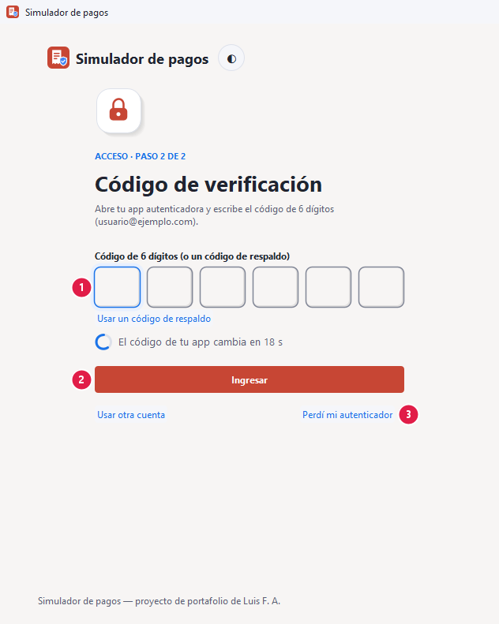

| # | Elemento | Qué hace |
|:-:|---|---|
| 1 | Código de 6 dígitos | El código de tu app (o de tu correo), o uno de tus códigos de respaldo |
| 2 | Ingresar | Confirma el código y abre el dashboard |
| 3 | Perdí mi autenticador | Te envía un código al correo de tu cuenta para configurar un autenticador nuevo |

### 5.4 Recuperar la contraseña

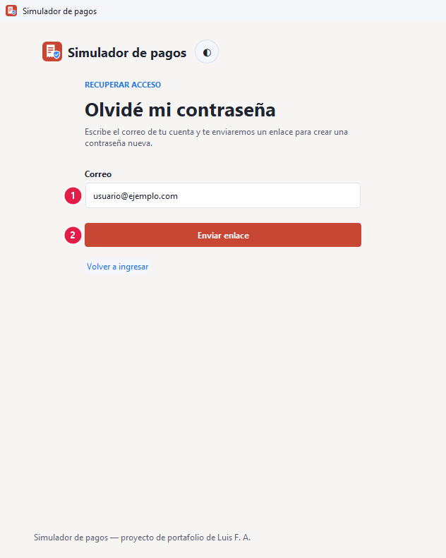

| # | Elemento | Qué hace |
|:-:|---|---|
| 1 | Correo | El correo de tu cuenta |
| 2 | Enviar enlace | Envía un enlace para crear una contraseña nueva (vence pronto y sirve una sola vez) |

## 6. Pantalla principal

El **Dashboard** muestra cómo va el mes.

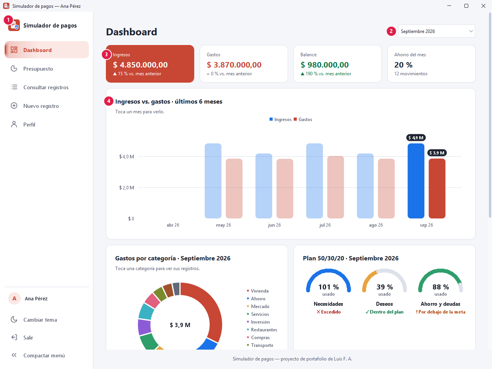

| # | Elemento | Qué hace |
|:-:|---|---|
| 1 | Menú | Lleva a Dashboard, Presupuesto, Consultar registros, Nuevo registro y Perfil |
| 2 | Mes | Elige el mes que quieres revisar |
| 3 | Cifras del mes | Ingresos, gastos, balance y porcentaje de ahorro, comparados con el mes anterior |
| 4 | Gráficas | Ingresos vs. gastos de los últimos 6 meses (toca un mes para abrirlo), gastos por categoría y avance del plan 50/30/20 |

## 7. Navegación

El menú está a la izquierda. **Compactar menú** lo reduce a íconos (al pasar el cursor aparece el
nombre); al pie están tu nombre, **Cambiar tema** y **Salir**.

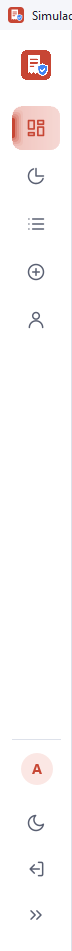

**Cambiar tema** alterna entre claro y oscuro, y la aplicación lo recuerda:

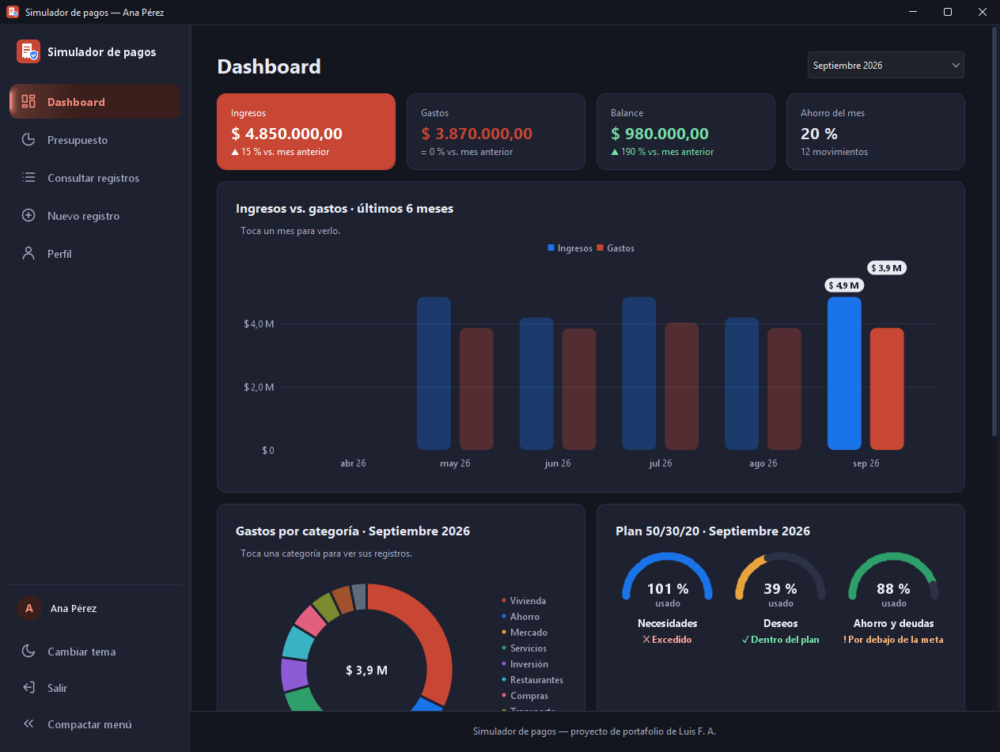

## 8. Funcionalidades

### 8.1 Crear: registrar un ingreso o un gasto

En el menú pulsa **Nuevo registro**.

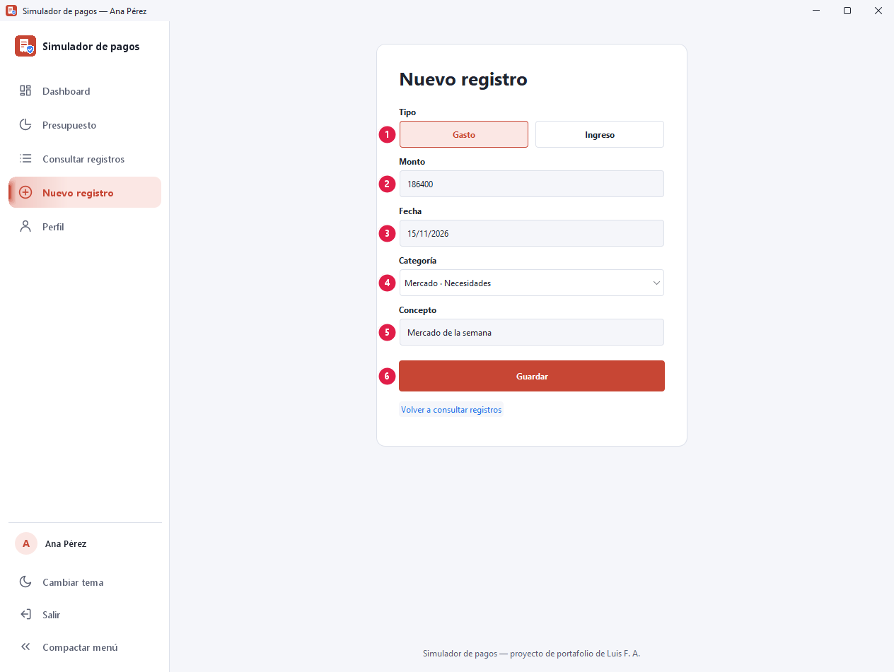

| # | Campo | Qué escribir |
|:-:|---|---|
| 1 | Tipo | **Gasto** o **Ingreso** |
| 2 | Monto | El valor, sin puntos de miles ni signo $ (los decimales pueden ir con coma) |
| 3 | Fecha | El día del movimiento |
| 4 | Categoría | Se filtra según el tipo; las de gasto muestran su grupo del plan (opcional) |
| 5 | Concepto | Una descripción corta, hasta 100 caracteres |
| 6 | Guardar | Registra el movimiento |

### 8.2 Consultar: buscar y exportar registros

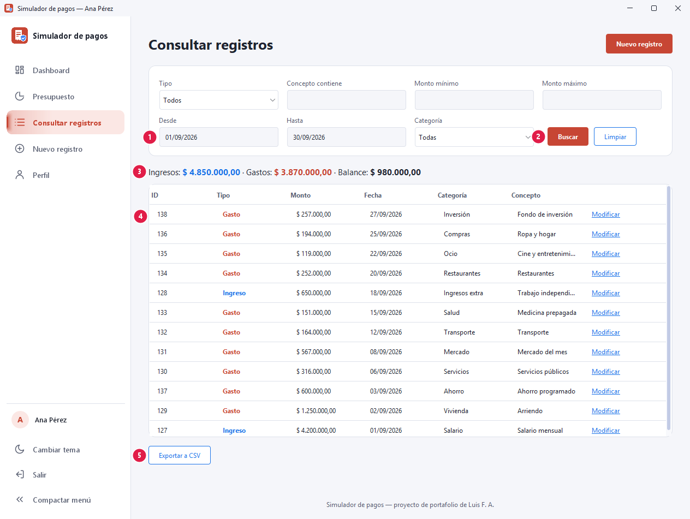

| # | Elemento | Qué hace |
|:-:|---|---|
| 1 | Desde / Hasta | El rango de fechas (también puedes filtrar por tipo, concepto, montos y categoría) |
| 2 | Buscar | Aplica los filtros; **Limpiar** los quita |
| 3 | Totales | Ingresos, gastos y balance de lo que cumple los filtros |
| 4 | Registros | Cada movimiento; **Modificar** lo abre para corregirlo (8.3) |
| 5 | Exportar a CSV | Guarda la consulta en un archivo para abrirlo en Excel |

### 8.3 Modificar: corregir un registro

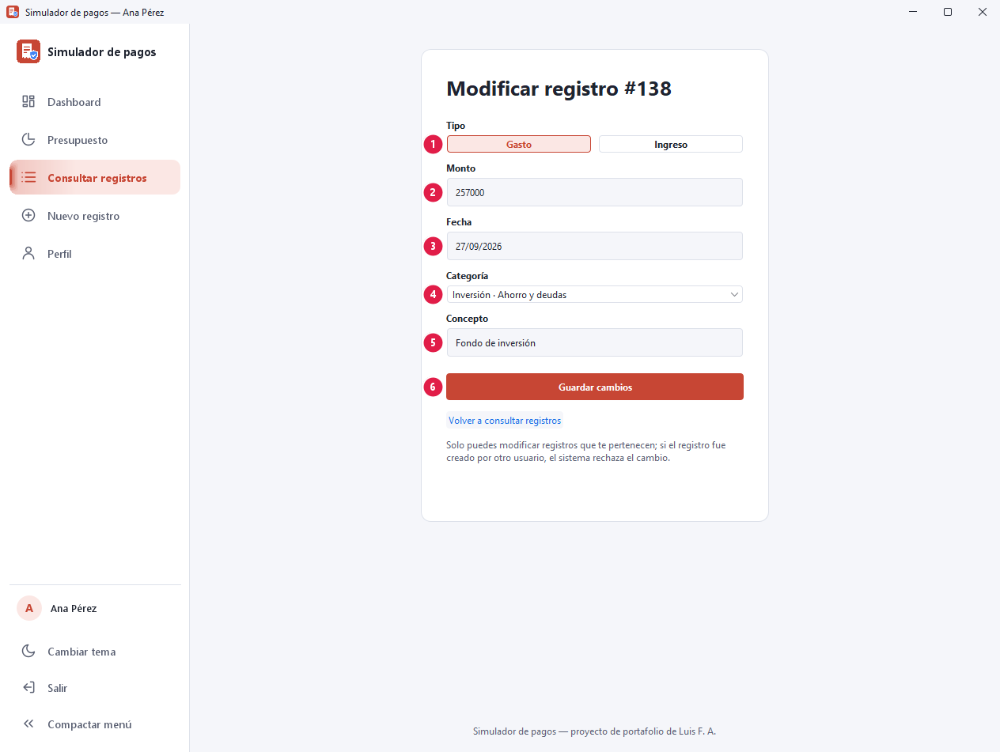

Son los mismos campos de 8.1 con los valores actuales: cambia lo que necesites y pulsa **Guardar
cambios** (6).

### 8.4 Reportar: presupuesto

**Presupuesto** compara lo que planeaste con lo que registraste, categoría por categoría.

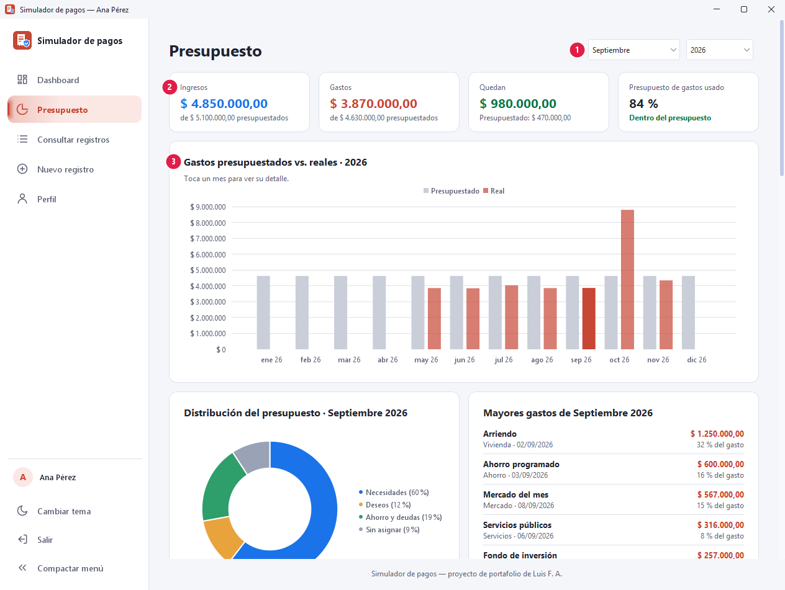

| # | Elemento | Qué hace |
|:-:|---|---|
| 1 | Mes y año | El periodo que planeas o revisas |
| 2 | Cifras del mes | Ingresos y gastos registrados frente a lo presupuestado, lo que queda y el porcentaje usado |
| 3 | Gráficas | Presupuestado vs. real de los 12 meses, distribución frente al plan y mayores gastos |

Más abajo está la **tabla del mes**: escribe el presupuesto de cada categoría y elige si se aplica
solo a ese mes, hasta diciembre o a todo el año. Al final del dashboard puedes pedir al momento el
**resumen por correo** de la semana o del mes.

## 9. Gestión de perfil

En el menú pulsa **Perfil**. Ahí también ajustas los porcentajes de tu **plan 50/30/20** y creas
tus propias **categorías**.

### 9.1 Tus datos

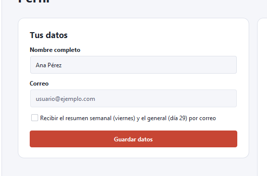

Cambia tu nombre y activa o desactiva los resúmenes por correo; pulsa **Guardar datos**.

### 9.2 Cambiar contraseña

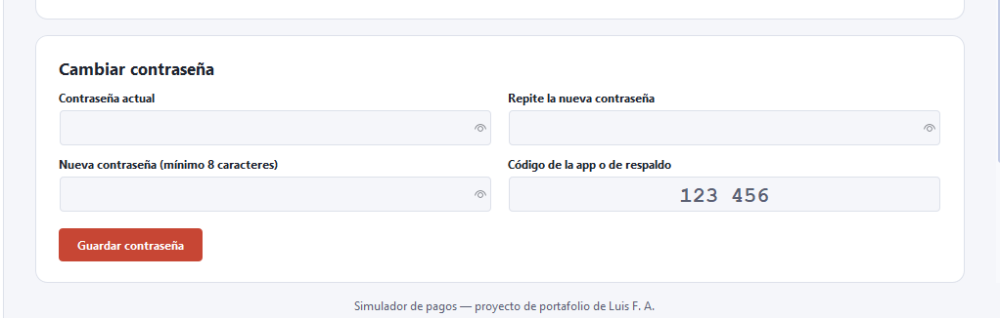

Escribe la contraseña actual, la nueva (mínimo 8 caracteres) dos veces y un código vigente de tu
app o de respaldo; pulsa **Guardar contraseña**. Recibes códigos de respaldo nuevos y los
anteriores dejan de servir.

### 9.3 Verificación en dos pasos

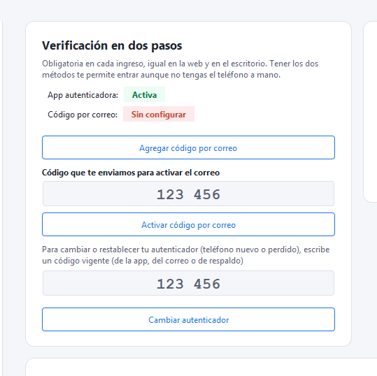

Muestra tus métodos activos. Puedes **agregar el código por correo**, elegir cuál se pide por
defecto y **cambiar el autenticador** si cambias de teléfono.

### 9.4 Llaves de acceso

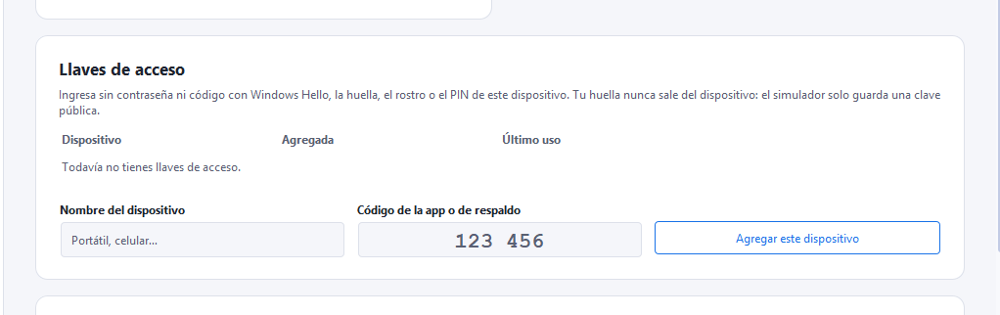

Con una llave de acceso entras con Windows Hello. Escribe un nombre para el equipo y un código
vigente, y pulsa **Agregar este dispositivo**. La misma llave sirve en Edge en ese mismo Windows.

### 9.5 Eliminar mi cuenta

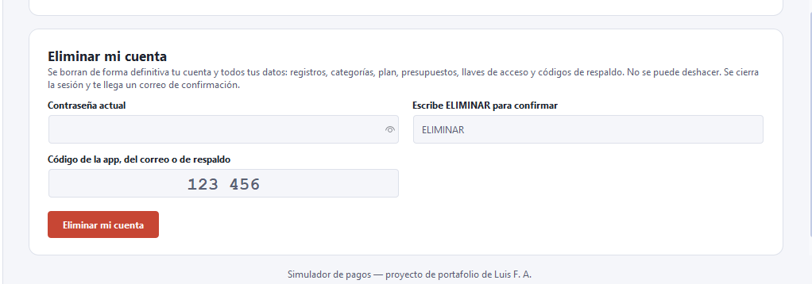

Borra para siempre tu cuenta y todos tus datos. Pide tu contraseña, un código vigente y la palabra
**ELIMINAR**. No se puede deshacer; al terminar te llega un correo de confirmación.

## 10. Mensajes frecuentes

| Mensaje | Qué significa | Qué hacer |
|---|---|---|
| Usuario o contraseña incorrectos | Los datos no coinciden | Revísalos o usa **Olvidé mi contraseña** |
| Demasiados intentos fallidos. Espera unos minutos e inténtalo de nuevo. | La cuenta se bloqueó un rato por seguridad | Espera unos minutos |
| Código incorrecto o ya usado | El código venció o ya se usó | Escribe el código que muestra la app ahora |
| El código no coincide. Revisa que la hora del teléfono sea la correcta. | La hora del teléfono está desfasada | Activa la hora automática del teléfono |
| Monto inválido | El monto no es un número | Escríbelo sin puntos ni signo $ |
| Escribe el concepto | Falta la descripción | Escribe una descripción corta |
| Registro guardado | El movimiento quedó registrado | Míralo en **Consultar registros** |
| Tu sesión se cerró tras 6 horas de inactividad. Ingresa de nuevo. | La sesión venció por seguridad | Ingresa otra vez |
| Sin conexión | El equipo no tiene internet | La aplicación reintenta sola |
| Hay una versión nueva del simulador de pagos, ya descargada y verificada. | Llegó una actualización | Pulsa **Actualizar ahora** |

## 11. Preguntas frecuentes

**¿Lo que registro aquí aparece en la web?** Sí, al instante: las dos usan la misma cuenta y los
mismos datos.

**¿Tengo que configurar el autenticador dos veces?** No. Es uno solo por cuenta y sirve en la web y
en el escritorio; lo mismo los códigos de respaldo.

**¿Funciona sin internet?** No: los datos están en el servidor para que sean los mismos en la web y
en el escritorio. Sin conexión, la aplicación lo indica y reintenta sola.

**¿Quién ve mis registros?** Solo tú.

**¿Dónde pido ayuda o reporto un problema?** Telegram [@lfac6](https://t.me/lfac6), WhatsApp
[@carraian160](https://wa.me/carraian160) o [ariascluisf@hotmail.com](mailto:ariascluisf@hotmail.com).

## 12. Glosario

| Término | Qué significa |
|---|---|
| **Balance** | Ingresos menos gastos |
| **Categoría** | Grupo de un movimiento: mercado, vivienda, salario… |
| **Código de respaldo** | Código de un solo uso para entrar si no tienes el teléfono |
| **CSV** | Archivo de tabla que se abre en Excel u hojas de cálculo |
| **Llave de acceso** | Forma de entrar con Windows Hello (huella, rostro o PIN), sin contraseña |
| **Plan 50/30/20** | Reparto de los ingresos: 50 % necesidades, 30 % deseos, 20 % ahorro y deudas |
| **Presupuesto** | Lo que planeas recibir o gastar en cada categoría |
| **Verificación en dos pasos** | Además de la contraseña, se pide un código que solo tú puedes recibir |
