# 📘 Manual de usuario · PRPagos Escritorio

Guía para instalar y usar la **aplicación de escritorio** para Windows paso a paso: qué significa
cada campo, qué datos se ingresan y qué protege la aplicación. La versión web tiene su propio
manual ([MANUAL-WEB.md](MANUAL-WEB.md)); las dos usan las mismas cuentas y los mismos datos. Para
la parte técnica vuelve al [README del escritorio](../escritorio/README.md).

**Descarga:** [última versión en GitHub Releases](https://github.com/lariasca1994/PRPagos/releases/latest)

## Contenido

1. [Proyecto: objetivos y alcances](#1-proyecto-objetivos-y-alcances)
2. [Glosario](#2-glosario)
3. [Plataformas, base de datos y servicios](#3-plataformas-base-de-datos-y-servicios)
4. [Paso a paso](#4-paso-a-paso)
5. [Seguridad: tu información protegida](#5-seguridad-tu-información-protegida)
6. [Agradecimientos](#6-agradecimientos)

---

## 1. Proyecto: objetivos y alcances

### Objetivo

Gestor de presupuesto personal: registras tus **ingresos y gastos** por categoría, los comparas
con el **plan 50/30/20** (50 % necesidades, 30 % deseos, 20 % ahorro y deudas) en un dashboard con
gráficas, y recibes un **resumen por correo** cada viernes (la semana) y cada día 29 (el mes; en
febrero, el último día). Funciona y se ve igual que la versión web, con los mismos datos.

### Alcance: qué necesitas y qué esperar

- **Windows 10 u 11.** No hace falta instalar Java ni compilar nada: la aplicación lo trae incluido.
- La **configuración de conexión** (`config.properties` y la carpeta de la billetera de Oracle),
  que recibes por un canal privado: no se publica en ningún repositorio.
- Una **cuenta** (la misma de la web) y una **app autenticadora** en el celular (Google
  Authenticator, Microsoft Authenticator, Authy…).

### Límites

- **Registra solo datos de ejemplo**: es un proyecto de portafolio, no un servicio financiero.
- Necesita internet: los datos viven en la base de datos en la nube, no en el equipo.
- La configuración protegida solo se puede leer en el equipo y el usuario de Windows donde se
  instaló (ver 5).

## 2. Glosario

| Término | Qué significa |
|---|---|
| **Plan 50/30/20** | Regla para repartir los ingresos del mes: 50 % a necesidades, 30 % a deseos y 20 % a ahorro y pago de deudas. |
| **Categoría** | Clasificación de un ingreso o gasto (Mercado, Vivienda, Salario…). Cada categoría de gasto pertenece a un grupo del plan. |
| **Balance** | Ingresos menos gastos del periodo. |
| **Dashboard** | Pantalla de resumen con cifras y gráficas del mes. |
| **Release** | Versión publicada de la aplicación en GitHub, lista para descargar. |
| **Instalador / portable** | El instalador crea accesos directos; la versión portable se descomprime y se abre sin instalar. |
| **DPAPI** | Protección de Windows que cifra datos con una clave atada a tu usuario y a tu equipo (la misma que usan Chrome y Edge para tus contraseñas). |
| **Huella SHA-256** | "Firma" de un archivo: si cambia un solo byte, cambia la huella. Se usa para comprobar que una actualización es la publicada. |
| **Base de datos** | Lugar donde la aplicación guarda la información de forma ordenada y permanente. |
| **Cifrado / TLS** | Protección que codifica la información mientras viaja, para que nadie en el camino pueda leerla. |
| **Llave de acceso (passkey)** | Forma de ingresar sin contraseña ni código: Windows Hello la desbloquea con tu PIN, huella o rostro. La huella nunca sale del equipo. |
| **Código de respaldo** | Código de un solo uso (formato `ABCD-EFGH`) para entrar si no tienes el teléfono. |
| **CSV** | Archivo de texto con datos en columnas, que se abre en Excel o Google Sheets. |
| **TOTP (código de verificación)** | Código de 6 dígitos que cambia cada 30 segundos en tu app autenticadora; se pide además de la contraseña. |
| **Sesión** | El tiempo en que la aplicación te reconoce después de iniciar sesión, sin pedirte la contraseña de nuevo. |

## 3. Plataformas, base de datos y servicios

| Plataforma | Tipo | Qué hace en el proyecto |
|---|---|---|
|  | Aplicación de escritorio | La aplicación (Java Swing, FlatLaf y JFreeChart) corre en tu equipo con su propio Java incluido. |
|  | Base de datos | Oracle Autonomous Database guarda cuentas, registros, categorías y planes —los mismos de la web— y ejecuta las reglas de negocio. Conexión por TLS con Wallet. |
|  | Correo | Envía los resúmenes que pides desde el dashboard y los códigos de recuperación. |
|  | Distribución | Publica cada versión (instalador y portable) y de ahí se descargan las actualizaciones automáticas. |

## 4. Paso a paso

En las tablas, `#` es el orden en que aparece cada campo en la pantalla, de arriba hacia abajo.

### 4.1 Instalar

1. Entra a la [última versión](https://github.com/lariasca1994/PRPagos/releases/latest) y descarga
   una de las dos opciones:
   - **`PRPagos-<versión>.exe`** (instalador): se instala solo para tu usuario, sin permisos elevados, y crea el acceso
     directo **PRPagos** en el escritorio y en el menú Inicio.
   - **`PRPagos-Escritorio-<versión>.zip`** (portable): descomprímelo y abre `PRPagos.exe`.
2. Copia la configuración de conexión en la carpeta `%APPDATA%\PRPagos\` (pega esa ruta en la barra
   del Explorador de archivos):
   - `config.properties`, con las claves **en claro**.
   - La carpeta de la billetera de Oracle (`wallet`), al lado del archivo. Si `wallet.path` no
     apunta a una carpeta que exista, la aplicación usa `%APPDATA%\PRPagos\wallet`.
3. Abre **PRPagos**. La primera vez, la aplicación cifra las claves de `config.properties` con la
   protección de Windows (ver 5); desde ese momento el archivo solo muestra `dpapi:…` en esos
   valores.

> **Instalar en otro equipo (por ejemplo, una tablet):** no copies el `config.properties` de un
> equipo donde ya abriste la aplicación: sus claves (`dpapi:…`) solo se pueden leer allá y
> aparece el aviso *"Este config.properties se protegió en otro equipo…"*. Copia el archivo
> original, con los valores en claro, junto con la carpeta `wallet`.

### 4.2 Portada

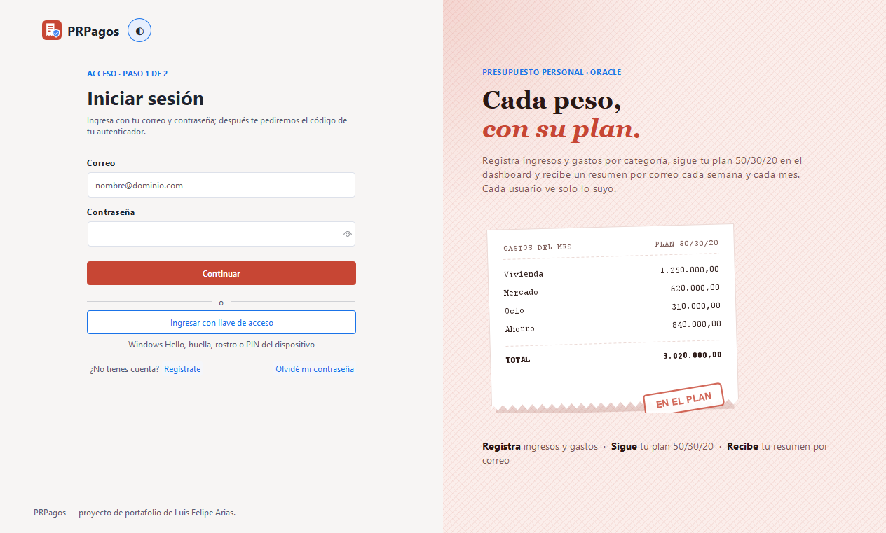

La portada es el inicio de sesión (paso 1: correo y contraseña), con la misma animación de la web.
Desde ahí eliges **Regístrate** u **Olvidé mi contraseña**. El botón ◐ cambia entre tema claro y
oscuro.

| # | Campo | Qué escribir |
|:-:|---|---|
| 1 | Correo | Tu correo |
| 2 | Contraseña | Tu contraseña (el ojo la muestra u oculta) |
| 3 | Continuar | Pasa al código de verificación |
| 4 | Ingresar con llave de acceso | Entra directo con Windows Hello (PIN, huella o rostro), sin contraseña ni código (ver 4.16) |

### 4.3 Crear una cuenta

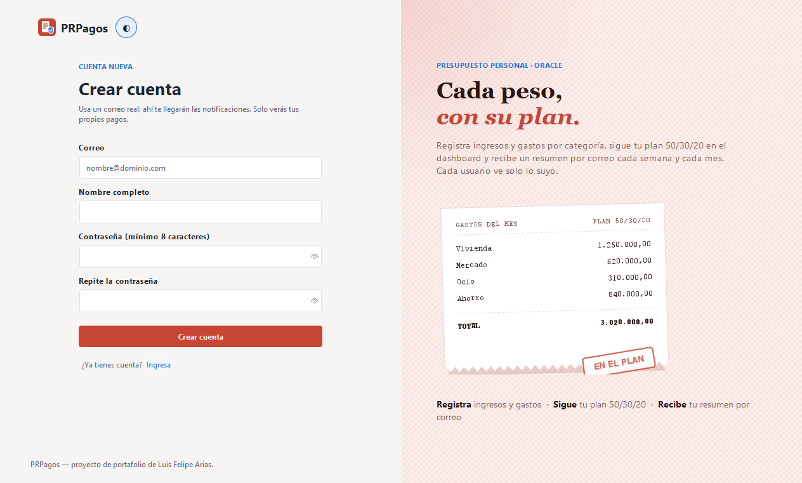

| # | Campo | Qué escribir | Reglas |
|:-:|---|---|---|
| 1 | Correo | Tu correo real; es tu usuario | Forma `nombre@dominio.com` y único |
| 2 | Nombre completo | Tu nombre | Se usa también para recuperar la contraseña |
| 3 | Contraseña | Tu contraseña | Mínimo 8 caracteres |
| 4 | Repite la contraseña | La misma | Debe coincidir |
| 5 | Crear cuenta | Botón | Crea la cuenta; sirve en el escritorio y en la web |

### 4.4 Configurar la verificación en dos pasos (solo la primera vez)

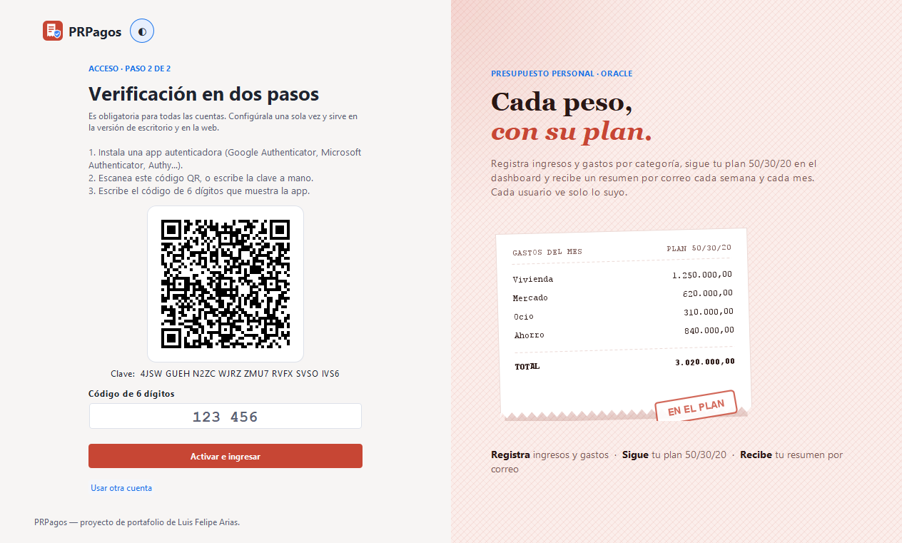

| # | Campo | Qué hacer |
|:-:|---|---|
| 1 | Código QR | Escanéalo con tu app autenticadora |
| 2 | Clave | La misma información, para escribirla a mano si no puedes escanear |
| 3 | Código de 6 dígitos | El que muestra la app para **PRPagos** |
| 4 | Activar e ingresar | Guarda el autenticador y muestra tus **códigos de respaldo** (ver 4.12) |

Si ya lo configuraste en la web, este paso no aparece.

### 4.5 Iniciar sesión (paso 2: código)

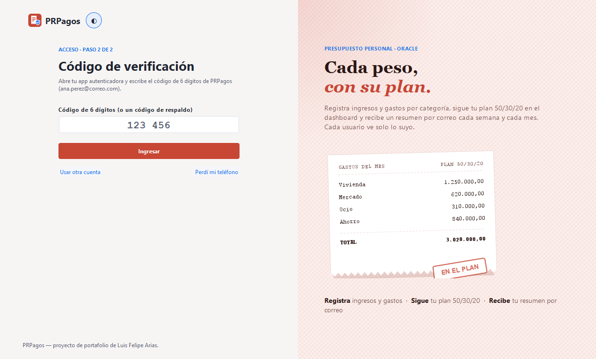

| # | Campo | Qué escribir |
|:-:|---|---|
| 1 | Código de 6 dígitos | El código actual de tu app (cambia cada 30 segundos) o un código de respaldo |
| 2 | Ingresar | Abre el **Dashboard** |
| 3 | Perdí mi teléfono | Te envía un código al correo (ver 4.13) |

La sesión se cierra tras **6 horas sin uso** o a las **8 horas** del ingreso, con un mensaje que
explica el motivo, igual que en la web.

### 4.6 Dashboard

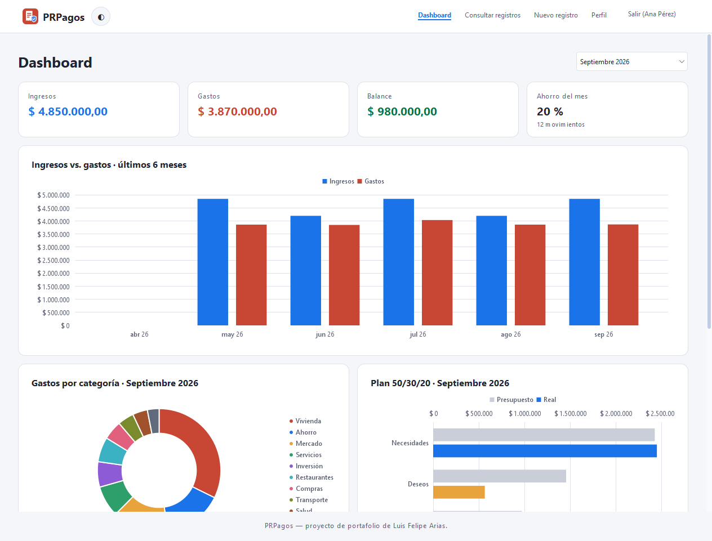

| # | Parte | Qué muestra |
|:-:|---|---|
| 1 | Selector de mes | El mes que quieres revisar (por defecto, el actual) |
| 2 | Ingresos · Gastos · Balance | Totales del mes; el balance sale en verde si es positivo y en rojo si es negativo |
| 3 | Ahorro del mes | Qué porcentaje de los ingresos no se gastó, y cuántos movimientos hubo |
| 4 | Ingresos vs. gastos | Barras de los últimos 6 meses, para ver la tendencia |
| 5 | Gastos por categoría | Anillo con el peso de cada categoría en el mes |
| 6 | Plan 50/30/20 | Presupuesto de cada grupo (calculado sobre los ingresos del mes) frente a lo real |
| 7 | Tabla del plan | Presupuesto, real, % usado y estado: **Dentro del plan**, **Excedido**, **Meta cumplida** o **Por debajo de la meta** (ahorro) |
| 8 | Resúmenes por correo | **Enviarme el resumen semanal** o **del mes** para recibirlo al momento |

Las cifras, los colores y las gráficas son los mismos de la web. En tema oscuro:

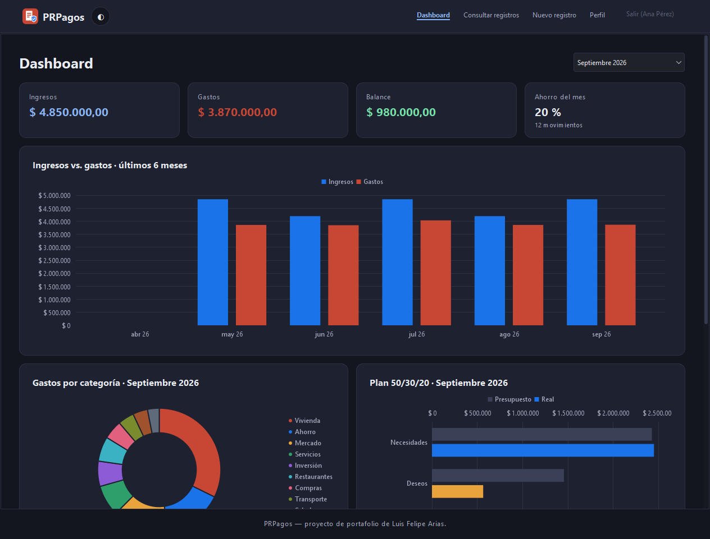

### 4.7 Registrar un ingreso o un gasto

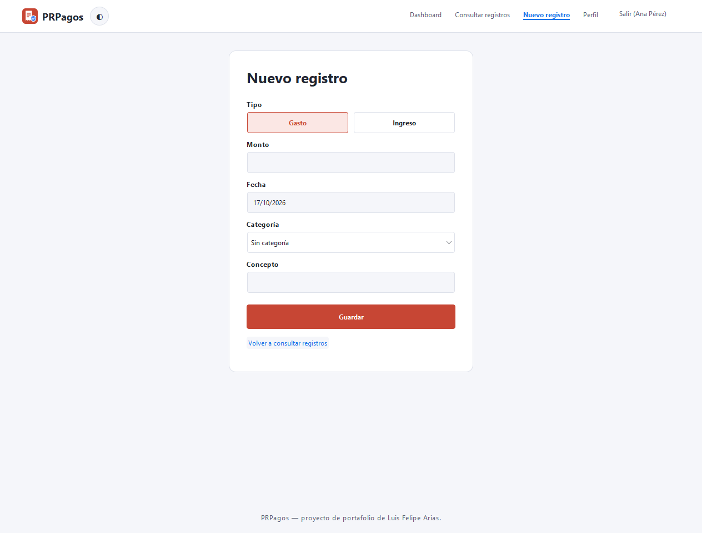

| # | Campo | Qué escribir | Reglas |
|:-:|---|---|---|
| 1 | Tipo | **Ingreso** o **Gasto** | Obligatorio |
| 2 | Monto | Valor, sin puntos de miles ni signo `$` (los decimales pueden ir con coma) | Número válido |
| 3 | Fecha | Día del movimiento (con el calendario) | Obligatoria |
| 4 | Categoría | Se filtra según el tipo; las de gasto muestran su grupo del plan | Opcional (**Sin categoría**) |
| 5 | Concepto | Descripción breve | Obligatorio, hasta 100 caracteres |
| 6 | Guardar | Botón | Registra el movimiento a tu nombre |

### 4.8 Consultar y exportar

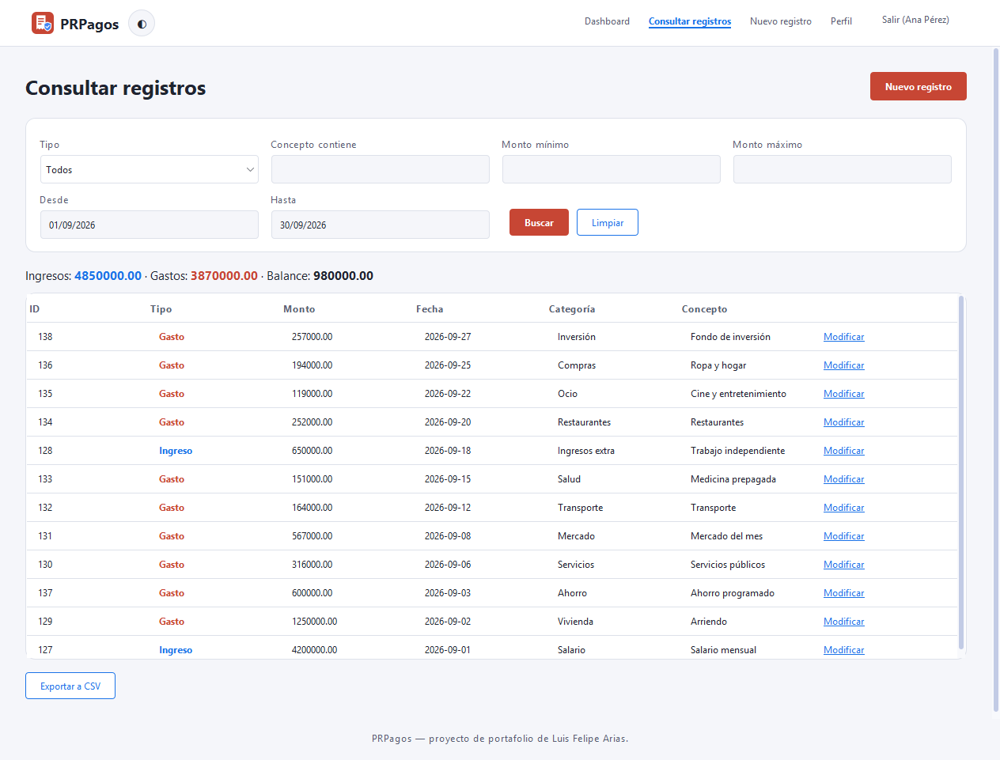

| # | Campo | Qué escribir |
|:-:|---|---|
| 1 | Tipo | Todos, solo ingresos o solo gastos |
| 2 | Concepto contiene | Parte del concepto que buscas |
| 3 | Monto mínimo / máximo | Rango de valores |
| 4 | Desde / Hasta | Rango de fechas |
| 5 | Buscar | Aplica los filtros (**Limpiar** los quita). Un campo vacío no filtra |
| 6 | Totales | Ingresos, gastos y balance de lo que cumple los filtros |
| 7 | Modificar | Abre el registro para corregirlo |
| 8 | Exportar a CSV | Guarda la consulta en un archivo (las mismas columnas que la web) |

Solo ves **tus** registros.

### 4.9 Modificar un registro

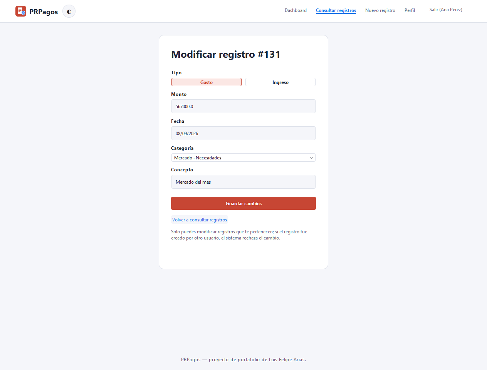

Los mismos campos de 4.7 con los valores actuales. **Guardar cambios** aplica la corrección y queda
en la auditoría.

### 4.10 Perfil

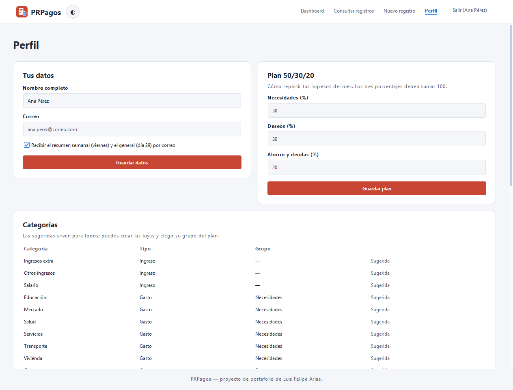

| # | Sección | Qué puedes hacer |
|:-:|---|---|
| 1 | Tus datos | Cambiar tu nombre y activar o desactivar los **resúmenes por correo** |
| 2 | Plan 50/30/20 | Ajustar los porcentajes de Necesidades, Deseos y Ahorro y deudas (deben sumar 100) |
| 3 | Categorías | Ver las sugeridas y **agregar** las tuyas (nombre, tipo y grupo del plan); las tuyas se pueden eliminar si no tienen registros |
| 4 | Verificación en dos pasos | **Cambiar autenticador** (teléfono nuevo o perdido) con un código de la app o de respaldo |
| 5 | Códigos de respaldo | Cuántos te quedan y **Generar códigos nuevos** (anula los anteriores) |
| 6 | Llaves de acceso | Ver tus dispositivos con llave, **agregar este dispositivo** o eliminar uno (ver 4.16) |
| 7 | Cambiar contraseña | Contraseña actual, la nueva dos veces y un código de la app o de respaldo |

### 4.11 Resúmenes por correo

- **Semanal:** cada viernes, con los 7 días que terminan ese viernes (de sábado a viernes).
- **Mensual:** cada día 29 (en febrero, el último día), con lo que va del mes: totales,
  categorías y el plan 50/30/20.
- Los envía el servidor a las 08:00 (hora de Colombia) aunque la aplicación esté cerrada, a las
  cuentas con los resúmenes activados en **Perfil**.
- Los botones del dashboard te los envían al momento; el correo es idéntico al de la web.

### 4.12 Códigos de respaldo

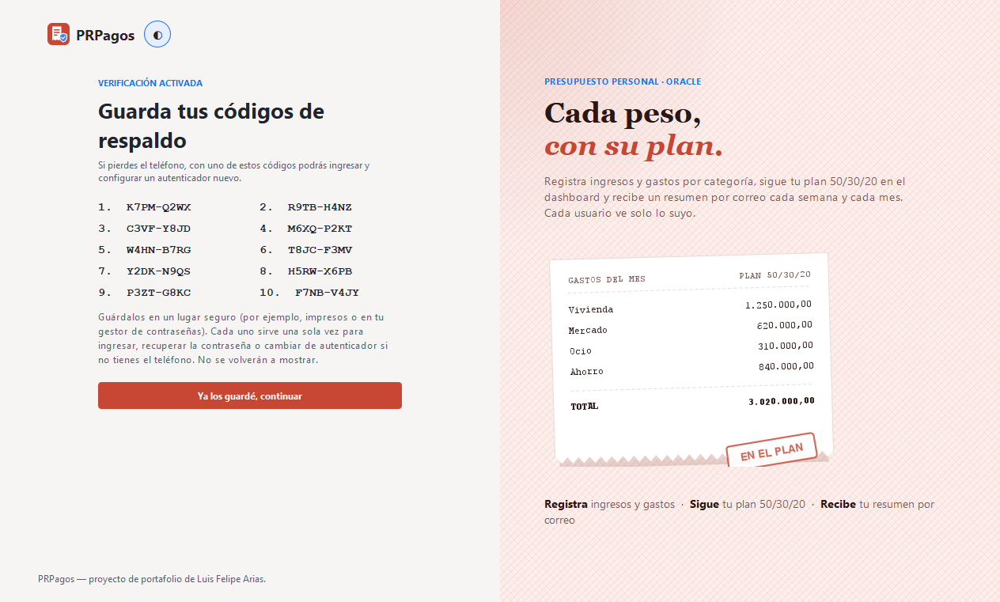

Aparecen al activar el autenticador y cada vez que generas nuevos en **Perfil**. Son 10, cada uno
sirve **una sola vez** y no se vuelven a mostrar: guárdalos impresos o en tu gestor de contraseñas.
Sirven en el escritorio y en la web para ingresar, recuperar la contraseña o cambiar de
autenticador.

### 4.13 Perdí mi teléfono

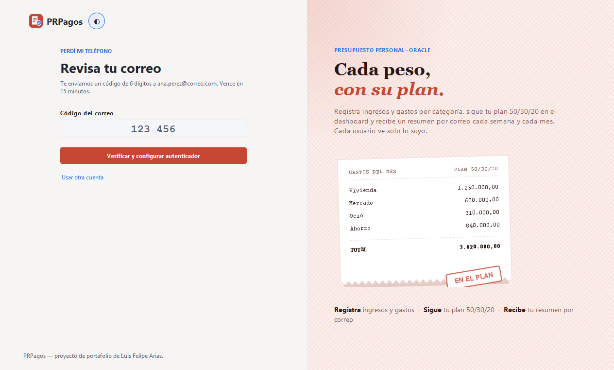

1. Inicia sesión con tu correo y contraseña.
2. En el paso del código, si tienes un **código de respaldo**, escríbelo y entra.
3. Si no, pulsa **Perdí mi teléfono**: llega a tu correo un código de 6 dígitos que vence en 15
   minutos.
4. Escríbelo en **Código del correo** y pulsa **Verificar y configurar autenticador**: configuras
   la app en el teléfono nuevo y recibes códigos de respaldo nuevos.

### 4.14 Recuperar la contraseña

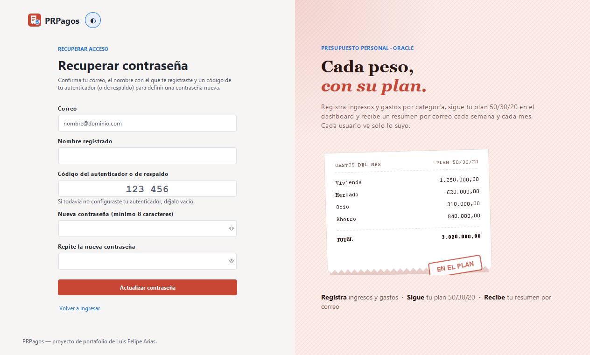

| # | Campo | Qué escribir |
|:-:|---|---|
| 1 | Correo | Tu correo |
| 2 | Nombre registrado | El nombre completo de tu cuenta (no distingue mayúsculas) |
| 3 | Código del autenticador o de respaldo | El código actual de tu app o un código de respaldo |
| 4 | Nueva contraseña | Mínimo 8 caracteres |
| 5 | Repite la nueva contraseña | La misma |
| 6 | Actualizar contraseña | Aplica el cambio |

### 4.15 Actualizaciones automáticas

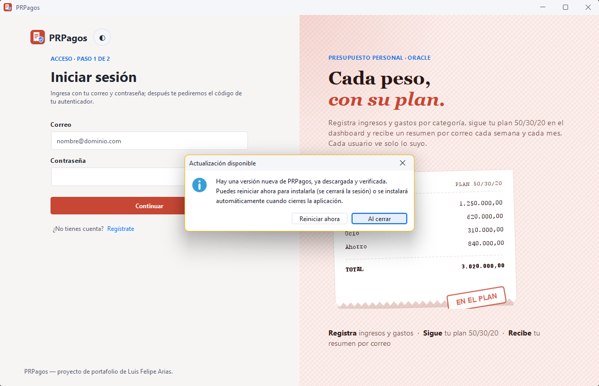

No tienes que volver a descargar nada: al abrir la aplicación, y luego cada hora, PRPagos revisa si
hay una versión nueva. Si la hay, la descarga en segundo plano, comprueba que sea la publicada y te
avisa:

- **Reiniciar ahora:** instala la versión nueva y vuelve a abrir PRPagos (se cierra la sesión).
- **Al cerrar:** la instala cuando cierres la aplicación; la próxima vez ya abre actualizada.

Si algo falla (sin internet, descarga incompleta, archivo que no coincide), sigues con la versión
que tenías y se reintenta más tarde. El registro queda en `%APPDATA%\PRPagos\logs\actualizador.log`.

### 4.16 Llaves de acceso (Windows Hello)

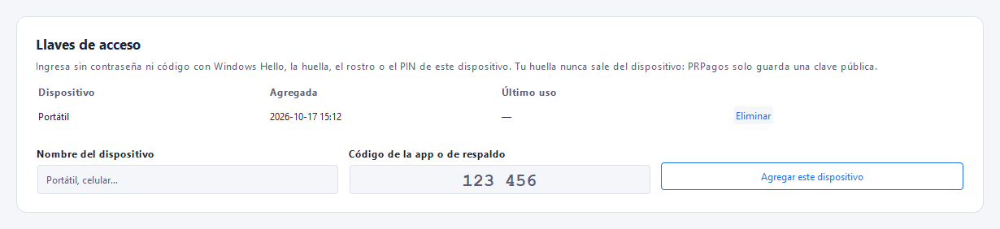

Con una llave de acceso entras sin escribir la contraseña ni el código: Windows Hello te pide tu
PIN, huella o rostro. Requiere Windows 10 u 11 con Windows Hello configurado (**Configuración →
Cuentas → Opciones de inicio de sesión**); si no lo está, el botón aparece desactivado con un aviso.

**Agregar este equipo** (en **Perfil → Llaves de acceso**):

| # | Campo | Qué escribir |
|:-:|---|---|
| 1 | Nombre del dispositivo | Un nombre para reconocerlo (por ejemplo, "Portátil") |
| 2 | Código de la app o de respaldo | Un código vigente, para confirmar que eres tú |
| 3 | Agregar este dispositivo | Windows pide tu PIN, huella o rostro y guarda la llave |

**Ingresar:** en la portada pulsa **Ingresar con llave de acceso** y confirma en la ventana de
Windows Hello. Abre el **Dashboard** directamente.

- La llave es la misma de la web: si la creaste en Edge o Chrome en este Windows, también sirve
  aquí (y al revés). En otro equipo necesitas agregar otra.
- Si cambias de equipo, elimina su llave en **Perfil**. La contraseña + código y los códigos de
  respaldo siguen funcionando.

### 4.17 Preguntas frecuentes

**¿Tengo que configurar el autenticador otra vez si ya lo uso en la web?** No. Es uno solo por
cuenta, igual que los códigos de respaldo.

**¿Lo que registro aquí aparece en la web?** Sí, al instante: ambas usan la misma base de datos.

**¿Puedo copiar mi `config.properties` a otro computador?** Las claves cifradas no funcionarán allá
(están atadas a tu usuario de Windows). Copia el archivo original en claro y la aplicación lo
protegerá en el equipo nuevo.

**Windows muestra "Windows protegió su PC" al abrir el instalador.** Pasa con aplicaciones sin
firma comercial: pulsa **Más información → Ejecutar de todas formas**. Descárgalo solo desde la
página de Releases del proyecto.

## 5. Seguridad: tu información protegida

### Qué datos se guardan y dónde

| Dato | Para qué se usa | Dónde se guarda | Quién lo ve |
|---|---|---|---|
| Correo y nombre | Identificar tu cuenta, enviarte los resúmenes y recuperar el acceso | Oracle Autonomous Database | Solo tú |
| Contraseña | Iniciar sesión | Oracle, solo su huella PBKDF2-SHA256 con sal | Nadie la ve en texto plano |
| Clave del autenticador | Verificar tus códigos | Oracle, cifrada con AES-256-GCM | Nadie; la clave de cifrado no está en la base |
| Códigos de respaldo y código por correo | Recuperar el acceso | Oracle, solo su huella SHA-256 | Nadie los ve después de mostrarlos |
| Ingresos, gastos, categorías y plan | Tu presupuesto | Oracle, marcados con tu cuenta | Solo tú |
| Configuración de conexión | Conectarse a la base y enviar correos | `%APPDATA%\PRPagos\config.properties`, con las claves cifradas por DPAPI | Solo tu usuario de Windows en ese equipo |
| Llaves de acceso | Ingresar con Windows Hello | Oracle, solo la clave pública y un contador | Nadie: el PIN, la huella y la clave privada nunca salen del equipo |
| Sesión | Mantenerte conectado | En memoria, mientras la aplicación está abierta | Nadie; se borra al cerrar |

### Cómo se protege tu información

- **Configuración cifrada con DPAPI:** la contraseña de la base, la clave del autenticador y la de
  correo quedan como `dpapi:…`. Si alguien copia el archivo a otro equipo, o lo pega en un chat,
  no puede descifrarlas.
- **Llaves de acceso con Windows Hello:** la aplicación usa la misma API de Windows que Edge y
  Chrome (webauthn.dll), exige la verificación (PIN, huella o rostro) y comprueba cada firma con la
  clave pública guardada, el sitio de PRPagos y un reto nuevo en cada ingreso.
- **Actualizaciones verificadas:** solo se descargan por HTTPS desde GitHub; la huella SHA-256
  esperada viene de la base de datos (no del sitio de descarga), y el paquete se descarta si la
  huella o la versión no coinciden.
- **Cada quien ve solo lo suyo:** dashboard, consulta, exportación, edición y correos filtran por la
  cuenta que inició sesión.
- **Verificación en dos pasos obligatoria (TOTP)**, compartida con la web: un código no se puede
  usar dos veces.
- **Contraseñas con PBKDF2-SHA256** (600.000 iteraciones y sal única por cuenta).
- **Bloqueo temporal:** 5 intentos fallidos seguidos bloquean la cuenta 5 minutos, en el
  escritorio y en la web a la vez.
- **Reglas de negocio en la base:** las operaciones pasan por procedimientos almacenados de Oracle
  con auditoría, y las consultas usan parámetros.
- **Conexión cifrada a la base:** Oracle Autonomous Database exige TLS con Wallet.

## 6. Agradecimientos

A mi familia, por su apoyo incondicional, su paciencia y por creer en cada proyecto incluso cuando
apenas era una idea. Este trabajo también es de ustedes.

Y a ti, que usas esta aplicación: cada prueba, comentario y sugerencia ayuda a que siga mejorando.
