# 📘 Manual de usuario · PRPagos Web

Guía para usar la **versión web** paso a paso: qué significa cada campo, qué datos se ingresan y
qué protege la plataforma. La versión de escritorio tiene su propio manual
([MANUAL-ESCRITORIO.md](MANUAL-ESCRITORIO.md)); las dos usan las mismas cuentas y los mismos datos.
Para la parte técnica vuelve al [README](../README.md).

**Demo web:** [PRPagos (Google Cloud Run)](https://prpagos-web-1087929107584.southamerica-east1.run.app)

## Contenido

1. [Proyecto: objetivos y alcances](#1-proyecto-objetivos-y-alcances)
2. [Glosario](#2-glosario)
3. [Plataformas, base de datos y servicios](#3-plataformas-base-de-datos-y-servicios)
4. [Paso a paso](#4-paso-a-paso)
5. [Seguridad: tu información protegida](#5-seguridad-tu-información-protegida)
6. [Agradecimientos](#6-agradecimientos)

---

## 1. Proyecto: objetivos y alcances

### Objetivo

Gestor de presupuesto personal: registras tus **ingresos y gastos** por categoría, los comparas
con el **plan 50/30/20** (50 % necesidades, 30 % deseos, 20 % ahorro y deudas) en un dashboard con
gráficas, y recibes un **resumen por correo** cada viernes (la semana) y cada día 29 (el mes; en
febrero, el último día). Las reglas de negocio viven en procedimientos almacenados de Oracle,
compartidos con la versión de escritorio.

### Alcance: qué necesitas y qué esperar

- Solo necesitas un navegador; también se puede **instalar como app** (PWA) desde el navegador, en
  el celular o en el computador.
- Un **correo real**: es tu usuario y ahí llegan los resúmenes y los códigos de recuperación.
- Una **app autenticadora** en el celular (Google Authenticator, Microsoft Authenticator, Authy…):
  la verificación en dos pasos es obligatoria. Se configura una sola vez y sirve también en la
  versión de escritorio.

### Límites

- **Registra solo datos de ejemplo**: es un proyecto de portafolio, no un servicio financiero.
- Los porcentajes del plan se pueden cambiar, pero siempre son tres grupos que suman 100.
- Si pierdes el teléfono necesitas un **código de respaldo** o acceso a tu **correo** para volver a
  entrar (ver 4.13).

## 2. Glosario

Palabras técnicas que aparecen en este manual, explicadas en lenguaje simple.

| Término | Qué significa |
|---|---|
| **Plan 50/30/20** | Regla para repartir los ingresos del mes: 50 % a necesidades, 30 % a deseos y 20 % a ahorro y pago de deudas. |
| **Categoría** | Clasificación de un ingreso o gasto (Mercado, Vivienda, Salario…). Cada categoría de gasto pertenece a un grupo del plan. |
| **Balance** | Ingresos menos gastos del periodo. |
| **Dashboard** | Pantalla de resumen con cifras y gráficas del mes. |
| **Base de datos** | Lugar donde la aplicación guarda la información de forma ordenada y permanente. |
| **Cifrado / TLS / HTTPS** | Protección que codifica la información mientras viaja, para que nadie en el camino pueda leerla. |
| **Contraseña cifrada (hash)** | La contraseña no se guarda tal cual, sino como una "huella" de la que no se puede recuperar el texto original. |
| **Llave de acceso (passkey)** | Forma de ingresar sin contraseña ni código: el dispositivo la desbloquea con Windows Hello, la huella, el rostro o el PIN. La huella nunca sale del dispositivo. |
| **Código de respaldo** | Código de un solo uso (formato `ABCD-EFGH`) para entrar si no tienes el teléfono. |
| **Cookie** | Pequeño dato que el navegador guarda para recordar tu sesión en ese sitio. |
| **CSV** | Archivo de texto con datos en columnas, que se abre en Excel o Google Sheets. |
| **JWT** | Tipo de token firmado digitalmente: si alguien lo altera, el servidor lo rechaza. |
| **Nube** | Servidores de una empresa (Google, Oracle…) donde la aplicación funciona sin depender de un computador propio. |
| **PWA (app instalable)** | Página web que se puede instalar en el celular o el computador y abrir como una app. |
| **TOTP (código de verificación)** | Código de 6 dígitos que cambia cada 30 segundos en tu app autenticadora; se pide además de la contraseña. |
| **Sesión** | El tiempo en que la aplicación te reconoce después de iniciar sesión, sin pedirte la contraseña de nuevo. |

## 3. Plataformas, base de datos y servicios

| Plataforma | Tipo | Qué hace en el proyecto |
|---|---|---|
|  | Nube | Corre la versión web (FastAPI + Jinja2 + Chart.js) en un contenedor Docker. |
|  | Base de datos | Oracle Autonomous Database guarda cuentas, registros, categorías y planes, y ejecuta los procedimientos almacenados con las reglas de negocio y la auditoría. Conexión por TLS con Wallet. |
|  | Correo | Envía los resúmenes semanales y mensuales y los códigos de recuperación. |
|  | Automatización | Despliega la web y programa cada día la tarea de los resúmenes por correo. |
|  | Pruebas automatizadas | Prueba la versión web automáticamente y publica la evidencia. |

## 4. Paso a paso

En las tablas, `#` es el orden en que aparece cada campo en la pantalla, de arriba hacia abajo.

### 4.1 Portada

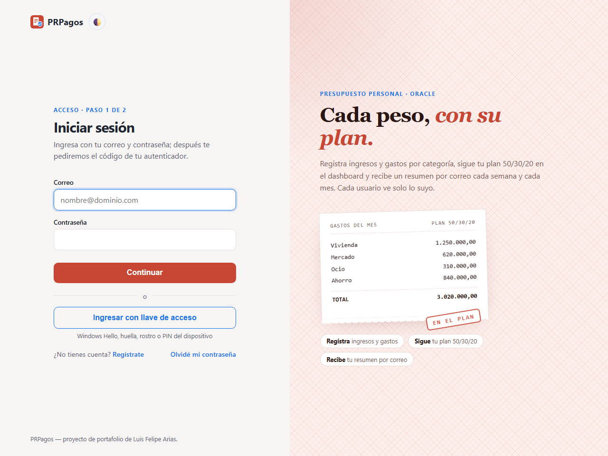

La portada es el inicio de sesión (paso 1: correo y contraseña). Desde ahí eliges **Regístrate** u
**Olvidé mi contraseña**. El botón ◐ cambia entre tema claro y oscuro, y la aplicación recuerda tu
elección.

| # | Campo | Qué escribir |
|:-:|---|---|
| 1 | Correo | Tu correo |
| 2 | Contraseña | Tu contraseña |
| 3 | Continuar | Pasa al código de verificación |
| 4 | Ingresar con llave de acceso | Entra directo con Windows Hello, la huella, el rostro o el PIN del dispositivo, sin contraseña ni código (ver 4.15) |

### 4.2 Crear una cuenta

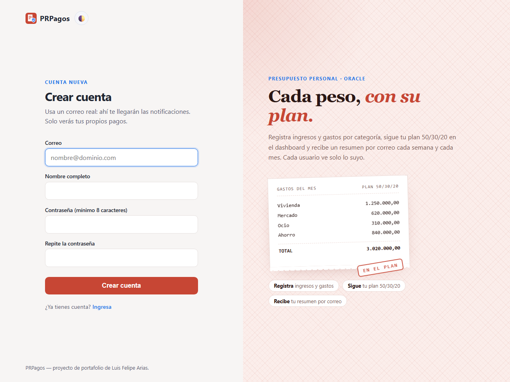

| # | Campo | Qué escribir | Reglas |
|:-:|---|---|---|
| 1 | Correo | Tu correo real; es tu usuario | Forma `nombre@dominio.com` y único |
| 2 | Nombre completo | Tu nombre | Se usa también para recuperar la contraseña |
| 3 | Contraseña | Tu contraseña | Mínimo 8 caracteres |
| 4 | Repite la contraseña | La misma | Debe coincidir |
| 5 | Crear cuenta | Botón | Crea la cuenta; sirve en la web y en el escritorio |

### 4.3 Configurar la verificación en dos pasos (solo la primera vez)

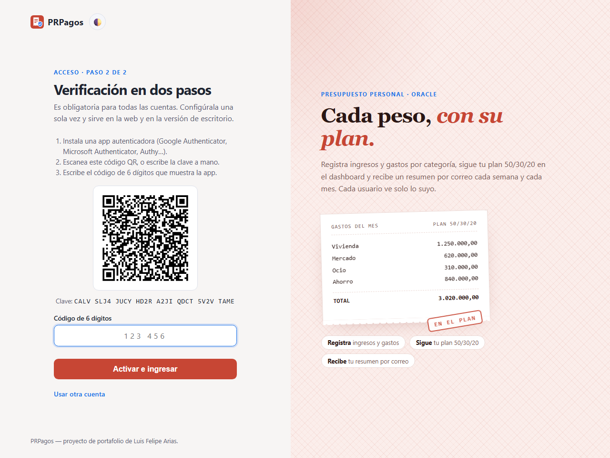

| # | Campo | Qué hacer |
|:-:|---|---|
| 1 | Código QR | Escanéalo con tu app autenticadora |
| 2 | Clave | La misma información, para escribirla a mano si no puedes escanear |
| 3 | Código de 6 dígitos | El que muestra la app para **PRPagos** |
| 4 | Activar e ingresar | Guarda el autenticador y muestra tus **códigos de respaldo** (ver 4.12) |

Si ya lo configuraste en la versión de escritorio, este paso no aparece.

### 4.4 Iniciar sesión (paso 2: código)

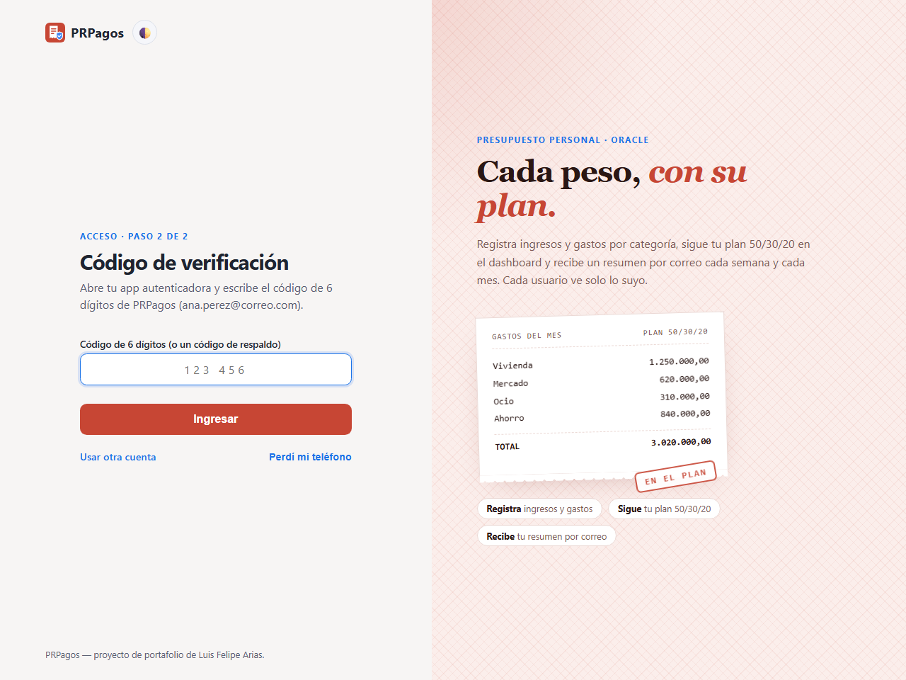

| # | Campo | Qué escribir |
|:-:|---|---|
| 1 | Código de 6 dígitos | El código actual de tu app (cambia cada 30 segundos) o un código de respaldo |
| 2 | Ingresar | Abre el **Dashboard** |
| 3 | Perdí mi teléfono | Te envía un código al correo (ver 4.13) |

La sesión se cierra tras **6 horas sin uso** o a las **8 horas** del ingreso, con un mensaje que
explica el motivo.

### 4.5 Dashboard

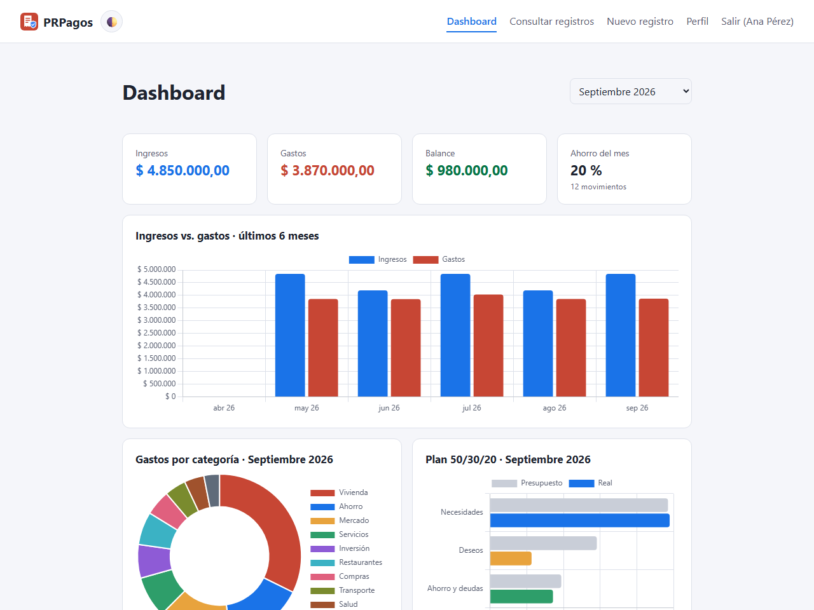

| # | Parte | Qué muestra |
|:-:|---|---|
| 1 | Selector de mes | El mes que quieres revisar (por defecto, el actual) |
| 2 | Ingresos · Gastos · Balance | Totales del mes; el balance sale en verde si es positivo y en rojo si es negativo |
| 3 | Ahorro del mes | Qué porcentaje de los ingresos no se gastó, y cuántos movimientos hubo |
| 4 | Ingresos vs. gastos | Barras de los últimos 6 meses, para ver la tendencia; **toca un mes** para abrirlo |
| 5 | Gastos por categoría | Anillo con el peso de cada categoría en el mes; **toca una** para ver sus registros |
| 6 | Plan 50/30/20 | Presupuesto de cada grupo (calculado sobre los ingresos del mes) frente a lo real. **Ver el presupuesto detallado por categoría** abre la pantalla Presupuesto en ese mes |
| 7 | Tabla del plan | Presupuesto, real, % usado y estado: **Dentro del plan**, **Excedido**, **Meta cumplida** o **Por debajo de la meta** (ahorro) |
| 8 | Resúmenes por correo | **Enviarme el resumen semanal** o **del mes** para recibirlo al momento |

El mismo dashboard en tema oscuro:

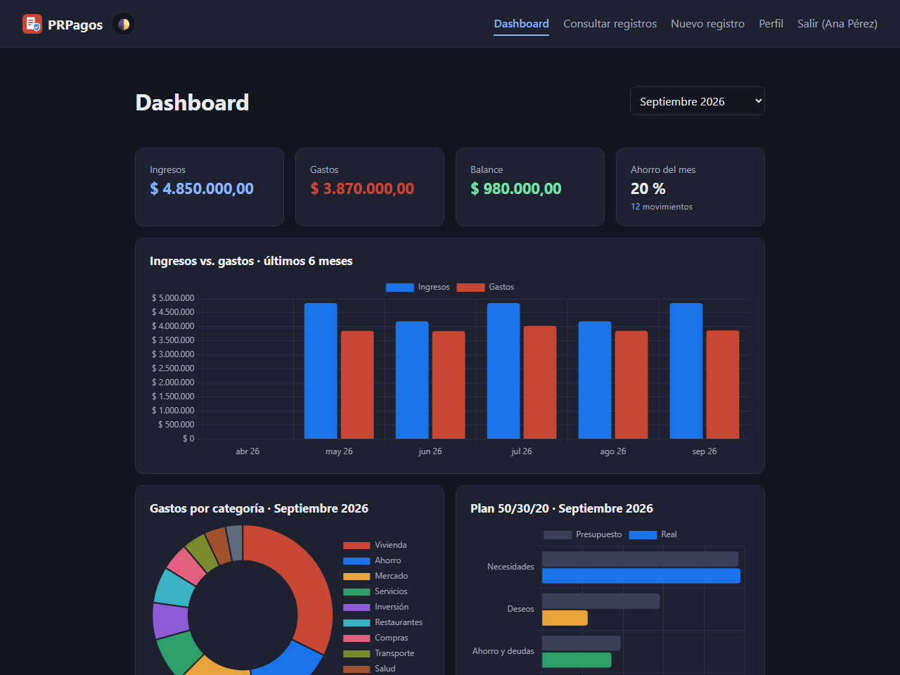

### 4.6 Presupuesto

Planea cuánto vas a recibir y gastar **en cada categoría, mes a mes**, y compáralo con lo que
registras. Es el mismo esquema de una hoja de presupuesto anual (ingresos, gastos fijos y
variables, ahorro y lo que **queda**), pero conectado a tus registros: no tienes que pasar nada a
mano.

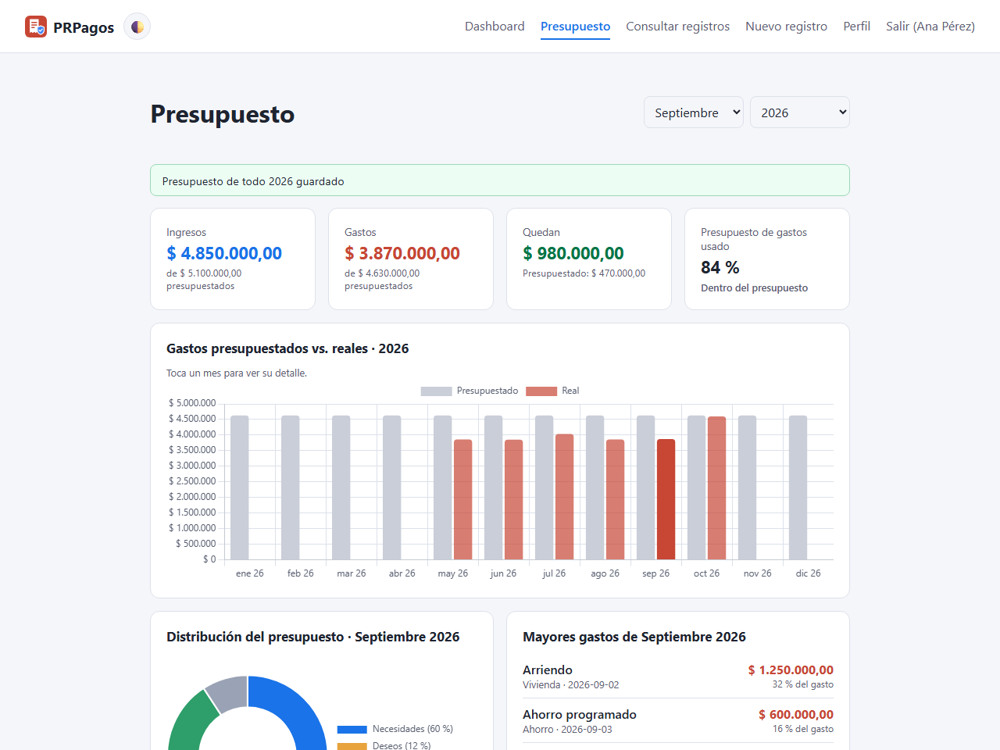

| # | Parte | Qué muestra o qué haces |
|:-:|---|---|
| 1 | Mes y año | El periodo que planeas (año anterior, actual o siguiente) |
| 2 | Ingresos · Gastos | Lo **registrado** en el mes y, debajo, lo **presupuestado** |
| 3 | Quedan | Ingresos menos gastos (el ahorro cuenta como gasto: ya tiene destino), real y presupuestado |
| 4 | Presupuesto de gastos usado | Qué porcentaje del presupuesto de gastos ya se usó y si vas **Dentro del presupuesto** o **Excedido** |
| 5 | Gastos presupuestados vs. reales | Barras de los 12 meses; **toca un mes** para abrirlo |
| 6 | Distribución del presupuesto | Cómo se reparten los ingresos presupuestados entre Necesidades, Deseos, Ahorro y deudas y lo **sin asignar** |
| 7 | Mayores gastos | Los 5 gastos más grandes del mes y su peso; **toca uno** para abrirlo, o **Ver todos los registros del mes** |
| 8 | Tabla del mes | Una fila por categoría, agrupadas como el plan 50/30/20. Escribe el monto en **Presupuesto** (con o sin puntos de miles; vacío = sin presupuesto). **Real**, **Usado** (con barra) y **Estado** salen de tus registros. **Toca el nombre** de una categoría para ver sus movimientos del mes |
| 9 | Meta del plan | En cada grupo: qué parte de los ingresos presupuestados le diste frente a la meta de tu plan 50/30/20 |
| 10 | Aplicar a · Guardar presupuesto | Guarda **solo este mes**, **de este mes a diciembre** o **todo el año** |
| 11 | Copiar el presupuesto del mes anterior | Deja el mes igual al anterior, para ajustar solo lo que cambia |
| 12 | Resumen del año | Presupuestado y real de cada mes (ingresos, gastos y quedan) con el total; **toca un mes** para abrirlo |

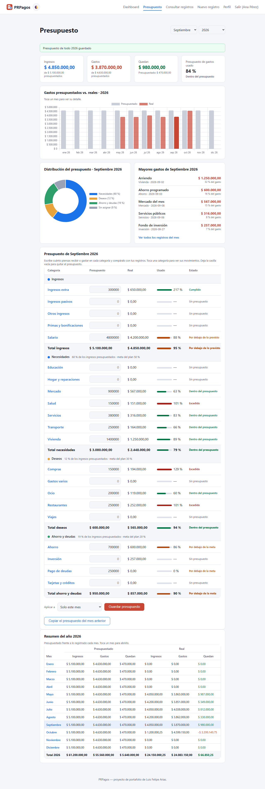

Estados: en ingresos, **Cumplido** o **Por debajo de lo previsto**; en gastos, **Dentro del
presupuesto**, **Excedido** o **Sin presupuesto**; en ahorro, **Meta cumplida** o **Por debajo de la
meta**. Al guardar un registro con categoría, el aviso te dice cómo va su presupuesto, por
ejemplo: *Registro guardado · Mercado en septiembre 2026: $ 657.000,00 de $ 900.000,00 (73 %) ·
Dentro del presupuesto*.

### 4.7 Registrar un ingreso o un gasto

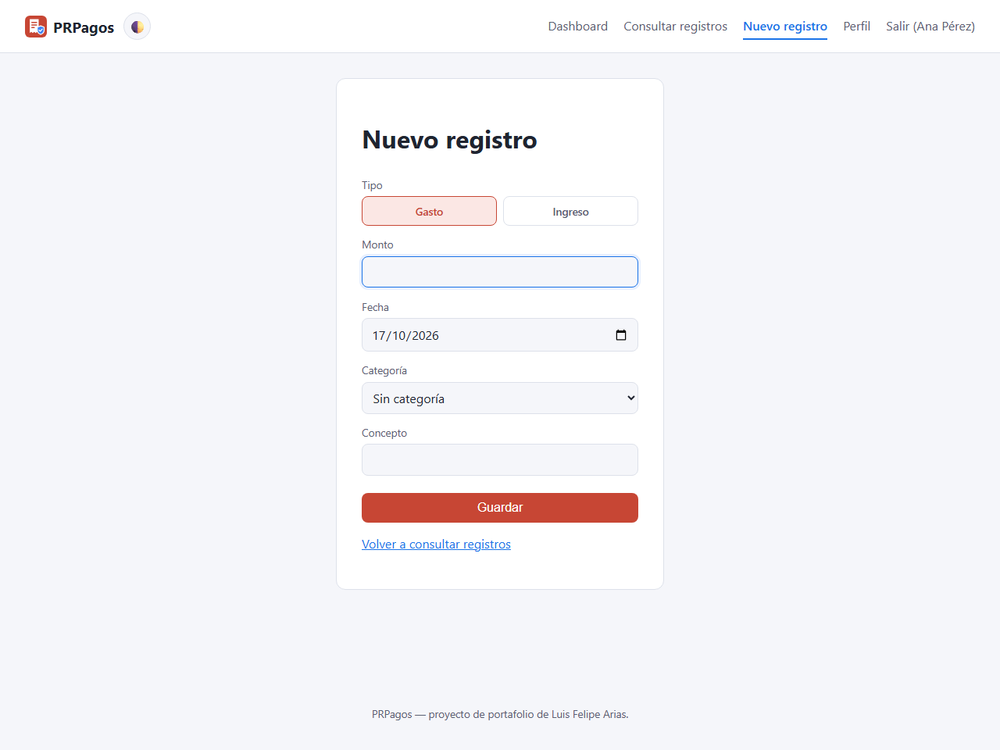

| # | Campo | Qué escribir | Reglas |
|:-:|---|---|---|
| 1 | Tipo | **Ingreso** o **Gasto** | Obligatorio |
| 2 | Monto | Valor, sin puntos de miles ni signo `$` (los decimales pueden ir con coma) | Número válido |
| 3 | Fecha | Día del movimiento | Obligatoria |
| 4 | Categoría | Se filtra según el tipo; las de gasto muestran su grupo del plan | Opcional (**Sin categoría**) |
| 5 | Concepto | Descripción breve | Obligatorio, hasta 100 caracteres |
| 6 | Guardar | Botón | Registra el movimiento a tu nombre |

### 4.8 Consultar y exportar

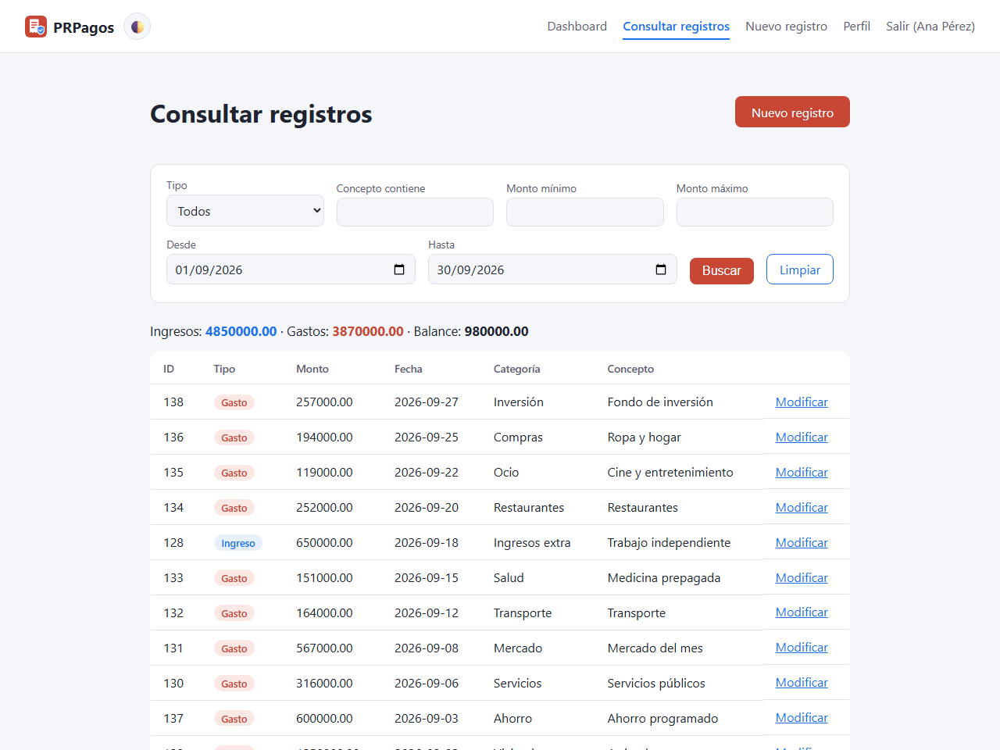

| # | Campo | Qué escribir |
|:-:|---|---|
| 1 | Tipo | Todos, solo ingresos o solo gastos |
| 2 | Concepto contiene | Parte del concepto que buscas |
| 3 | Monto mínimo / máximo | Rango de valores |
| 4 | Desde / Hasta | Rango de fechas |
| 5 | Categoría | Una categoría, **Sin categoría** o todas |
| 6 | Buscar | Aplica los filtros (**Limpiar** los quita). Un campo vacío no filtra |
| 7 | Totales | Ingresos, gastos y balance de lo que cumple los filtros |
| 8 | Modificar | Abre el registro para corregirlo |
| 9 | Exportar a CSV | Descarga la consulta (ID, tipo, monto, fecha, categoría y concepto) |

Solo ves **tus** registros.

### 4.9 Modificar un registro

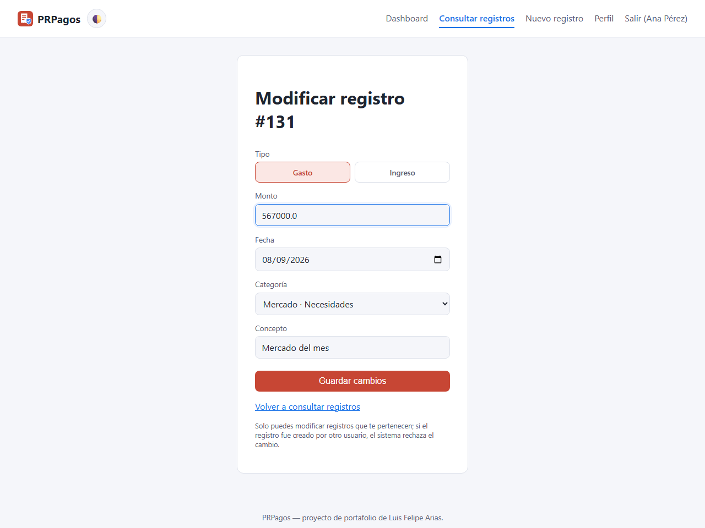

Los mismos campos de 4.7 con los valores actuales. **Guardar cambios** aplica la corrección y queda
en la auditoría. Si te equivocaste de registro, corrígelo: las cuentas de usuario no eliminan
registros.

### 4.10 Perfil

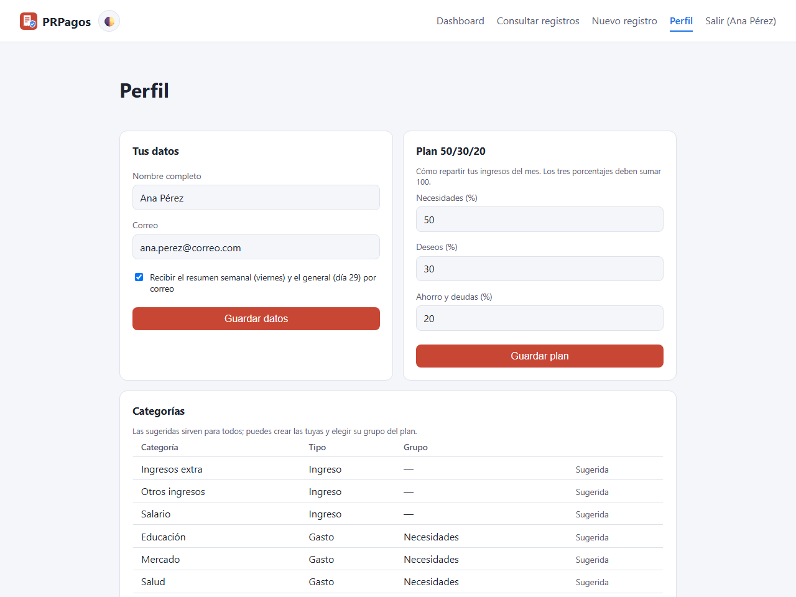

| # | Sección | Qué puedes hacer |
|:-:|---|---|
| 1 | Tus datos | Cambiar tu nombre y activar o desactivar los **resúmenes por correo** |
| 2 | Plan 50/30/20 | Ajustar los porcentajes de Necesidades, Deseos y Ahorro y deudas (deben sumar 100) |
| 3 | Categorías | Ver las sugeridas y **agregar** las tuyas (nombre, tipo y grupo del plan); las tuyas se pueden eliminar si no tienen registros |
| 4 | Verificación en dos pasos | **Cambiar autenticador** (teléfono nuevo o perdido) con un código de la app o de respaldo |
| 5 | Códigos de respaldo | Cuántos te quedan y **Generar códigos nuevos** (anula los anteriores) |
| 6 | Llaves de acceso | Ver tus dispositivos con llave, **agregar este dispositivo** o eliminar uno (ver 4.15) |
| 7 | Cambiar contraseña | Contraseña actual, la nueva dos veces y un código de la app o de respaldo |

### 4.11 Resúmenes por correo

- **Semanal:** cada viernes, con los ingresos, gastos y balance de los 7 días que terminan ese
  viernes (de sábado a viernes).
- **Mensual:** cada día 29 (en febrero, el último día), con lo que va del mes: totales,
  categorías y el plan 50/30/20.
- Se envían a las 08:00 (hora de Colombia) a las cuentas con los resúmenes activados en **Perfil**.
- Los botones del dashboard te los envían al momento; el contenido es idéntico al que envía la
  versión de escritorio.

### 4.12 Códigos de respaldo

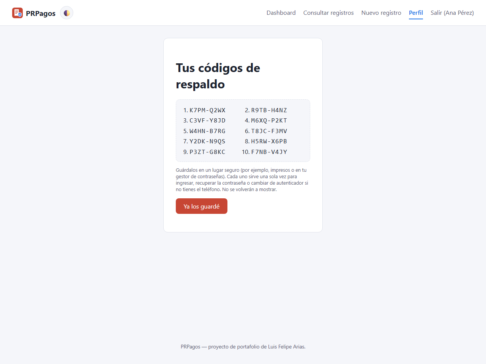

Aparecen al activar el autenticador y cada vez que generas nuevos en **Perfil**. Son 10, cada uno
sirve **una sola vez** y no se vuelven a mostrar: guárdalos impresos o en tu gestor de contraseñas.
Sirven para ingresar (en lugar del código de 6 dígitos), recuperar la contraseña o cambiar de
autenticador.

### 4.13 Perdí mi teléfono

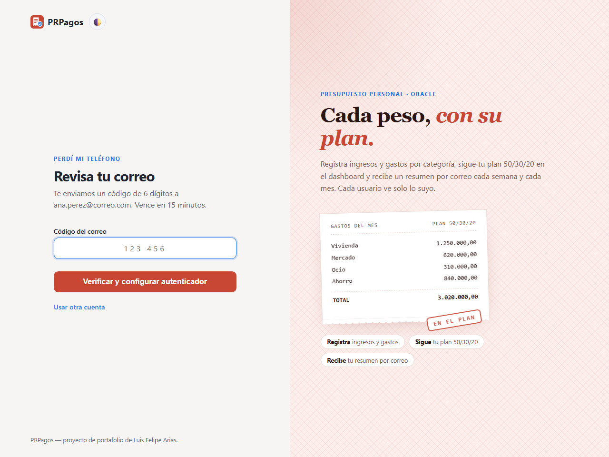

1. Inicia sesión con tu correo y contraseña.
2. En el paso del código, si tienes un **código de respaldo**, escríbelo y entra.
3. Si no, pulsa **Perdí mi teléfono**: llega a tu correo un código de 6 dígitos que vence en 15
   minutos.
4. Escríbelo en **Código del correo** y pulsa **Verificar y configurar autenticador**: configuras
   la app en el teléfono nuevo y recibes códigos de respaldo nuevos.

### 4.14 Recuperar la contraseña

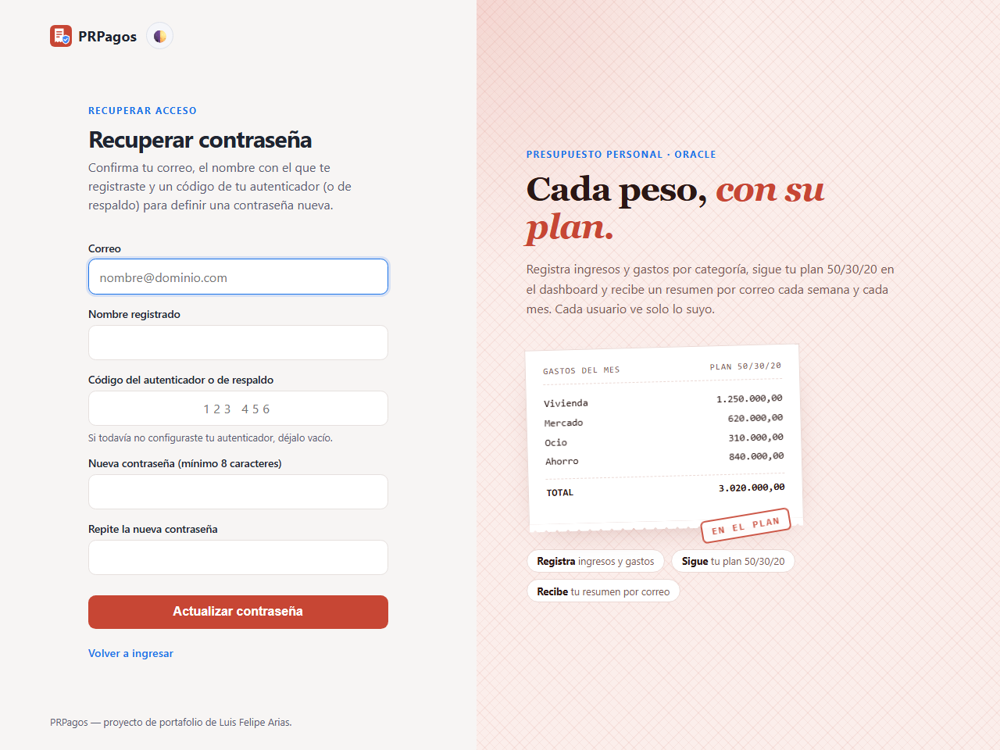

| # | Campo | Qué escribir |
|:-:|---|---|
| 1 | Correo | Tu correo |
| 2 | Nombre registrado | El nombre completo de tu cuenta (no distingue mayúsculas) |
| 3 | Código del autenticador o de respaldo | El código actual de tu app o un código de respaldo |
| 4 | Nueva contraseña | Mínimo 8 caracteres |
| 5 | Repite la nueva contraseña | La misma |
| 6 | Actualizar contraseña | Aplica el cambio |

### 4.15 Llaves de acceso (Windows Hello, huella o PIN)

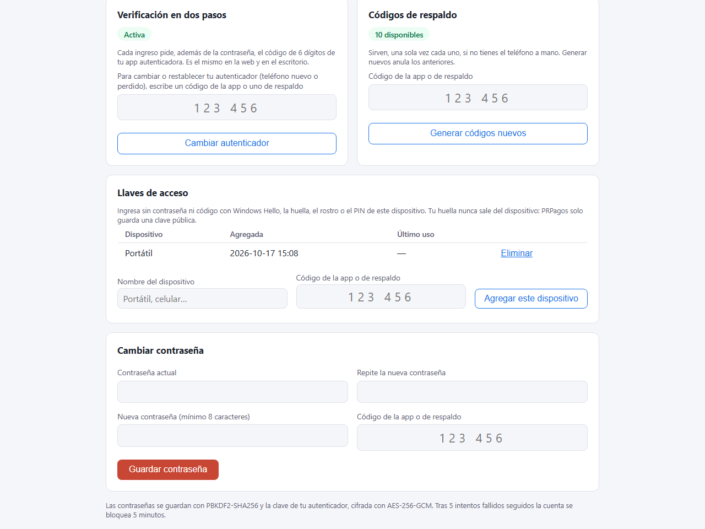

Con una llave de acceso entras sin escribir la contraseña ni el código: el dispositivo te pide
Windows Hello, la huella, el rostro o su PIN. Funciona en Edge o Chrome en Windows, en Android
(navegador o app instalada) y en iPhone.

**Agregar este dispositivo** (en **Perfil → Llaves de acceso**):

| # | Campo | Qué escribir |
|:-:|---|---|
| 1 | Nombre del dispositivo | Un nombre para reconocerlo (por ejemplo, "Portátil" o "Celular") |
| 2 | Código de la app o de respaldo | Un código vigente, para confirmar que eres tú |
| 3 | Agregar este dispositivo | El dispositivo pide tu huella, rostro o PIN y guarda la llave |

**Ingresar:** en la portada pulsa **Ingresar con llave de acceso** y confirma con tu huella,
rostro o PIN. Abre el **Dashboard** directamente.

- Cada dispositivo necesita su propia llave (en Android, Google puede sincronizarla entre tus
  dispositivos). Una llave creada en Edge sirve también en la app de escritorio del mismo Windows.
- Si pierdes un dispositivo, elimina su llave en **Perfil**. La contraseña + código y los códigos
  de respaldo siguen funcionando.

### 4.16 Preguntas frecuentes

**¿Tengo que configurar el autenticador dos veces, en la web y en el escritorio?** No. Es uno solo
por cuenta: el que configures en una versión sirve en la otra. Lo mismo con los códigos de respaldo.

**¿Lo que registro en la web aparece en la app de escritorio?** Sí, al instante: la app de
escritorio pide los datos a este mismo servidor, así que muestra las mismas cifras y gráficas.

**¿Cómo instalo la app en el celular?** En Chrome o Edge, menú ⋮ → **Instalar aplicación** (en
iPhone, Safari → Compartir → **Agregar a inicio**).

**¿Puedo dejar de recibir los correos?** Sí: en **Perfil → Tus datos**, desmarca la casilla de
resúmenes y guarda.

## 5. Seguridad: tu información protegida

Tu confianza es lo primero: la plataforma solo pide los datos necesarios para funcionar, los
protege y no los comparte con terceros.

### Qué datos se guardan y dónde

| Dato | Para qué se usa | Dónde se guarda | Quién lo ve |
|---|---|---|---|
| Correo y nombre | Identificar tu cuenta, enviarte los resúmenes y recuperar el acceso | Oracle Autonomous Database | Solo tú |
| Contraseña | Iniciar sesión | Oracle, solo su huella PBKDF2-SHA256 con sal | Nadie la ve en texto plano |
| Clave del autenticador | Verificar tus códigos | Oracle, cifrada con AES-256-GCM | Nadie; la clave de cifrado vive fuera de la base |
| Códigos de respaldo y código por correo | Recuperar el acceso | Oracle, solo su huella SHA-256 | Nadie los ve después de mostrarlos |
| Ingresos, gastos, categorías y plan | Tu presupuesto | Oracle, marcados con tu cuenta | Solo tú |
| Llaves de acceso | Ingresar con huella, rostro o PIN | Oracle, solo la clave pública y un contador | Nadie: la huella y la clave privada nunca salen de tu dispositivo |
| Sesión | Mantenerte conectado | Cookie en tu navegador | Firmada, invisible para JavaScript |

### Cómo se protege tu información

- **Cada quien ve solo lo suyo:** dashboard, consulta, exportación, edición y correos filtran por la
  cuenta que inició sesión. Cambiar el número del registro en la URL no abre registros ajenos.
- **Verificación en dos pasos obligatoria (TOTP):** sin el código de tu app (o uno de respaldo), la
  contraseña sola no basta para entrar, recuperar la cuenta ni cambiar la contraseña. Un código no
  se puede usar dos veces.
- **Llaves de acceso (WebAuthn):** exigen la verificación del dispositivo (huella, rostro o PIN),
  solo sirven en el sitio de PRPagos (no se pueden usar en una página falsa) y cada firma se
  comprueba en el servidor con la clave pública guardada. Agregar una pide un código vigente.
- **Recuperación sin el teléfono controlada:** los códigos de respaldo sirven una sola vez y el
  código por correo vence en 15 minutos; cada uso queda en la auditoría.
- **Contraseñas con PBKDF2-SHA256** (600.000 iteraciones y sal única por cuenta).
- **Bloqueo temporal:** 5 intentos fallidos seguidos bloquean la cuenta 5 minutos, en la web y en el
  escritorio a la vez.
- **Sesión con JWT en cookie `HttpOnly`, `Secure` y `SameSite=Lax`**: se cierra tras 6 horas sin uso
  o a las 8 horas, con un mensaje que explica el motivo.
- **Reglas de negocio en la base:** las operaciones pasan por procedimientos almacenados de Oracle
  con auditoría, y las consultas usan parámetros (sin concatenar texto del usuario en el SQL).
- **Conexión cifrada a la base:** Oracle Autonomous Database exige TLS con Wallet.
- **Secretos fuera del repositorio:** credenciales, clave de cifrado y clave de Brevo viven en la
  configuración del servidor, nunca en el código.

## 6. Agradecimientos

A mi familia, por su apoyo incondicional, su paciencia y por creer en cada proyecto incluso cuando
apenas era una idea. Este trabajo también es de ustedes.

Y a ti, que usas esta plataforma: cada prueba, comentario y sugerencia ayuda a que siga mejorando.
