# 📘 Manual de usuario · Simulador de pagos (web)

## 1. Portada

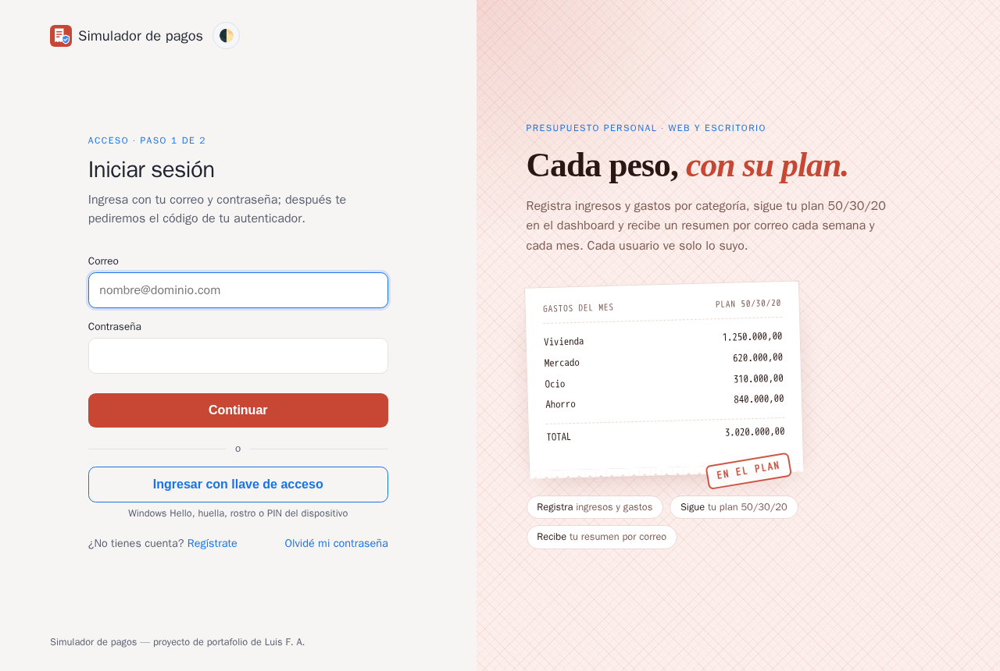

| | |
|---|---|
| **Producto** | Simulador de pagos (PRPagos), versión web |
| **Documento** | Manual de usuario |
| **Versión** | 2.0 · noviembre de 2026 |
| **Dirigido a** | Personas que quieren llevar su presupuesto personal |
| **Dirección** | [Simulador de pagos](https://prpagos-web-1087929107584.us-east4.run.app) |
| **Autor** | Luis F. A. |

La aplicación de Windows tiene su propio manual: [MANUAL-ESCRITORIO.md](MANUAL-ESCRITORIO.md). Las
dos usan la misma cuenta y los mismos datos.

## Contenido

1. [Portada](#1-portada)
2. [Introducción](#2-introducción)
3. [Objetivo](#3-objetivo)
4. [Alcance](#4-alcance)
5. [Acceso al sistema](#5-acceso-al-sistema)
6. [Pantalla principal](#6-pantalla-principal)
7. [Navegación](#7-navegación)
8. [Funcionalidades](#8-funcionalidades)
9. [Gestión de perfil](#9-gestión-de-perfil)
10. [Mensajes frecuentes](#10-mensajes-frecuentes)
11. [Preguntas frecuentes](#11-preguntas-frecuentes)
12. [Glosario](#12-glosario)

---

## 2. Introducción

El **Simulador de pagos** registra tus ingresos y gastos por categoría y los compara con el **plan
50/30/20**: la mitad de lo que recibes para necesidades, un 30 % para deseos y un 20 % para ahorro
y deudas. Un dashboard te muestra cómo va el mes, la pantalla **Presupuesto** te deja planear mes a
mes y cada semana y cada mes te llega un resumen por correo.

Este manual explica cada pantalla, paso a paso y con imágenes.

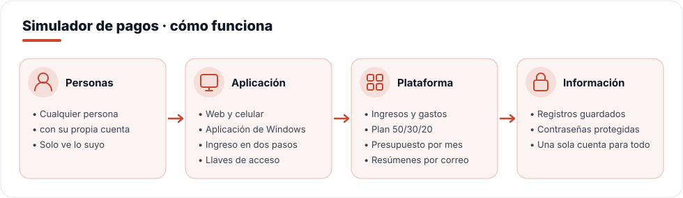

## 3. Objetivo

Que cualquier persona pueda, sin conocimientos técnicos:

- Crear su cuenta e ingresar de forma segura.
- Registrar sus ingresos y gastos en segundos.
- Consultar, corregir y exportar sus registros.
- Saber si el mes va dentro de su plan y planear el presupuesto de cada categoría.

## 4. Alcance

**Incluye:** registro e ingreso con verificación en dos pasos, llaves de acceso (huella, rostro o
PIN), ingresos y gastos con categorías, dashboard del mes, presupuesto por categoría, consulta con
filtros y exportación a CSV, resúmenes por correo, tema claro y oscuro, y uso en celular, tablet y
computador.

**No incluye:** conexión con bancos ni pagos reales: los montos los escribes tú.

**Qué necesitas:** un navegador actualizado, conexión a internet, un correo propio y una app
autenticadora en el celular (o acceso a tu correo para recibir códigos).

## 5. Acceso al sistema

### 5.1 Crear una cuenta

En la portada pulsa **Regístrate**.

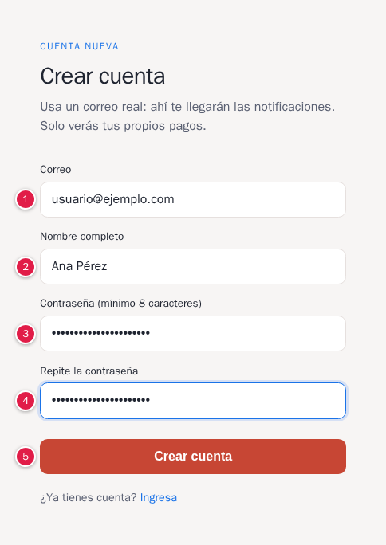

| # | Campo | Qué escribir |
|:-:|---|---|
| 1 | Correo | Tu correo real: es tu usuario y ahí llegan los avisos |
| 2 | Nombre completo | Tu nombre, como quieres verlo en la aplicación |
| 3 | Contraseña | Mínimo 8 caracteres |
| 4 | Repite la contraseña | La misma contraseña |
| 5 | Crear cuenta | Crea la cuenta y te lleva a configurar la verificación en dos pasos |

La primera vez eliges cómo recibir el código de la verificación en dos pasos: con una **app
autenticadora** (escaneas un código QR; recomendado) o con un **código por correo**. Al activarla
recibes tus **códigos de respaldo**: guárdalos, sirven si pierdes el teléfono.

### 5.2 Iniciar sesión

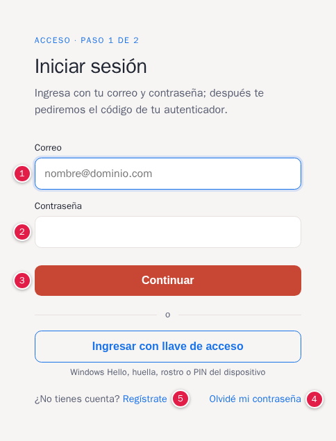

| # | Elemento | Qué hace |
|:-:|---|---|
| 1 | Correo | El correo de tu cuenta |
| 2 | Contraseña | Tu contraseña |
| 3 | Continuar | Comprueba tus datos y pasa al código de verificación |
| 4 | Olvidé mi contraseña | Abre la recuperación de contraseña (5.4) |
| 5 | Regístrate | Crea una cuenta nueva (5.1) |

Si ya agregaste una llave de acceso (9.4), **Ingresar con llave de acceso** te deja entrar con tu
huella, rostro o PIN, sin contraseña ni código.

### 5.3 Verificación en dos pasos

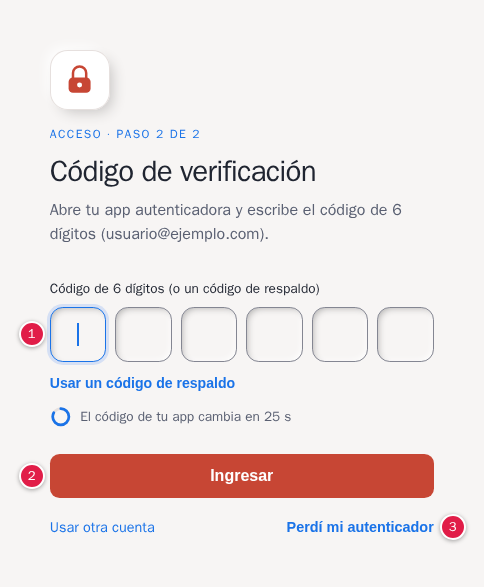

| # | Elemento | Qué hace |
|:-:|---|---|
| 1 | Código de 6 dígitos | El código de tu app (o de tu correo), o uno de tus códigos de respaldo |
| 2 | Ingresar | Confirma el código y abre el dashboard |
| 3 | Perdí mi autenticador | Te envía un código al correo de tu cuenta para configurar un autenticador nuevo |

### 5.4 Recuperar la contraseña

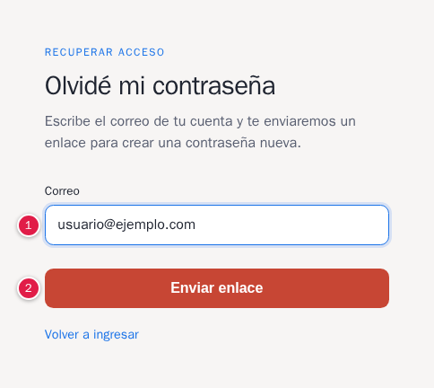

| # | Elemento | Qué hace |
|:-:|---|---|
| 1 | Correo | El correo de tu cuenta |
| 2 | Enviar enlace | Envía un enlace para crear una contraseña nueva (vence pronto y sirve una sola vez) |

Al guardar la contraseña nueva se cierran las sesiones abiertas y la verificación en dos pasos
sigue activa.

## 6. Pantalla principal

El **Dashboard** muestra cómo va el mes.

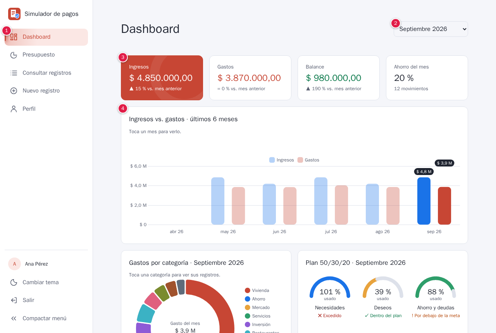

| # | Elemento | Qué hace |
|:-:|---|---|
| 1 | Menú | Lleva a Dashboard, Presupuesto, Consultar registros, Nuevo registro y Perfil |
| 2 | Mes | Elige el mes que quieres revisar |
| 3 | Cifras del mes | Ingresos, gastos, balance y porcentaje de ahorro, comparados con el mes anterior |
| 4 | Gráficas | Ingresos vs. gastos de los últimos 6 meses (toca un mes para abrirlo), gastos por categoría (toca una para ver sus registros) y avance del plan 50/30/20 |

## 7. Navegación

En el computador el menú está a la izquierda. **Compactar menú** lo reduce a íconos; al pie están tu
nombre, **Cambiar tema** y **Salir**.

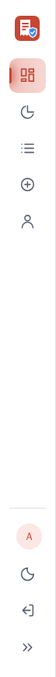

En la tablet en vertical las gráficas se acomodan una debajo de otra. En el celular el menú pasa a
una barra inferior; **Más** abre Perfil y Salir.

| Tablet en vertical | Celular con la barra inferior |
|:-:|:-:|
| 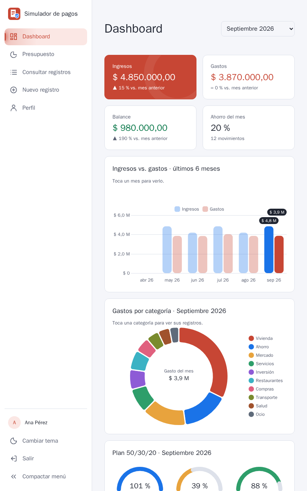 | 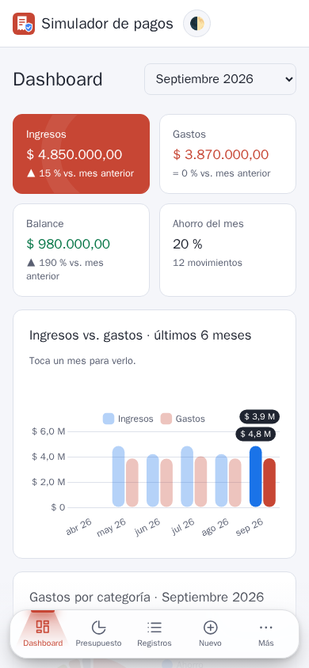 |

El tema oscuro se activa con **Cambiar tema** (o el botón ◐) y la aplicación lo recuerda:

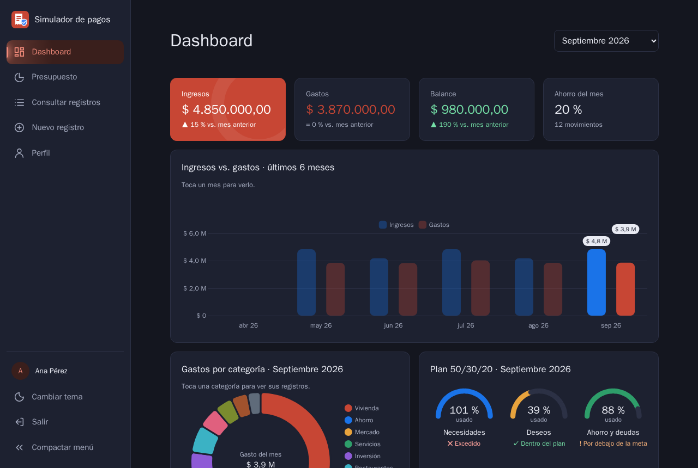

## 8. Funcionalidades

### 8.1 Crear: registrar un ingreso o un gasto

En el menú pulsa **Nuevo registro**.

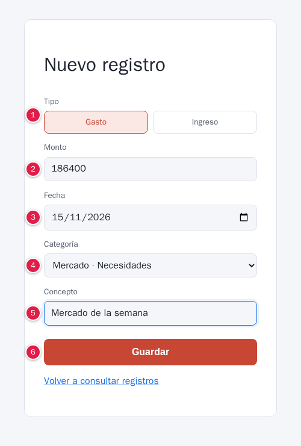

| # | Campo | Qué escribir |
|:-:|---|---|
| 1 | Tipo | **Gasto** o **Ingreso** |
| 2 | Monto | El valor, sin puntos de miles ni signo $ (los decimales pueden ir con coma) |
| 3 | Fecha | El día del movimiento |
| 4 | Categoría | Se filtra según el tipo; las de gasto muestran su grupo del plan (opcional) |
| 5 | Concepto | Una descripción corta, hasta 100 caracteres |
| 6 | Guardar | Registra el movimiento |

Al guardar, el aviso te dice cómo va el presupuesto de esa categoría en el mes.

### 8.2 Consultar: buscar y exportar registros

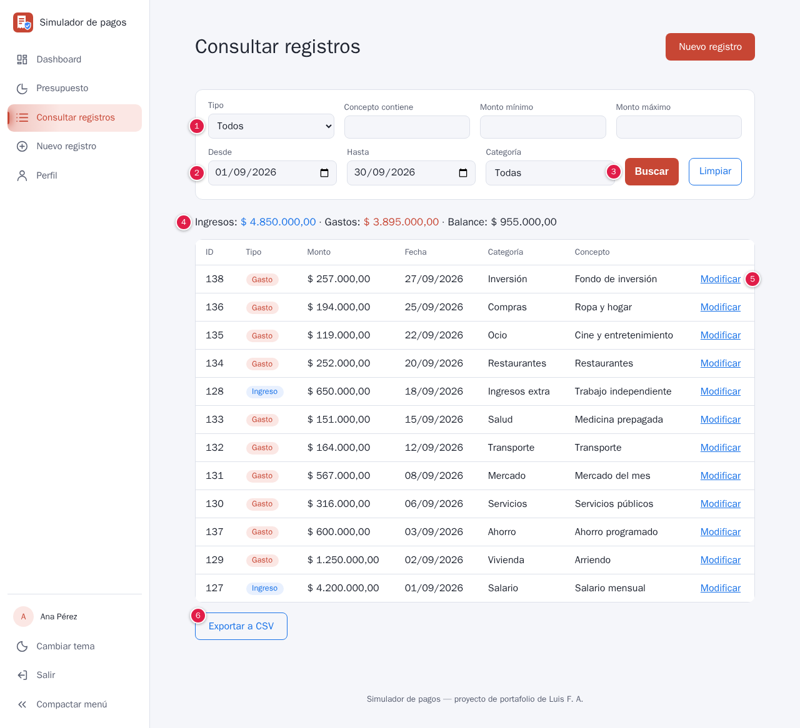

| # | Elemento | Qué hace |
|:-:|---|---|
| 1 | Tipo | Todos, solo ingresos o solo gastos (también puedes filtrar por concepto, montos y categoría) |
| 2 | Desde / Hasta | El rango de fechas |
| 3 | Buscar | Aplica los filtros; **Limpiar** los quita |
| 4 | Totales | Ingresos, gastos y balance de lo que cumple los filtros |
| 5 | Modificar | Abre el registro para corregirlo (8.3) |
| 6 | Exportar a CSV | Descarga la consulta para abrirla en Excel |

### 8.3 Modificar: corregir un registro

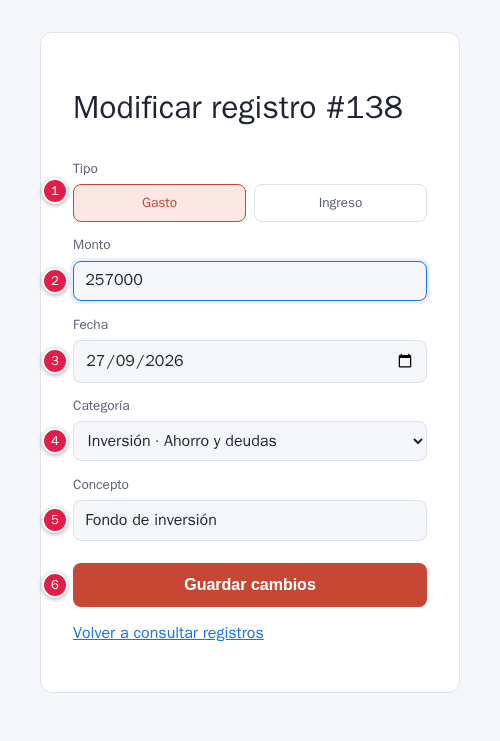

Son los mismos campos de 8.1 con los valores actuales: cambia lo que necesites y pulsa **Guardar
cambios** (6).

### 8.4 Reportar: presupuesto y resúmenes

**Presupuesto** compara lo que planeaste con lo que registraste, categoría por categoría.

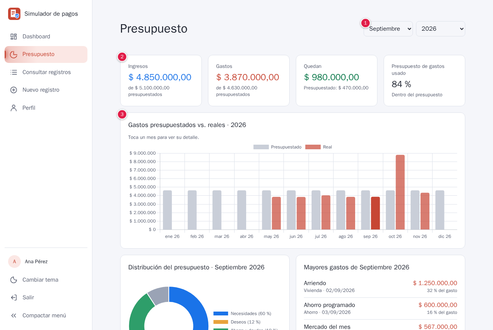

| # | Elemento | Qué hace |
|:-:|---|---|
| 1 | Mes y año | El periodo que planeas o revisas |
| 2 | Cifras del mes | Ingresos y gastos registrados frente a lo presupuestado, lo que queda y el porcentaje usado |
| 3 | Gráficas | Presupuestado vs. real de los 12 meses, distribución frente al plan y mayores gastos |

Más abajo está la **tabla del mes**: escribe el presupuesto de cada categoría y elige si se aplica
solo a ese mes, hasta diciembre o a todo el año; **Copiar el presupuesto del mes anterior** te ahorra
volver a escribirlo.

**Resúmenes por correo:** cada viernes te llega el resumen de la semana y cada día 29 (en febrero,
el último día) el del mes. Al final del dashboard puedes pedirlos al momento:

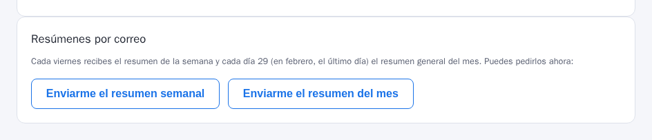

## 9. Gestión de perfil

En el menú pulsa **Perfil**. Ahí también ajustas los porcentajes de tu **plan 50/30/20** y creas
tus propias **categorías**.

### 9.1 Tus datos

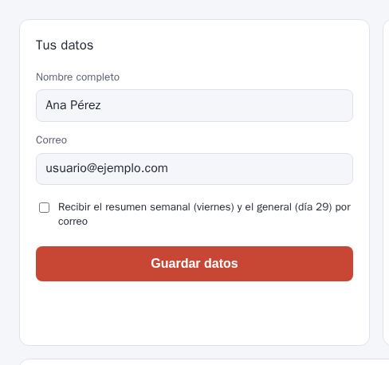

Cambia tu nombre y activa o desactiva los resúmenes por correo; pulsa **Guardar datos**.

### 9.2 Cambiar contraseña

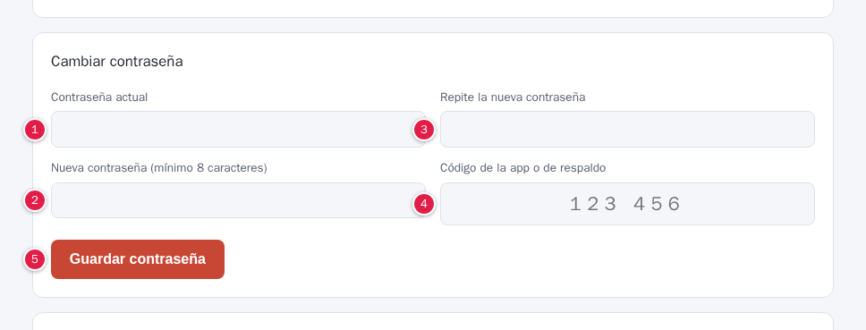

| # | Campo | Qué escribir |
|:-:|---|---|
| 1 | Contraseña actual | Tu contraseña de hoy |
| 2 | Nueva contraseña | Mínimo 8 caracteres |
| 3 | Repite la nueva contraseña | La misma contraseña nueva |
| 4 | Código de la app o de respaldo | Un código vigente, para confirmar que eres tú |
| 5 | Guardar contraseña | Guarda el cambio y te muestra códigos de respaldo nuevos (los anteriores dejan de servir) |

### 9.3 Verificación en dos pasos

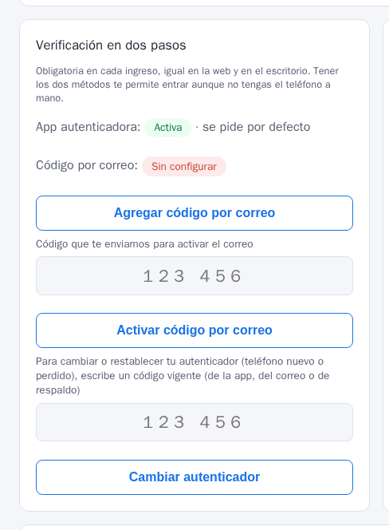

Muestra tus métodos activos. Puedes **agregar el código por correo** (o la app, si empezaste con el
correo), elegir cuál se pide por defecto y **cambiar el autenticador** si cambias de teléfono. En
la tarjeta **Códigos de respaldo** ves cuántos te quedan y generas nuevos.

### 9.4 Llaves de acceso

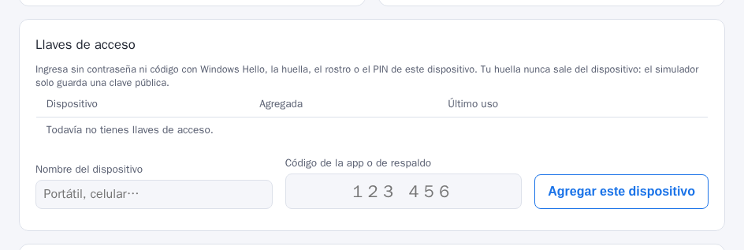

Con una llave de acceso entras con Windows Hello, tu huella, tu rostro o el PIN del dispositivo.
Escribe un nombre para el dispositivo y un código vigente, y pulsa **Agregar este dispositivo**. Si
pierdes un dispositivo, elimina su llave aquí.

### 9.5 Eliminar mi cuenta

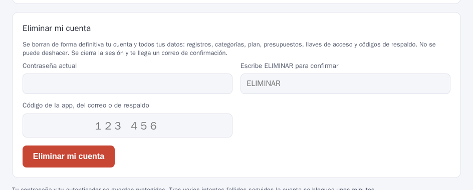

Borra para siempre tu cuenta y todos tus datos. Pide tu contraseña, un código vigente y la palabra
**ELIMINAR**. No se puede deshacer; al terminar te llega un correo de confirmación.

## 10. Mensajes frecuentes

| Mensaje | Qué significa | Qué hacer |
|---|---|---|
| Usuario o contraseña incorrectos | Los datos no coinciden | Revísalos o usa **Olvidé mi contraseña** |
| Demasiados intentos fallidos. Espera unos minutos e inténtalo de nuevo. | La cuenta se bloqueó un rato por seguridad | Espera unos minutos |
| Código incorrecto o ya usado | El código venció o ya se usó | Escribe el código que muestra la app ahora |
| El código no coincide. Revisa que la hora del teléfono sea la correcta. | La hora del teléfono está desfasada | Activa la hora automática del teléfono |
| Ese correo ya tiene una cuenta | Ya existe una cuenta con ese correo | Ingresa o recupera la contraseña |
| Monto inválido | El monto no es un número | Escríbelo sin puntos ni signo $ |
| Escribe el concepto | Falta la descripción | Escribe una descripción corta |
| Los tres porcentajes deben sumar 100 | El plan no suma 100 % | Ajusta los porcentajes |
| Registro guardado | El movimiento quedó registrado | Míralo en **Consultar registros** |
| Tu sesión se cerró tras 6 horas de inactividad. Ingresa de nuevo. | La sesión venció por seguridad | Ingresa otra vez |
| Página no encontrada | La dirección no existe | Vuelve con el menú |
| Sin conexión | Tu equipo no tiene internet | La pantalla reintenta sola |

| Página no encontrada | Sin conexión |
|:-:|:-:|
| 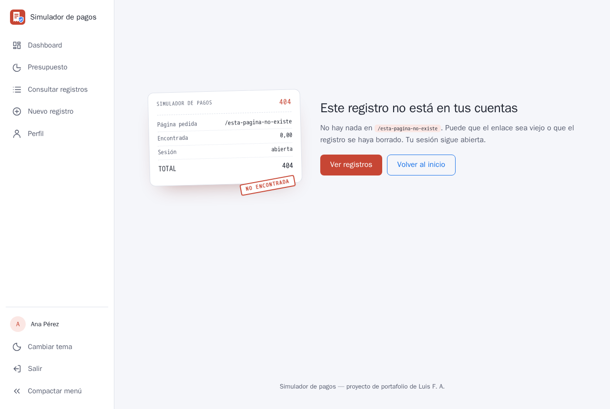 | 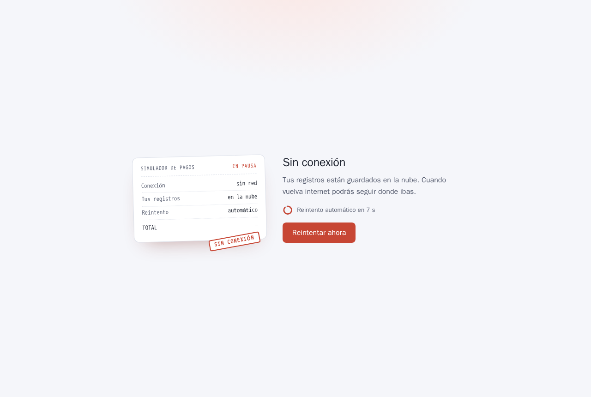 |

## 11. Preguntas frecuentes

**¿Lo que registro en la web aparece en la aplicación de Windows?** Sí, al instante: las dos usan la
misma cuenta y los mismos datos.

**¿Tengo que configurar el autenticador dos veces?** No. Es uno solo por cuenta y sirve en la web y
en el escritorio; lo mismo los códigos de respaldo.

**¿Quién ve mis registros?** Solo tú.

**¿Puedo dejar de recibir los correos?** Sí: en **Perfil → Tus datos** desmarca la casilla de
resúmenes y guarda.

**¿Se puede instalar como aplicación?** Sí: en Chrome o Edge, **Instalar aplicación**; en iPhone,
Safari → **Compartir → Agregar a inicio**.

**¿Dónde pido ayuda o reporto un problema?** Telegram [@lfac6](https://t.me/lfac6), WhatsApp
[@carraian160](https://wa.me/carraian160) o [ariascluisf@hotmail.com](mailto:ariascluisf@hotmail.com).

## 12. Glosario

| Término | Qué significa |
|---|---|
| **Balance** | Ingresos menos gastos |
| **Categoría** | Grupo de un movimiento: mercado, vivienda, salario… |
| **Código de respaldo** | Código de un solo uso para entrar si no tienes el teléfono |
| **CSV** | Archivo de tabla que se abre en Excel u hojas de cálculo |
| **Llave de acceso** | Forma de entrar con tu huella, rostro o PIN, sin contraseña |
| **Plan 50/30/20** | Reparto de los ingresos: 50 % necesidades, 30 % deseos, 20 % ahorro y deudas |
| **Presupuesto** | Lo que planeas recibir o gastar en cada categoría |
| **Verificación en dos pasos** | Además de la contraseña, se pide un código que solo tú puedes recibir |
