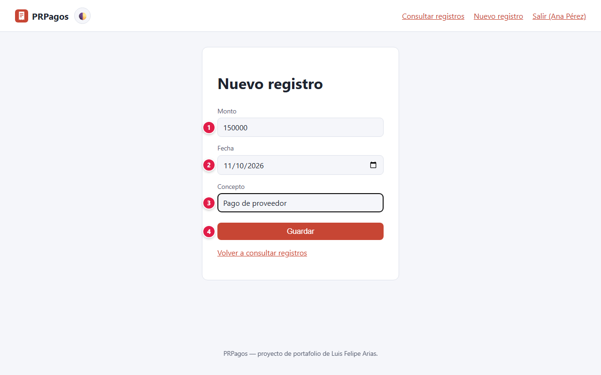
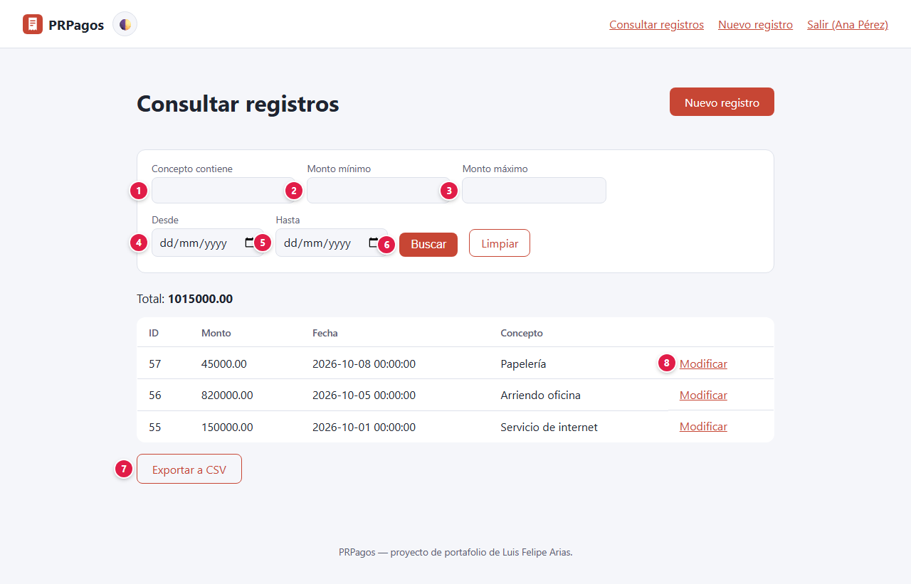
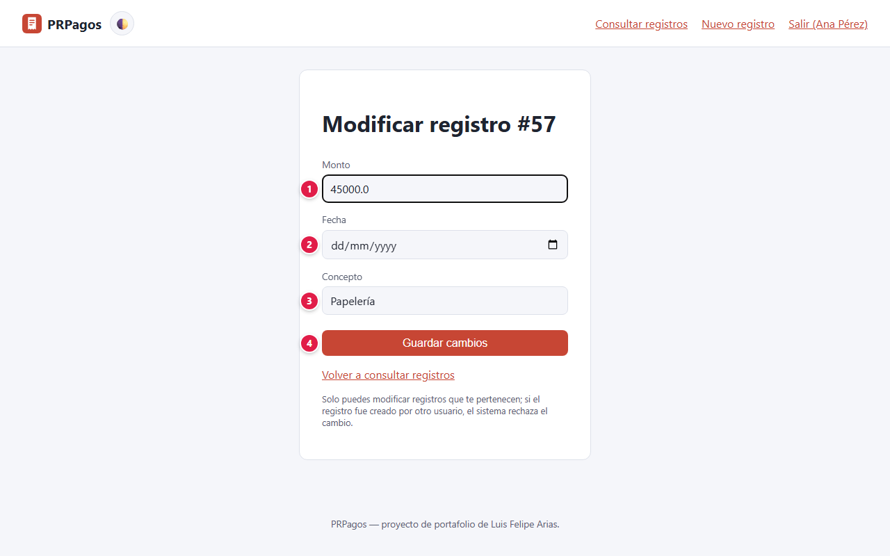
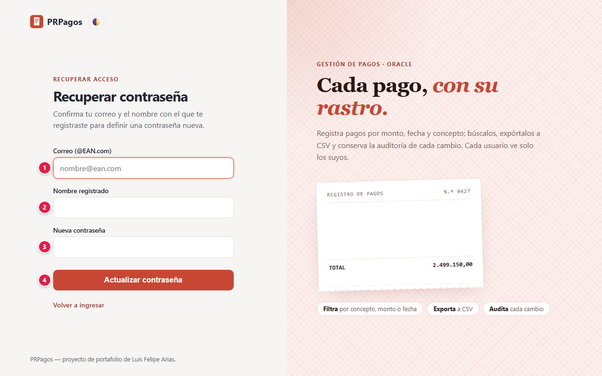

# 📘 Manual de usuario · PRPagos

Guía para usar la versión web paso a paso: qué significa cada campo, qué datos se ingresan y qué
protege la plataforma. La versión de escritorio usa las mismas cuentas, campos y datos (ver
[`escritorio/README.md`](../escritorio/README.md)). Para la parte técnica vuelve al
[README](../README.md).

**Demo web:** [PRPagos (Google Cloud Run)](https://prpagos-web-1087929107584.southamerica-east1.run.app)

## Contenido

1. [Proyecto: objetivos y alcances](#1-proyecto-objetivos-y-alcances)
2. [Glosario](#2-glosario)
3. [Plataformas, base de datos y servicios](#3-plataformas-base-de-datos-y-servicios)
4. [Paso a paso](#4-paso-a-paso)
5. [Seguridad: tu información protegida](#5-seguridad-tu-información-protegida)
6. [Agradecimientos](#6-agradecimientos)

---

## 1. Proyecto: objetivos y alcances

### Objetivo

Simulador de registro de pagos: cada persona anota sus pagos (monto, fecha y concepto), los
consulta con filtros, los modifica y los exporta a CSV. Las reglas de negocio viven en
procedimientos almacenados de Oracle, compartidos por la versión web y la de escritorio.

### Alcance: qué necesitas y qué esperar

- Solo necesitas un navegador; también se puede **instalar como app** (PWA) desde el navegador.
- El **usuario** debe tener forma de correo terminado en `@EAN.com`. Es una regla heredada de la
  aplicación original: **no es un buzón real** y nunca se le envía nada.

### Límites

PRPagos reproduce a propósito una aplicación académica original, y conserva algunas de sus
decisiones para que web y escritorio compartan las mismas cuentas. Por eso:

- **La recuperación de contraseña solo pide el usuario y el nombre registrado.** Quien conozca
  ambos datos puede cambiar tu contraseña. No uses tu nombre real ni una contraseña que uses en
  otros sitios.
- **La contraseña se guarda con SHA-256 sin sal**, compatible con la versión de escritorio en Java.
  En un sistema real lo correcto sería bcrypt o PBKDF2 (el propio código lo indica).
- No hay reglas de longitud mínima ni bloqueo por intentos fallidos.
- La recuperación indica si un usuario existe o no.
- **Registra solo datos de ejemplo**: es un simulador, no un sistema de pagos real.

## 2. Glosario

Palabras técnicas que aparecen en este manual, explicadas en lenguaje simple.

| Término | Qué significa |
|---|---|
| **Administrador** | Cuenta con permisos para gestionar usuarios y configuraciones de la aplicación. |
| **API** | Puerta de entrada de un programa para que otros programas le pidan o le envíen datos. |
| **Base de datos** | Lugar donde la aplicación guarda la información de forma ordenada y permanente. |
| **Cifrado / TLS / HTTPS** | Protección que codifica la información mientras viaja, para que nadie en el camino pueda leerla. |
| **Contraseña cifrada (hash)** | La contraseña no se guarda tal cual, sino como una "huella" de la que no se puede recuperar el texto original. |
| **Cookie** | Pequeño dato que el navegador guarda para recordar tu sesión en ese sitio. |
| **CSV** | Archivo de texto con datos en columnas, que se abre en Excel o Google Sheets. |
| **JWT** | Tipo de token firmado digitalmente: si alguien lo altera, el servidor lo rechaza. |
| **Navegador** | Programa con el que abres páginas web: Chrome, Edge, Firefox, Safari. |
| **Nube** | Servidores de una empresa (Amazon, Microsoft, Google, Oracle…) donde la aplicación funciona sin depender de un computador propio. |
| **PWA (app instalable)** | Página web que se puede instalar en el celular o el computador y abrir como una app. |
| **Rate limit (límite de intentos)** | Tope de intentos en poco tiempo, para frenar a quien intenta adivinar contraseñas. |
| **Rol** | Tipo de cuenta que define qué puede hacer cada persona (por ejemplo, usuario o administrador). |
| **Servidor** | Computador en la nube que atiende las peticiones de la aplicación. |
| **Sesión** | El tiempo en que la aplicación te reconoce después de iniciar sesión, sin pedirte la contraseña de nuevo. |
| **Variables de entorno / secretos** | Claves y contraseñas internas de la aplicación, guardadas fuera del código para que no queden expuestas. |

## 3. Plataformas, base de datos y servicios

Qué servicio de nube, base de datos o API usa el proyecto y para qué sirve cada uno.

| Plataforma | Tipo | Qué hace en el proyecto |
|---|---|---|
|  | Nube | Corre la versión web (FastAPI + Jinja2) en un contenedor Docker. |
|  | Base de datos | Oracle Autonomous Database guarda usuarios y pagos, y ejecuta los procedimientos almacenados con las reglas de negocio y la auditoría. La conexión es por TLS con el Wallet; no requiere ningún otro servicio, cuenta ni clave de API. |
|  | Aplicación de escritorio | La versión de escritorio corre en el equipo de cada usuario, sin servidor. |
|  | Pruebas automatizadas | Prueba la versión web automáticamente dos veces al día y publica la evidencia. |

## 4. Paso a paso

### 4.1 Portada

Desde la portada eliges **Crear cuenta** o **Ya tengo cuenta**.

### 4.2 Crear una cuenta

| # | Campo | Qué escribir | Reglas |
|:-:|---|---|---|
| 1 | Usuario (correo @EAN.com) | Tu usuario de acceso | Debe terminar en `@EAN.com` y ser único |
| 2 | Nombre completo | Tu nombre | Se usa también para recuperar la contraseña |
| 3 | Contraseña | Tu contraseña | Obligatoria |
| 4 | Crear usuario | Botón | Crea la cuenta; sirve en web y en escritorio |

### 4.3 Iniciar sesión

| # | Campo | Qué escribir |
|:-:|---|---|
| 1 | Usuario | Tu usuario `@EAN.com` |
| 2 | Contraseña | Tu contraseña |
| 3 | Ingresar | Abre **Consultar registros**. La sesión dura hasta 8 horas |
| 4 | Olvidé mi contraseña | Abre la recuperación (ver 3.7) |

### 4.4 Registrar un pago

| # | Campo | Qué escribir | Reglas |
|:-:|---|---|---|
| 1 | Monto | Valor del pago, sin puntos ni signo `$` | Número válido |
| 2 | Fecha | Día del pago | Obligatoria |
| 3 | Concepto | Para qué fue el pago | Obligatorio |
| 4 | Guardar | Botón | Registra el pago a tu nombre |

### 4.5 Consultar y exportar

| # | Campo | Qué escribir |
|:-:|---|---|
| 1 | Concepto contiene | Parte del concepto que buscas |
| 2 | Monto mínimo | Valor desde el que se muestran pagos |
| 3 | Monto máximo | Valor hasta el que se muestran pagos |
| 4 | Desde | Fecha inicial |
| 5 | Hasta | Fecha final |
| 6 | Buscar | Aplica los filtros (**Limpiar** los quita). Un campo vacío no filtra |
| 7 | Exportar a CSV | Descarga los pagos de la consulta, con los filtros aplicados |
| 8 | Modificar | Abre el pago para corregirlo |

El **Total** suma los pagos que cumplen los filtros. Solo ves **tus** pagos.

### 4.6 Modificar un pago

| # | Campo | Qué escribir |
|:-:|---|---|
| 1 | Monto | El valor corregido |
| 2 | Fecha | La fecha corregida |
| 3 | Concepto | El concepto corregido |
| 4 | Guardar cambios | Aplica la corrección |

### 4.7 Recuperar la contraseña

| # | Campo | Qué escribir |
|:-:|---|---|
| 1 | Correo (@EAN.com) | Tu usuario |
| 2 | Nombre registrado | El nombre completo con el que te registraste (no distingue mayúsculas) |
| 3 | Nueva contraseña | La contraseña nueva |
| 4 | Actualizar contraseña | Aplica el cambio |

### 4.8 Preguntas frecuentes

**¿Tengo que tener un correo de la EAN?** No. Basta con que el usuario termine en `@EAN.com`; no se
envía ningún correo.

**¿Lo que registro en la web aparece en la app de escritorio?** Sí. Ambas usan la misma base de
datos y las mismas cuentas.

**¿Puedo eliminar un pago?** No desde una cuenta normal; corrígelo con **Modificar**. Eliminar está
reservado al administrador.

## 5. Seguridad: tu información protegida

Tu confianza es lo primero: la plataforma solo pide los datos necesarios para funcionar, los protege y no los comparte con terceros. Esto es lo que se guarda y cómo se protege.

### Qué datos se guardan y dónde

| Dato | Para qué se usa | Dónde se guarda | Quién lo ve |
|---|---|---|---|
| Usuario y nombre | Identificar tu cuenta y recuperar la contraseña | Oracle Autonomous Database (tabla `TBPLogin`) | Tú y el administrador |
| Contraseña | Iniciar sesión | Oracle, solo su huella SHA-256 | Nadie la ve en texto plano |
| Pagos (monto, fecha, concepto) | Tu registro de pagos | Oracle, marcados con tu cuenta | Tú y el administrador |
| Sesión | Mantenerte conectado | Cookie en tu navegador | Firmada, invisible para JavaScript, vence a las 8 horas |

### Cómo se protege tu información

Comprobado en el código del proyecto (`web/app/seguridad.py`, `routers/auth.py`,
`routers/registros.py`, `repositorio.py`):

- **Cada quien ve solo sus pagos:** la consulta, la exportación y la edición filtran por la cuenta
  que inició sesión. Cambiar el número del pago en la URL no abre pagos ajenos.
- **Eliminar pagos y administrar cuentas** (suspender, reactivar, eliminar) es exclusivo del rol
  administrador, que no se puede obtener desde el registro.
- **Sesión con JWT en cookie `HttpOnly` y `SameSite=Lax`**, válida por 8 horas.
- **Reglas de negocio en la base:** el inicio de sesión y las operaciones pasan por
  procedimientos almacenados de Oracle con auditoría, y las consultas usan parámetros (sin
  concatenar texto del usuario en el SQL).
- **Conexión cifrada a la base:** Oracle Autonomous Database exige TLS con Wallet.
- **Plantillas con escape automático** (Jinja2).
- **Secretos fuera del repositorio:** credenciales y Wallet de Oracle en la configuración de Cloud
  Run.

## 6. Agradecimientos

A mi familia, por su apoyo incondicional, su paciencia y por creer en cada proyecto incluso cuando apenas era una idea. Este trabajo también es de ustedes.

Y a ti, que usas esta plataforma: cada prueba, comentario y sugerencia ayuda a que siga mejorando.
