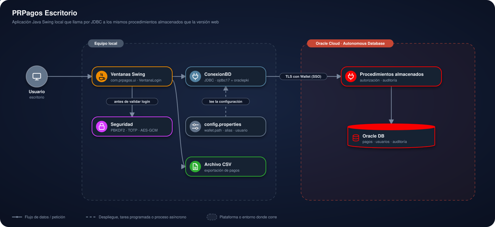

# PRPagos Escritorio

<p>
  <a href="https://prpagos-web-1087929107584.southamerica-east1.run.app"></a>
  <a href="https://frontend-nine-topaz-99.vercel.app"></a>
  <a href="https://d4i3vsgw7xwmh.cloudfront.net"></a>
</p>


## Contenido

1. [Presentación](#1-presentación)
2. [Estructura del proyecto](#2-estructura-del-proyecto)
3. [Arquitectura](#3-arquitectura)
4. [Plataformas y su función](#4-plataformas-y-su-función)
5. [Cómo usar la plataforma](#5-cómo-usar-la-plataforma)
6. [Instalación para pruebas](#6-instalación-para-pruebas)
7. [Autor y licencia](#7-autor-y-licencia)

---

## 1. Presentación

Versión de escritorio de PRPagos, construida con Java Swing: el mismo gestor
de presupuesto de la web (ingresos, gastos, plan 50/30/20, dashboard y
resúmenes por correo) como aplicación de Windows.

**Un solo origen de datos y una sola lógica:** la aplicación de escritorio no
se conecta a la base ni guarda claves. Pide todo a la **API de la web**
(`/api/...`, en Google Cloud Run), igual que el navegador pide las páginas. Las
reglas, los cálculos, los mensajes y los datos son exactamente los mismos en la
web, la PWA y el escritorio; aquí solo se dibujan (JFreeChart en lugar de
Chart.js).

Se distribuye como **PRPagos.exe** con Java incluido —instalador o versión
portable— en [GitHub Releases](https://github.com/lariasca1994/PRPagos/releases/latest):
**se instala y se usa**, sin configurar nada, y se **actualiza sola** cuando se
publica una versión nueva.

Ver el [`README.md`](../README.md) de la raíz para la descripción general del
proyecto y [`CHANGELOG-migracion.md`](../CHANGELOG-migracion.md) para el
detalle de la migración.

### En pocas palabras

- **Qué hace:** registra ingresos y gastos por categoría, muestra el mes en un
  dashboard frente al plan 50/30/20 y envía el resumen por correo. Cada persona
  ve solo lo suyo, con la misma cuenta de la web.
- **Qué lo hace interesante:** es un cliente delgado de la misma API que usa la
  web: no duplica reglas ni datos, no lleva secretos dentro del instalador y aun
  así ofrece Windows Hello, actualización automática verificada y la misma
  apariencia que la web.
- **Cómo probarlo:** descarga la [última versión](https://github.com/lariasca1994/PRPagos/releases/latest),
  ábrela y crea una cuenta (o usa la de la web). Para probar sin instalar nada,
  usa la [demo web](https://prpagos-web-1087929107584.southamerica-east1.run.app).

### Demo en vivo

La versión de escritorio se ejecuta en el equipo de cada usuario.
**Descarga:** [última versión](https://github.com/lariasca1994/PRPagos/releases/latest).

**Versión web (los mismos datos):** [abrir la demo en vivo](https://prpagos-web-1087929107584.southamerica-east1.run.app)

### Funcionalidades

**Presupuesto**
- Ingresos y gastos con tipo, monto, fecha (con calendario), categoría y concepto
- Categorías sugeridas y propias, cada una de gasto en un grupo del plan
- Plan 50/30/20 con porcentajes editables en Perfil
- **Dashboard** por mes con los mismos gráficos y cifras de la web: barras de 6
  meses, anillo de categorías y barras del plan con su estado
- **Presupuesto** por categoría y mes con los mismos datos y gráficos de la web (como una hoja de presupuesto anual), comparado con
  los registros: tarjetas, gastos presupuestados vs. reales del año, distribución frente
  al plan, mayores gastos, estado por categoría y resumen de los 12 meses
- Interactivo: un mes de las gráficas abre ese mes, una categoría abre sus registros y
  cada registro nuevo avisa cómo va el presupuesto de su categoría
- Consulta con filtros (tipo, concepto, montos, fechas y categoría), totales y CSV

**Resúmenes por correo**
- Botones **Enviarme el resumen semanal / del mes**: el servidor arma y envía el
  mismo correo que desde la web
- Los envíos programados (viernes y día 29) los hace el servidor, aunque la
  aplicación esté cerrada

**Cuentas y seguridad**
- Ingreso en dos pasos obligatorio (TOTP), el mismo de la web
- Códigos de respaldo y código por correo si se pierde el teléfono
- **Llaves de acceso con Windows Hello** (PIN, huella o rostro): la misma llave de
  Edge o Chrome en ese Windows; se agregan desde Perfil
- **Perfil** con datos, plan, categorías, autenticador, códigos, llaves y contraseña
- Bloqueo de 5 minutos tras 5 intentos fallidos seguidos
- Sesión que se cierra tras 6 horas sin uso (máximo 8 horas), con el mensaje del motivo

**Aplicación de Windows**
- **PRPagos.exe** con Java incluido: instalador por usuario (sin permisos elevados
  de Windows) o versión portable, con el ícono de la app; sin configuración
- **Actualización automática**: comprueba al abrir y cada hora; instala al
  reiniciar o al cerrar
- Misma portada animada, menú y colores que la web, en tema claro y oscuro

### Stack

| Capa | Tecnología |
|---|---|
| Interfaz | Java Swing con FlatLaf (tema claro y oscuro) y JFreeChart |
| Lenguaje | Java 17 (el ejecutable incluye su propio Java) |
| Datos y reglas | API JSON de la web (`/api/...`) con `java.net.http` y Gson |
| Sesión | El mismo token de la web (Bearer); 6 h sin uso, máximo 8 h |
| Verificación en dos pasos | TOTP en el servidor; QR del autenticador con ZXing |
| Llaves de acceso | Windows Hello con `webauthn.dll` (JNA); la firma la verifica el servidor |
| Distribución | jpackage → GitHub Releases; actualización con verificación SHA-256 |

---

## 2. Estructura del proyecto

```
escritorio/
├── empaquetar.ps1      Compila y arma PRPagos.exe (y el instalador) con jpackage
├── lib/                FlatLaf, ZXing, JFreeChart, JNA y Gson
├── resources/          Ícono de la aplicación (el mismo de la web)
└── src/main/
    ├── java/com/prpagos/
    │   ├── cliente/         Api (único acceso a los datos: la API de la web) y Json
    │   ├── datos/           Sesion y Pago, tal como los entrega la API
    │   ├── seguridad/       WindowsHello (llaves de acceso con webauthn.dll)
    │   ├── actualizaciones/ Actualizador y comprobación periódica de versiones
    │   └── ui/              Portada, ventana principal y paneles (Dashboard,
    │                        Presupuesto, Consulta, Registro, Perfil), Tema y componentes
    └── resources/           Script que instala las actualizaciones
```

El escritorio no contiene SQL, reglas de negocio, plantillas de correo ni
claves: todo eso vive solo en el servidor (`../web/app/servicios/`).

---

## 3. Arquitectura

<p align="center">
  
</p>

- La aplicación corre en el **equipo del usuario**; la ventana de inicio es
  `com.prpagos.ui.VentanaLogin`.
- **cliente.Api** es el único acceso a los datos: llama por HTTPS a la API de la
  web con el token de la sesión y lo renueva con cada respuesta. Si el servidor
  da la sesión por cerrada, la ventana vuelve al ingreso con su mensaje.
- El **Dashboard** recibe la vista ya calculada y formateada (la misma de la web)
  y la dibuja con JFreeChart.
- **WindowsHello** muestra la ventana de Windows (PIN, huella o rostro) y arma la
  respuesta como un navegador; el servidor la verifica.
- El **Actualizador** pide a la API la última versión publicada y su huella
  SHA-256, la descarga de **GitHub Releases** y la instala al cerrar.

### Seguridad

- **Sin secretos en el equipo:** el instalador no lleva contraseña de la base,
  wallet ni claves; solo la dirección pública de la web. Aunque alguien copie la
  aplicación, no obtiene acceso a los datos.
- **Una sola seguridad:** contraseñas (PBKDF2), verificación en dos pasos,
  códigos de respaldo, bloqueos, llaves de acceso y sesiones se validan en el
  servidor, igual que para la web.
- **Sesión:** el mismo token firmado de la web, en memoria mientras la
  aplicación está abierta; nunca se guarda en disco.
- **Llaves de acceso:** Windows Hello vía `webauthn.dll`, la misma API de Edge y
  Chrome; la firma, el sitio, el reto y la verificación del usuario los comprueba
  el servidor.
- **Actualizaciones verificadas** (mismo esquema que los agentes de SysPulse):
  solo HTTPS y solo GitHub (también tras las redirecciones), tamaño máximo,
  huella SHA-256 entregada por el servidor y no por el sitio de descarga, y
  versión del `.jar` igual a la publicada. Si algo falla, se conserva la versión
  instalada.

---

## 4. Plataformas y su función

| Plataforma | Función en el proyecto |
|---|---|
|  | La aplicación corre en el equipo de cada usuario como PRPagos.exe, con su propio Java. |
|  | Aloja la web y su API, de donde el escritorio toma todos los datos, reglas y mensajes. |
|  | Oracle Autonomous Database guarda cuentas, registros, categorías y planes; solo el servidor se conecta a ella. |
|  | GitHub Actions compila y publica cada versión (instalador y portable); de ahí se actualizan las aplicaciones instaladas. |

---

## 5. Cómo usar la plataforma

El paso a paso con capturas de cada pantalla, incluida la instalación, está en
el **[Manual de escritorio](../docs/MANUAL-ESCRITORIO.md)**. En resumen:

La ventana tiene la misma barra que la web: **Dashboard**, **Presupuesto**,
**Consultar registros**, **Nuevo registro**, **Perfil** y **Salir**, y el botón ◐ para
cambiar entre tema claro y oscuro.

### 5.1 Instalar

1. Descarga de [Releases](https://github.com/lariasca1994/PRPagos/releases/latest)
   el instalador `PRPagos-<versión>.exe` o el portable `PRPagos-Escritorio-<versión>.zip`.
2. Abre **PRPagos** desde el acceso directo. No hace falta configurar nada; las
   versiones nuevas se instalan solas.

### 5.2 Crear una cuenta e ingresar

1. En la portada, pulsa **Regístrate**: correo, nombre completo y contraseña. La
   misma cuenta sirve en la web.
2. Ingresa con **Correo** y **Contraseña**; la primera vez escanea el QR con tu
   app autenticadora y guarda los 10 **códigos de respaldo**.
3. Las siguientes veces, escribe el código de 6 dígitos (o uno de respaldo), o
   pulsa **Ingresar con llave de acceso** si agregaste este equipo en Perfil.

### 5.3 Dashboard, registros y Perfil

- **Dashboard:** elige el mes; cifras, gráficas, plan 50/30/20 y botones de resumen por correo.
- **Presupuesto:** monto por categoría y mes frente a lo registrado, con gráficas y resumen del año.
- **Nuevo registro:** tipo, monto, fecha, categoría y concepto.
- **Consultar registros:** filtros, totales, **Modificar** y **Exportar a CSV**.
- **Perfil:** nombre y resúmenes, plan, categorías, autenticador, códigos de respaldo, llaves de acceso y contraseña.

### 5.4 Recuperar el acceso

- **Perdí mi teléfono** (paso del código): un código de respaldo, o un código
  al correo para configurar un autenticador nuevo.
- **Olvidé mi contraseña** (portada): correo, nombre registrado, un código del
  autenticador o de respaldo y la nueva contraseña dos veces.

---

## 6. Instalación para pruebas

### Requisitos

- JDK 17 o superior (para compilar; el ejecutable trae su propio Java)
- Las librerías de `lib/` (ya incluidas en el repositorio): FlatLaf, ZXing,
  JFreeChart, JNA y Gson
- Conexión a internet (o la web corriendo en local, ver abajo)

### Ejecución

Desde un IDE (Eclipse o VS Code): importar el proyecto, agregar todos los
`.jar` de `lib/` al classpath y ejecutar `com.prpagos.ui.VentanaLogin`.

Desde consola (PowerShell, parado en `escritorio/`):

```powershell
javac --release 17 -encoding UTF-8 -d bin -cp "lib\*" (Get-ChildItem -Recurse -Path src -Filter *.java | % FullName)
java --enable-native-access=ALL-UNNAMED -cp "bin;lib\*" com.prpagos.ui.VentanaLogin
```

En Linux o macOS el separador del classpath es `:` en lugar de `;`.

Por defecto usa la web de producción. Para probar contra la web en local
(`uvicorn` en `web/`), indica su dirección con la variable `PRPAGOS_URL` o con
`-Dprpagos.url=http://localhost:8000`.

Para armar el ejecutable (JDK 17+ con jpackage):

```powershell
.\empaquetar.ps1                  # build\dist\PRPagos\PRPagos.exe (portable)
.\empaquetar.ps1 -Instalador      # además, el instalador .exe (requiere WiX Toolset)
```

### Despliegue

Todo sale de GitHub. Cada push a `main` que toque el escritorio ejecuta
[`.github/workflows/escritorio.yml`](../.github/workflows/escritorio.yml), que:

1. Compila y empaqueta con `empaquetar.ps1` en un runner de Windows.
2. Publica el Release `escritorio-v1.0.<n>` con el instalador y el portable.
3. Registra la versión y la huella SHA-256 en el servidor, de donde la leen las
   aplicaciones instaladas para actualizarse.

---

## 7. Autor y licencia

> 📘 **[Manual de escritorio](../docs/MANUAL-ESCRITORIO.md)**: cómo instalar y usar la aplicación campo por campo, qué datos se ingresan y qué garantiza en seguridad.

**Luis Felipe Arias Carriazo**
[GitHub](https://github.com/lariasca1994) · [LinkedIn](https://linkedin.com/in/lfac1)

Licencia: MIT.
