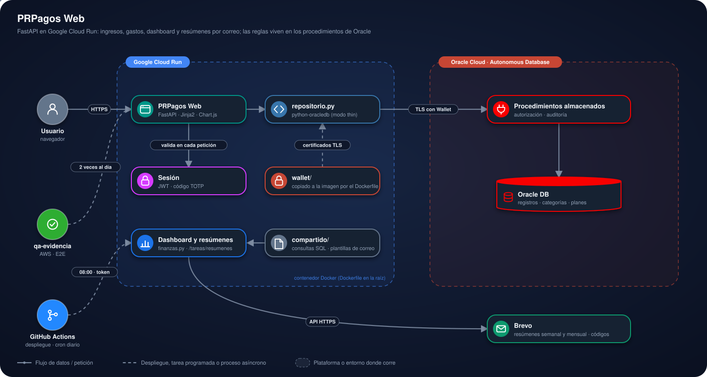

# PRPagos Web

<p>
  <a href="https://prpagos-web-1087929107584.southamerica-east1.run.app"></a>
  <a href="https://frontend-nine-topaz-99.vercel.app"></a>
  <a href="https://d4i3vsgw7xwmh.cloudfront.net"></a>
</p>


## Contenido

1. [Presentación](#1-presentación)
2. [Estructura del proyecto](#2-estructura-del-proyecto)
3. [Arquitectura](#3-arquitectura)
4. [Plataformas y su función](#4-plataformas-y-su-función)
5. [Cómo usar la plataforma](#5-cómo-usar-la-plataforma)
6. [Instalación para pruebas](#6-instalación-para-pruebas)
7. [Autor y licencia](#7-autor-y-licencia)

---

## 1. Presentación

Versión web de PRPagos, construida con FastAPI: un gestor de presupuesto
personal con ingresos, gastos, plan 50/30/20, dashboard con gráficas
(Chart.js) y resúmenes por correo.

Es **el único origen** de datos y de lógica del proyecto: toda regla, cálculo y
mensaje vive en `app/servicios/`. Las páginas web los usan directamente y la
aplicación de escritorio ([`../escritorio`](../escritorio)) los pide por la
**API JSON** (`/api/...`), así que las dos muestran exactamente los mismos
datos, cifras y textos.

Además es una **PWA** (aplicación web progresiva): se puede instalar como app
en Android, iPhone/iPad, Windows, macOS y Linux desde el navegador, con su
propio ícono y ventana, sin pasar por ninguna tienda de aplicaciones.

Ver el [`README.md`](../README.md) de la raíz para la descripción general del
proyecto y [`CHANGELOG-migracion.md`](../CHANGELOG-migracion.md) para el
detalle de la migración.

### En pocas palabras

- **Qué hace:** registra ingresos y gastos por categoría, muestra el mes en un
  dashboard frente al plan 50/30/20 y envía el resumen por correo cada viernes
  y cada día 29. Cada persona ve solo lo suyo.
- **Qué lo hace interesante:** una sola capa de servicios alimenta las páginas y
  la API del escritorio; la autorización y la auditoría viven además en
  procedimientos de Oracle, y la app entra a la base con un usuario propio de
  privilegios mínimos.
- **Cómo probarlo:** entra a la [demo](https://prpagos-web-1087929107584.southamerica-east1.run.app)
  y crea un usuario. Para correrlo en tu equipo, ve a
  [Instalación para pruebas](#6-instalación-para-pruebas).

### Demo en vivo

**Aplicación:** [abrir la demo en vivo](https://prpagos-web-1087929107584.southamerica-east1.run.app)

### Funcionalidades

**Presupuesto**
- Ingresos y gastos con tipo, monto, fecha, categoría y concepto
- Categorías sugeridas y propias, cada una de gasto en un grupo del plan
- Plan 50/30/20 con porcentajes editables en Perfil
- **Dashboard** por mes: ingresos, gastos, balance y ahorro; ingresos vs.
  gastos de 6 meses, gastos por categoría y avance del plan con su estado
- **Presupuesto** por categoría y mes (como una hoja de presupuesto anual), comparado con
  los registros: tarjetas, gastos presupuestados vs. reales del año, distribución frente
  al plan, mayores gastos, estado por categoría y resumen de los 12 meses
- Interactivo: un mes de las gráficas abre ese mes, una categoría abre sus registros y
  cada registro nuevo avisa cómo va el presupuesto de su categoría
- Consulta con filtros (tipo, concepto, montos, fechas y categoría), totales y CSV

**Resúmenes por correo (Brevo)**
- Semanal (viernes) y mensual (día 29; en febrero, el último día), a las 08:00
  de Colombia, disparados por GitHub Actions; se desactivan desde Perfil
- Botones **Enviarme el resumen semanal / del mes** en el dashboard

**Cuentas y seguridad**
- Ingreso en dos pasos obligatorio: contraseña y código TOTP; el autenticador
  se configura una sola vez y sirve también en el escritorio
- 10 **códigos de respaldo** de un solo uso y **código por correo** si se pierde el teléfono
- **Llaves de acceso (passkeys):** **Ingresar con llave de acceso** con Windows Hello, huella,
  rostro o PIN, en Windows, Android (también en la PWA) y iPhone; se agregan desde Perfil
- **Perfil**: datos, resúmenes, plan, categorías, autenticador, códigos de
  respaldo y contraseña
- Bloqueo de 5 minutos tras 5 intentos fallidos seguidos
- Sesión en una cookie `httponly` que se cierra tras 6 horas sin uso (máximo 8
  horas); la página vuelve sola al ingreso con un mensaje del motivo

**API para la aplicación de escritorio**
- `/api/...` en JSON: acceso (dos pasos, llaves de acceso, recuperación),
  dashboard, presupuesto, registros y CSV, Perfil, cuentas y versión publicada del escritorio
- Misma sesión que la web (token Bearer, renovado en la cabecera `X-Sesion`) y
  los mismos mensajes de error

**App instalable (PWA)**
- Se instala en el celular, la tablet o el computador desde el navegador
- Abre en su propia ventana, con ícono y nombre propios
- Muestra una página propia cuando no hay conexión

Las rutas de registros usan `/registros` en la URL en lugar de `/pagos`:
algunos antivirus con protección de banca en línea interceptan los formularios
con contraseña cuando la URL contiene "pagos".

### Stack

| Capa | Tecnología |
|---|---|
| Servidor | FastAPI, Uvicorn |
| Lógica | `app/servicios/` (una sola, para las páginas y la API) |
| API del escritorio | JSON en `/api/...` (`routers/api.py`) |
| Interfaz | Jinja2, HTML, CSS y Chart.js (incluido en `static/vendor`) |
| Acceso a datos | python-oracledb (modo thin), usuario de la app sin permisos de DDL |
| Consultas del dashboard | `../compartido/consultas/*.sql` |
| Base de datos | Oracle Autonomous Database |
| Reglas de negocio | Procedimientos almacenados PL/SQL |
| Correos | Brevo (API HTTPS) con las plantillas de `../compartido/correo/` |
| Tareas programadas | GitHub Actions → `POST /tareas/resumenes` con token |
| Sesiones | JWT (HS256) en cookie httponly; 6 h sin uso, máximo 8 h |
| Contraseñas | PBKDF2-SHA256 (600.000 iteraciones, sal única) |
| Verificación en dos pasos | TOTP (RFC 6238); QR en SVG; secreto cifrado con AES-256-GCM |
| Llaves de acceso | WebAuthn: librería `webauthn` (servidor) y `static/llaves.js` (navegador) |
| App instalable | PWA: manifiesto web y service worker |
| Despliegue | Docker en Google Cloud Run |

---

## 2. Estructura del proyecto

```
web/
├── requirements.txt
├── requirements-dev.txt  + pytest
├── .env.example          Plantilla de configuración
├── migrar.py             Aplica una migración de ../sql/ (aditiva)
├── tests/                Pruebas de seguridad, finanzas, servicios, API, resúmenes y tareas
└── app/
    ├── main.py           Punto de entrada y manejo de errores
    ├── config.py         Carga del .env
    ├── database.py       Conexión a Oracle con el Wallet (usuario de la app + DB_ESQUEMA)
    ├── servicios/        LA lógica: acceso, registros, dashboard, presupuesto, perfil, cuentas y
    │                     verificación del segundo factor (web y API la usan igual)
    ├── repositorio.py    Procedimientos almacenados y consultas compartidas
    ├── compartido.py     Lee ../compartido/ (consultas SQL y plantillas de correo)
    ├── finanzas.py       Periodos, formato de moneda, plan 50/30/20 y HTML de correos
    ├── resumenes.py      Arma y envía los resúmenes; tarea diaria
    ├── correo.py         Cliente de la API de Brevo
    ├── seguridad.py      PBKDF2, TOTP, cifrado AES-GCM, códigos de respaldo y JWT
    ├── llaves.py         Llaves de acceso (WebAuthn): opciones, reto firmado y verificación
    ├── qr.py             Código QR del autenticador (SVG)
    ├── dependencias.py   Identificación del usuario en cada petición
    ├── routers/          Páginas (acceso, dashboard, presupuesto, registros, perfil, cuentas),
    │                     api.py (JSON para el escritorio) y tareas
    ├── templates/        Plantillas Jinja2
    └── static/           Estilos, tema, gráficas (dashboard.js, presupuesto.js), íconos y PWA
                          (manifest.webmanifest, sw.js, offline.html)
```

Las tablas y procedimientos (`../sql/`), las consultas y plantillas de correo
(`../compartido/`), el Wallet (`../wallet/`) y el `Dockerfile` están en la raíz
del repositorio.

---

## 3. Arquitectura

<p align="center">
  
</p>

- Una sola app FastAPI sirve páginas Jinja2 protegidas por una sesión JWT en
  cookie y, con el mismo token en la cabecera `Authorization`, la API JSON de la
  aplicación de escritorio. Las dos llaman a `app/servicios/`.
- El ingreso tiene **dos pasos** (contraseña y código TOTP o de respaldo); la
  sesión solo se emite al final, y cada petición la valida antes de responder.
- `repositorio.py` concentra el acceso a datos: llama a los procedimientos y a
  las consultas de `../compartido/consultas`, con `python-oracledb` en modo thin
  y el **Wallet** (copiado a la imagen al construirla) por TLS.
- `finanzas.py` y `resumenes.py` calculan el dashboard y los resúmenes; los
  correos usan las plantillas de `../compartido/correo` y salen por **Brevo**.
- **GitHub Actions** llama cada día a `POST /tareas/resumenes`; la app decide si
  hoy toca el semanal (viernes) o el mensual (día 29 o último de febrero) y no
  repite un envío ya hecho.

### Seguridad

- **Una sola seguridad para las dos interfaces:** todo se valida aquí, también
  lo que llega del escritorio por la API; un autenticador o una llave de acceso
  configurados en una interfaz sirven en la otra.
- La base se usa con un usuario propio de la app (`DB_USUARIO`), que solo puede
  leer, escribir y ejecutar los procedimientos del esquema dueño (`DB_ESQUEMA`);
  no puede crear ni borrar tablas.
- Contraseñas con PBKDF2-SHA256 (600.000 iteraciones y sal única). Las cuentas
  creadas con el SHA-256 anterior se actualizan solas en su siguiente ingreso.
- Verificación en dos pasos obligatoria (TOTP); un código no se puede usar dos
  veces. El secreto se guarda cifrado con AES-256-GCM; la clave (`TOTP_CLAVE`)
  vive fuera de la base.
- Llaves de acceso: verificación del dispositivo obligatoria, solo para el dominio de la web, reto
  nuevo en una cookie firmada de 5 minutos y firma comprobada con la clave pública guardada (ES256
  o RS256); un contador que no avanza se rechaza. Agregar una pide un código vigente.
- Códigos de respaldo y código por correo: solo se guarda su huella SHA-256,
  sirven una vez (el de correo vence en 15 minutos) y cada uso queda auditado.
- Cinco intentos fallidos seguidos bloquean la cuenta 5 minutos; lo decide la
  base, venga el intento de la web o del escritorio.
- Cambiar la contraseña o el autenticador pide un código vigente.
- Sesión en cookie `httponly`, `Secure` y `SameSite=Lax`: JavaScript no puede
  leer el token.
- Un usuario solo ve y modifica sus propios registros; esa regla vive en los
  procedimientos y en las consultas, siempre filtradas por la cuenta.
- `/tareas/*` exige el token `TAREAS_TOKEN` (comparación en tiempo constante);
  sin token configurado, la tarea queda desactivada.
- Los errores de base de datos muestran un mensaje genérico; el detalle queda
  solo en el log del servidor.
- El service worker solo guarda en caché archivos estáticos y la página sin
  conexión: las páginas con datos, la sesión y los CSV siempre van a la red.
- El Wallet y el `.env` (con las claves) no se suben al repositorio.

---

## 4. Plataformas y su función

| Plataforma | Función en el proyecto |
|---|---|
|  | Corre la app FastAPI en un contenedor Docker construido con el `Dockerfile` de la raíz. |
|  | Oracle Autonomous Database guarda cuentas, registros, categorías y planes, y ejecuta los procedimientos con las reglas y la auditoría. Conexión por TLS con el Wallet. |
|  | Envía los resúmenes y los códigos de recuperación (plan gratuito). |
|  | Despliega la app en cada push a `main` y dispara cada día la tarea de los resúmenes. |
|  | Prueba la demo automáticamente dos veces al día y publica la evidencia. |

---

## 5. Cómo usar la plataforma

El paso a paso con capturas de cada pantalla está en el
**[Manual web](../docs/MANUAL-WEB.md)**. En resumen:

### 5.1 Crear una cuenta e ingresar

1. En la portada, pulsa **Regístrate**: correo, nombre completo y contraseña
   (mínimo 8 caracteres). La misma cuenta sirve en el escritorio.
2. Ingresa con **Correo** y **Contraseña** y pulsa **Continuar**.
3. **Primera vez:** escanea el QR con tu app autenticadora, escribe el código y
   pulsa **Activar e ingresar**; guarda los 10 **códigos de respaldo** que
   aparecen. Si ya lo configuraste en el escritorio, este paso no aparece.
4. **Siguientes veces:** escribe el código de 6 dígitos (o uno de respaldo), o pulsa **Ingresar
   con llave de acceso** si agregaste este dispositivo en Perfil.

### 5.2 Dashboard

Elige el mes y revisa ingresos, gastos, balance y ahorro; la gráfica de 6
meses, los gastos por categoría y el plan 50/30/20 con su estado. Abajo, pide
el resumen semanal o del mes por correo. Toca un mes de las barras para abrirlo o
una categoría del anillo para ver sus registros.

### 5.2.1 Presupuesto

Escribe cuánto piensas recibir o gastar en cada categoría y guárdalo para el mes,
de ese mes a diciembre o para todo el año (o copia el mes anterior). La pantalla
lo compara con tus registros: real, porcentaje usado y estado por categoría,
gastos presupuestados vs. reales de los 12 meses, distribución frente al plan
50/30/20, mayores gastos del mes y el resumen del año.

### 5.3 Registrar, consultar y exportar

1. **Nuevo registro:** tipo (ingreso o gasto), monto, fecha, categoría y concepto.
2. **Consultar registros:** filtra por tipo, concepto, montos y fechas; revisa
   los totales; **Modificar** corrige un registro; **Exportar a CSV** descarga la consulta.

### 5.4 Perfil y recuperación

- **Perfil:** nombre y resúmenes por correo, porcentajes del plan, categorías
  propias, cambio de autenticador, códigos de respaldo nuevos, llaves de acceso y contraseña.
- **Perdí mi teléfono** (paso del código): usa un código de respaldo o pide un
  código al correo para configurar un autenticador nuevo.
- **Olvidé mi contraseña** (portada): correo, nombre registrado, un código del
  autenticador o de respaldo y la nueva contraseña dos veces.

### 5.5 Instalar la app (PWA)

Abre la [demo](https://prpagos-web-1087929107584.southamerica-east1.run.app) y:

| Plataforma | Cómo instalarla |
|---|---|
| Android (Chrome) | Menú **⋮** → **Instalar app** (o **Agregar a la pantalla principal**). |
| iPhone / iPad (Safari) | Botón **Compartir** → **Agregar a inicio**. |
| Windows, macOS y Linux (Chrome o Edge) | Ícono de instalar en la barra de direcciones, o menú → **Instalar PRPagos**. |

La app queda con su ícono junto a las demás y abre en su propia ventana. Usa
la misma cuenta y los mismos datos que la versión web y la de escritorio, y
necesita conexión para consultar y guardar.

---

## 6. Instalación para pruebas

### Requisitos

- Python 3.11 o superior
- Una base Oracle accesible, preparada con `../sql/DBPagos.sql` (una sola vez)
- El Wallet de esa base descomprimido en `../wallet`. No viene en el
  repositorio: se descarga desde la consola de Oracle Cloud.
- Para los correos: una cuenta de Brevo (plan gratuito) con un remitente verificado

### Instalación

```bash
git clone https://github.com/lariasca1994/PRPagos.git
cd PRPagos/web

python -m venv .venv
.venv\Scripts\Activate.ps1        # Windows
source .venv/bin/activate         # Linux o macOS

pip install -r requirements.txt
cp .env.example .env
```

Si PowerShell bloquea la activación del entorno:

```powershell
Set-ExecutionPolicy -Scope Process -ExecutionPolicy RemoteSigned
```

### Configuración

El `.env` necesita la ruta y la contraseña del Wallet, el alias de conexión
(de `wallet/tnsnames.ora`), el usuario de la aplicación y su contraseña
(`DB_USUARIO`, `DB_PASSWORD`), el esquema dueño de las tablas (`DB_ESQUEMA`) y
estas claves propias:

```bash
# JWT_SECRET: firma las sesiones
python -c "import secrets; print(secrets.token_urlsafe(48))"
# TOTP_CLAVE: cifra los autenticadores (32 bytes en base64)
python -c "import base64, secrets; print(base64.b64encode(secrets.token_bytes(32)).decode())"
# TAREAS_TOKEN: protege la tarea de resúmenes (el mismo va como secreto en GitHub)
python -c "import secrets; print(secrets.token_urlsafe(32))"
```

`TOTP_CLAVE` solo vive en el servidor (el escritorio no la necesita). Si se
cambia con cuentas que ya tienen autenticador, hay que volver a cifrar sus
secretos con la clave nueva en el mismo cambio.

Para los correos: `BREVO_API_KEY` y `BREVO_REMITENTE` (un remitente verificado
en Brevo). `URL_PUBLICA` es la dirección pública de la web: el enlace de los
correos y el sitio de las llaves de acceso.

La plantilla indica el nombre y el propósito de cada variable. El `.env`
nunca se sube a git.

### Base de datos

Además de `../sql/DBPagos.sql`, aplica las migraciones con el usuario **dueño**
del esquema (el usuario de la app no puede crear tablas) y luego da al usuario
de la app permisos sobre los objetos nuevos. Son aditivas y se pueden repetir;
sin `--aplicar` solo muestran el SQL:

```bash
python migrar.py seguridad --aplicar        # verificación en dos pasos
python migrar.py finanzas --aplicar         # ingresos, categorías, plan, respaldo y resúmenes
python migrar.py actualizaciones --aplicar  # versiones del escritorio
python migrar.py llaves --aplicar           # llaves de acceso
```

### Ejecución

```bash
cd web
uvicorn app.main:app --reload
```

El `cd web` es necesario: las rutas de plantillas y archivos estáticos se
resuelven desde ahí.

Pruebas (sin base de datos):

```bash
pip install -r requirements-dev.txt
pytest tests -q
```

| Recurso | Dirección |
|---|---|
| Aplicación | `http://127.0.0.1:8000` |
| Documentación de la API | `http://127.0.0.1:8000/docs` |

### Despliegue

La aplicación corre en Google Cloud Run, con Oracle Autonomous Database como
base de datos. El despliegue es continuo: cada push a `main` que cambie
`web/`, `compartido/`, el `Dockerfile` o el propio flujo ejecuta
[`.github/workflows/desplegar.yml`](../.github/workflows/desplegar.yml), que:

1. Construye la imagen con el `Dockerfile` de la **raíz** del repositorio
   (copia `web/app/`, `compartido/` y `wallet/`).
2. La publica en Artifact Registry.
3. Actualiza el servicio de Cloud Run, conservando sus variables de entorno.

[`.github/workflows/resumenes.yml`](../.github/workflows/resumenes.yml) llama
cada día a las 08:00 (hora de Colombia) a `POST /tareas/resumenes` con el
secreto `TAREAS_TOKEN`; se puede lanzar a mano forzando el semanal o el mensual.

- El Wallet no está en Git: el flujo lo toma de Secret Manager al construir
  la imagen.
- GitHub se autentica en Google Cloud por federación de identidades, sin
  llaves guardadas en el repositorio.
- Las variables del `.env` viven como variables de entorno del servicio en
  Cloud Run, nunca como un archivo dentro de la imagen.

---

## 7. Autor y licencia

> 📘 **[Manual web](../docs/MANUAL-WEB.md)**: cómo usar la versión web campo por campo, qué datos se ingresan y qué garantiza en seguridad.

**Luis Felipe Arias Carriazo**
[GitHub](https://github.com/lariasca1994) · [LinkedIn](https://linkedin.com/in/lfac1)

Licencia: MIT.
